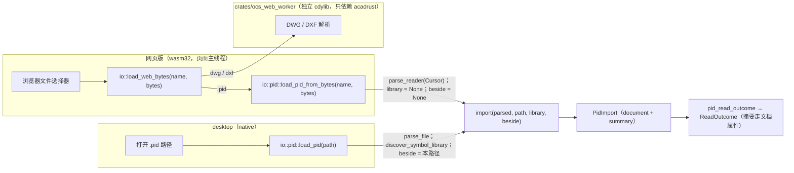
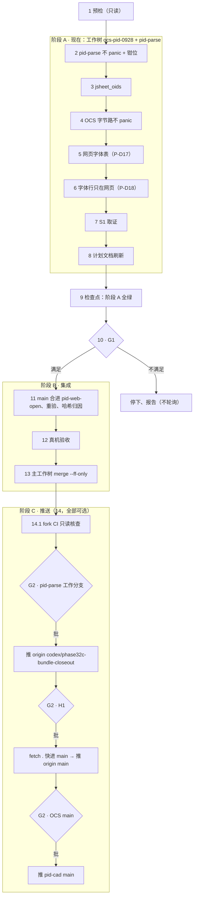

# Design Document: pid-import-next-round（`.pid` 线收尾 + 加固）

> 需求见 `requirements.md`。计划文档（送 Plannotator 批注，决策以它为准）：`docs/plans/2026-09-29-pid-import-next-round.md`（工作树）。上一单：`docs/plans/2026-09-28-pid-import-next-steps.md`（最新副本在工作树的分支 `pid-web-open` 上）。决策从 P-D15 续号。
> 事实截至 2026-09-29：工作树 `pid-web-open` @ `eeee3ef9`（除未提交的计划文档外干净）；pid-parse `codex/phase32c-bundle-closeout` @ `50560a1`；主工作树合并中（MERGE_HEAD `88169c1d`，HEAD `a651940f`）。
> 测试数字取自提交记录，开单时**未重跑**（本会话 shell 不回输出）。文中标「名字暂定」的文件名与函数名，实施时可按仓里习惯改，改了就同步本文。
> 2026-09-30 增补：任务 15 = 小单 E（D12，需求 12）；D3 的字体表、D11 的落后数按实测更正；G1 前许写主工作树的范围放宽到本 spec 目录（需求 1.1）。

## Overview

W2 让网页版能开 `.pid`，但解析放在页面主线程，一个 panic 就带走整页。本轮先在工作树与 pid-parse 里把这条路加固：任意字节不 panic、另存保住字体、提示行只在网页、`jsheet_oids` 补判据。S1 取证同时做。等主工作树的上游合并与 rvt 提交完成（G1），再把分支集成进 main、重验、真机验收、快进。推送逐推点头。

## Architecture

### 今天的两条路（`pid-web-open` @ `eeee3ef9`）



- 两路共用 `import()`。四主图上字节路与路径路整份文档相等（`a_pid_handed_over_as_bytes_imports_as_the_document_its_path_does`，`pid_import` 53 / 53）。
- DWG / DXF 在 worker 里解析，panic 只丢 worker。`.pid` 在页面主线程，wasm32 上 panic = abort：没有 unwinding，`catch_unwind` 无效（审计发现 1）。
- 字节路不找符号库、不读 `_Data.xml`。语料六张图 `library_bodies` 全 0，不丢笔画；publish 0202 走字节路时没有 `class=`。
- pid-parse 库代码里的 `SystemTime::now` / `Instant::now` 只在 `#[cfg(test)]` 或 `backup` 模块里，OCS 用 `iced::time::Instant`。网页上的时间 panic 不在风险里（审计发现 6，已核）。

### 阶段与门槛



| 阶段 | 写在哪 | 任务 | 出口 |
|---|---|---|---|
| A | 工作树、pid-parse（外来文件除外）、本 spec 目录 | 1–9 | 两仓全绿、提交齐、计划文档刷新 |
| G1 | 只读 | 10 | 四条同时成立（见 requirements 术语表） |
| B | 工作树；主工作树只做 `merge --ff-only` | 11–13 | `main` = `pid-web-open` |
| C | 远端 | 14（可选） | 每一推各过一次 G2 |

全部任务按序执行：两仓共用工作树与同一个 `CARGO_TARGET_DIR`（`D:\Rust\target`），任何两项不得同时在同一仓跑。

## Decisions（⭕ = 推荐；本 spec 获批即按 ⭕ 执行）

| # | 决策 | 结论 |
|---|---|---|
| P-D15 | 集成方式 | ⭕ **G1 后 merge、再快进**：工作树里把新 `main` 合进 `pid-web-open`，主工作树 `git merge --ff-only pid-web-open`。`e527be78` / `d1d93b29` / `eeee3ef9` 原样保留，计划文档与证据里的引用不变。备选：① rebase 到新 main（三个哈希全变，文字要跟着改）；② 抢在上游合并提交之后、rvt 取回 stash 之前的窗口先落 W2（那时 main 干净，冲突留给 rvt 吸收）——不推荐：rvt 会话取回 stash 时会意外撞上 W2 |
| P-D16 | 网页 `.pid` 在哪个线程解析 | ⭕ **追认页面主线程**（W2 `e527be78` 的做法，偏离 P-D5 / W2 原写的 `ocs_web_worker` 路由），由两仓「任意字节不 panic」套件护住。worker 单（先把 `io::pid` 抽成独立 crate）在任一条出现时开：① 修不掉的第三方 panic（如 `cfb` 0.14 内部）；② 真图上页面线程导入明显慢（如 release 下 > 200 ms，任务 12 实测）；③ 有人要求解析离开页面线程。兜底「worker 金丝雀解析」：`ocs_web_worker` 加 pid-parse 依赖（无 `backup`），先在 worker 里整遍解析一次、只为探 panic；worker 活着回话，主线程再照今天导入。它挡得住 pid-parse / `cfb` 的 panic，挡不住 OCS 导入器自己的，代价是解析两遍。备选：现在就开 worker 单（几千行搬家，与 rvt 改的 `src/io/mod.rs` 撞车） |
| P-D17 | 网页另存的字体文件名 | **已批**（2026-09-29 clarify）：wasm32 上 `face_file_name` 为 None 且族名在固定表里 → `font_file` 写表里的文件名；不在表里 → 照旧 `txt` 并计数；命中表仍计「未安装」（网页照样用回退字体画）。desktop 策略不变（09-24 单：没装的保留 `txt`、记日志、不猜）。**收录判据** ⭕：微软发行该字体时用的文件名，在参考机注册表 Fonts 键与 `C:\Windows\Fonts` 上核过，来源（Windows 默认 / Office）写在表旁。备选：只收 Windows 默认字体集——Arial Narrow 通常随 Office 而非 Windows 发行，按此会出表，工艺管道号的网页另存仍回 `txt` |
| P-D18 | 字体未安装行 | **已批**（2026-09-29 clarify）：命令行那一行只在网页版推（`#[cfg(target_arch = "wasm32")]`）；摘要字段与日志两端照旧计数；user-guide / native-vs-web 写明 |
| P-D19 | 网页版怎么验收 | ⭕ 手工：`trunk serve --release` + Chromium，四主图 + 截断图 + 另存往返，证据进 `docs/evidence/<日期>-pid-web-open/`。两仓都没有无头浏览器框架，不为此加依赖。备选：wasm-bindgen-test 浏览器测试 / Playwright（新依赖，登记不做） |
| P-D20 | 推送 | ⭕ 每一推单独过 G2（点名远端与分支）。顺序：① pid-parse 工作分支 → `origin`；② H1（`git fetch . codex/phase32c-bundle-closeout:main` → `git push origin main`，不在 pid-parse 切分支）；③ OCS `main` → `pid-cad`。OCS 的计划文档与数字引用 pid-parse 的提交，所以先推 pid-parse。推 ③ 前只读核查 `pid-cad` 的 CI（含上游新带的 `ci.yml`）对 `path = "../pid-parse"` 的处理；会失败就登记跟进单，本 spec 不改 CI |
| P-D21 | `jsheet_oids` | ⭕ 改用 `parse_live_psm_header`（与 22 个族解码器同一判据），合成字节测试钉住；`sheet_record_starts` 保持不过滤（它走链）。语料没有带位的 JSheet，棘轮不变。备选：登记不改（今天没有可见影响，但将来带位的旧 JSheet 会把死 sheet 的 oid 当成活的） |
| P-D22 | 不 panic 套件的生成器 | ⭕ 不加测试依赖：定种 xorshift64 生成变异。默认批约 100 例（debug 约 1 分钟；pid-parse 未优化解析 0201 约 290 ms）；`#[ignore]` 扩展批数千例，收尾前跑 `cargo test --release -- --ignored`。每例一个线程：panic = join 错误，挂起 = `recv_timeout(10 s)` 超时；失败信息打印文件、变异与种子。备选：proptest（带收缩，但是新依赖）；cargo-fuzz（要 nightly + libFuzzer，Windows 上麻烦） |

## Components and Interfaces

### D1 现场保护与门槛（需求 1）

预检与 G1 的命令全部只读。`--no-optional-locks` 让 `status` 不刷新索引、不抢锁。

```powershell
$ocs = 'd:\work\plant-code\cad\OpenCADStudio'   # 主工作树
$wt  = 'D:\work\plant-code\cad\ocs-pid-0928'     # 工作树
$pp  = 'D:\work\plant-code\cad\pid-parse'
git --version                                             # 不打印就停（需求 1.8）
git -C $wt rev-parse --abbrev-ref HEAD                    # pid-web-open
git -C $wt rev-parse HEAD                                 # eeee3ef9…，或其上只改计划文档的提交
git -C $wt --no-optional-locks status --porcelain         # 空，或只列计划文档
git -C $pp rev-parse --abbrev-ref HEAD                    # codex/phase32c-bundle-closeout
git -C $pp rev-parse HEAD                                 # 50560a1…
git -C $pp --no-optional-locks status --porcelain         # 只有四个外来文件
# G1（任务 10）
git -C $ocs rev-parse -q --verify MERGE_HEAD              # ① 无输出、退出码 1
git -C $ocs merge-base --is-ancestor 88169c1d main        # ② 退出码 0
git -C $ocs log --oneline -1 main -- src/io/rvt.rs        # ③ 非空
git -C $wt diff --name-only main...pid-web-open           # ④ 本分支文件
git -C $ocs --no-optional-locks status --porcelain        # ④ 与上一条求交 = 空
```

- 预检时计划文档可能尚未提交（`?? docs/plans/2026-09-29-pid-import-next-round.md`），也可能已作为只改它的提交落在 `eeee3ef9` 之上；两种都算通过，用 `git diff --name-only eeee3ef9 HEAD` 核。
- ① 还要看 `REBASE_HEAD` / `CHERRY_PICK_HEAD` 都不在。
- ③ 用「main 历史里有加入 `src/io/rvt.rs` 的提交」代表 rvt 已提交。rvt 若改名或放弃，③ 不成立 → 停下问用户。
- pid-parse 每次提交前用 `git diff --cached --name-only` 核对只含本任务路径。
- G2 请求写明：命令原文、远端与分支、推前远端哈希、将推的提交（`git log --oneline <remote>/<branch>..<branch>`）；OCS 那一推另附 CI 核查结论。用户回复点名远端与分支才算批。

### D2 不 panic 套件（需求 4，P-D16 / P-D22）

文件（名字暂定）：

- pid-parse `tests/arbitrary_bytes_never_panic.rs`。管线：`PidParser::with_options(ParseOptions::geometry()).parse_reader(Cursor::new(bytes))` → `Ok` 时 `build_normalized_geometry` → OCS 调的文字样式入口。调用序列照 OCS `src/io/pid/mod.rs` 的 `import()` 抄，实施时逐个核名。
- OCS `tests/pid_bytes_never_panic.rs`。管线：`load_pid_from_bytes(name, bytes)`。语料取 `../pid-parse/test-file`，没有检出就软跳过（同 B3）。
- 两份各带一份生成器与执行器（约百行），不跨仓共享，不为测试加依赖或 crate。

生成器：

```rust
/// 定种 xorshift64（P-D22）。种子先过 splitmix64，`| 1` 保证状态非零。
struct XorShift64(u64);

impl XorShift64 {
    fn new(seed: u64) -> Self {
        let mut z = seed.wrapping_add(0x9E37_79B9_7F4A_7C15);
        z = (z ^ (z >> 30)).wrapping_mul(0xBF58_476D_1CE4_E5B9);
        z = (z ^ (z >> 27)).wrapping_mul(0x94D0_49BB_1331_11EB);
        Self((z ^ (z >> 31)) | 1)
    }
    fn next_u64(&mut self) -> u64 {
        let mut x = self.0;
        x ^= x << 13;
        x ^= x >> 7;
        x ^= x << 17;
        self.0 = x;
        x
    }
    /// [0, n)；n = 0 时返回 0。测试用，取模偏差可忽略。
    fn below(&mut self, n: usize) -> usize {
        if n == 0 { 0 } else { (self.next_u64() % n as u64) as usize }
    }
}

#[derive(Debug, Clone)]
enum Mutation {
    Empty,
    Random { len: usize },
    Truncate { at: usize },
    FlipBytes { count: usize },
    ZeroSector { sector: usize }, // 512 字节一扇区
    HugeLength { count: usize },  // 4 字节对齐处写巨值
}

/// 纯函数：同一 (源字节, 变异, 种子) 永远生成同一串字节（需求 4.4）。
fn build(source: &[u8], mutation: &Mutation, seed: u64) -> Vec<u8> { /* … */ }
```

| 类别 | 参数取值 |
|---|---|
| 空字节 | `[]` |
| 随机字节 | `len` = 1、7、8、511、512、513、4096、65 536、随机 ≤ 1 MiB |
| 截断 | `at` = 0、8、76（CFB 头中段）、511、512、513、首个 4096 边界、`len / 2`、`len - 1`、随机 |
| 翻字节 | 1、4、32 个随机位置各异或一个随机非零字节 |
| 整扇区清零 | 扇区 0（头）、1、随机 |
| 长度写巨值 | 1–8 个随机 4 字节对齐位置写 `0xFFFF_FFFF` / `0xFFFF_FFFE` / `0x8000_0000` / `0x7FFF_FFFF` / `0x0100_0000`；另点名 CFB 头计数字段 `0x2C` / `0x30` / `0x3C` / `0x40` / `0x44` / `0x48` |

文件级变异多数落在流体里（头 + FAT + 目录只占小头），族解码器能被打到；CFB 头字段另外点名，专打 `cfb`。

执行器与分配看门：

```rust
use std::alloc::{GlobalAlloc, Layout, System};
use std::sync::atomic::{AtomicUsize, Ordering};

/// 只记不拦：GlobalAlloc 不许 unwind。`alloc_zeroed` 默认走 `alloc`，照样记。
struct Watch;
static LARGEST: AtomicUsize = AtomicUsize::new(0);

unsafe impl GlobalAlloc for Watch {
    unsafe fn alloc(&self, layout: Layout) -> *mut u8 {
        LARGEST.fetch_max(layout.size(), Ordering::Relaxed);
        unsafe { System.alloc(layout) }
    }
    unsafe fn realloc(&self, ptr: *mut u8, layout: Layout, new_size: usize) -> *mut u8 {
        LARGEST.fetch_max(new_size, Ordering::Relaxed);
        unsafe { System.realloc(ptr, layout, new_size) }
    }
    unsafe fn dealloc(&self, ptr: *mut u8, layout: Layout) {
        unsafe { System.dealloc(ptr, layout) }
    }
}

#[global_allocator]
static WATCH: Watch = Watch;

enum Failure { Panicked(String), Hung, OverAllocated { largest: usize, cap: usize } }

fn run_case(label: &str, bytes: Vec<u8>, cap: usize, pipeline: fn(&[u8])) -> Result<(), Failure> {
    LARGEST.store(0, Ordering::Relaxed);
    let (tx, rx) = std::sync::mpsc::channel();
    let handle = std::thread::Builder::new()
        .name(label.to_owned())
        .spawn(move || {
            pipeline(&bytes);
            let _ = tx.send(());
        })
        .expect("spawn a case thread");
    match rx.recv_timeout(std::time::Duration::from_secs(10)) {
        Ok(()) => {
            let _ = handle.join();
            let largest = LARGEST.load(Ordering::Relaxed);
            if largest > cap { Err(Failure::OverAllocated { largest, cap }) } else { Ok(()) }
        }
        Err(std::sync::mpsc::RecvTimeoutError::Disconnected) => {
            Err(Failure::Panicked(panic_text(handle.join())))
        }
        Err(std::sync::mpsc::RecvTimeoutError::Timeout) => Err(Failure::Hung), // 线程泄漏
    }
}
```

- 分配上限 = max(64 MiB, 对照组峰值 × 8)。对照组是六张原图，套件先跑它们并打印峰值——上限是量出来的，不是拍的。
- 计数器是进程级的：本二进制每个测试先拿一把 `static SERIAL: Mutex<()>`；默认批与扩展批不要同进程并跑（`--ignored` 只跑扩展批）。
- 失败信息一行一例：`<文件> <变异类别> <参数> seed=0x…: <panic 信息 | hung > 10 s | largest allocation N B > cap M B>`，全部失败一次报出。
- 累计 3 例挂起即停批，免得泄漏的线程占满 CPU。
- 进程级 abort（native 上也分配不出的请求）：用 `-- --nocapture` 重跑，最后一行「case i: …」就是肇事用例。

| 批 | 例数 | 跑法 | 预算 |
|---|---|---|---|
| 默认 | 约 100（6 张 × 15 + 空 1 + 随机 9） | `cargo test --test <文件>` | debug 约 1 分钟 |
| 扩展 `#[ignore]` | 数千（6 张 × 500 起） | `cargo test --release --test <文件> -- --ignored` | 收尾前一次 |

- 基种子是常量（如 `0x5EED_0929`），例种子 = splitmix64(基种子 ^ 例序号)。环境变量 `PID_NEVER_PANIC_SEED` 可换基种子做探索；失败信息照样打印种子，仍可复现。
- 每例生成两次、逐字节比（需求 4.4）。
- debug 与 release 互补：debug 抓整数溢出 panic（release 会回绕）；release 抓回绕后的巨额分配与大批量下的挂起。

预分配审计（需求 4.9）：

- 在 pid-parse `src/` 里搜 `with_capacity(` / `vec![0` / `resize(` / `reserve(` / `repeat(`，凡大小来自盘上计数（`u16` / `u32` 字段）的逐处列进提交说明。
- 统一走一个钳位函数（名字暂定，放在仓里现有工具函数的归处）：

```rust
/// 盘上计数驱动的预分配上界：不超过剩余字节能容纳的元素数（需求 4.9）。
pub(crate) fn bounded_capacity(count: usize, remaining_bytes: usize, min_elem_bytes: usize) -> usize {
    count.min(remaining_bytes / min_elem_bytes.max(1))
}
// 用法：Vec::with_capacity(bounded_capacity(n as usize, remaining, 4))
```

- 32 位 `usize`：wasm32 上 `u32 as usize` 之后的加、乘会在 native 64 位看不见的地方溢出。偏移与长度运算改 `checked_*` 或先升 `u64`。可选：`rustup target add i686-pc-windows-msvc` 后在 32 位 native 上跑一次扩展批（这是工具链目标，不是依赖；装不上就登记）。

`cfb` 内部 panic（需求 4.11）：

- 能低成本预检的，交给 `cfb` 之前先查：头签名、扇区移位是 9 或 12、FAT / 目录扇区数 × 扇区大小 ≤ 文件长。不合法直接 `Err`。
- 预检挡不住的：复现字节进 `#[ignore]` 回归测试，注明「cfb 0.14 内部 panic，P-D16 触发 ①」；计划文档记触发；默认批排除这一例并点名。

修复原则：在出事的源头修——返回 `Err`，或跳过该条记录并计入已有的拒收计数。不在调用方包 `catch_unwind`（wasm32 上无效）。修复不许改语料结果（需求 4.10）。

### D3 网页字体表（需求 5，P-D17）

位置：`src/io/pid/text.rs`，挨着 `register_text_styles`（文件太长就拆同目录新文件，名字暂定 `web_faces.rs`）。

```rust
/// P-D17：网页版另存时写进 STYLE 组码 3 的文件名。
/// 每个目标都编（native 单测要测它），只在 wasm32 上走到（见 choose_font_file 的 `web`）。
/// 只收语料点名、按收录判据核过的族；拼写按参考机实测（含大小写），来源写在行尾。
const WEB_FACE_FILES: &[(&str, &str)] = &[
    // 任务 5.1 实测后填。候选（未核前不得写入）：Arial Narrow / Arial / 宋体。
];

pub(crate) fn web_face_file(family: &str) -> Option<&'static str> {
    WEB_FACE_FILES
        .iter()
        .find(|(name, _)| name.eq_ignore_ascii_case(family)) // 语料族名只有 ASCII 与 CJK
        .map(|&(_, file)| file)
}

pub(crate) enum FontFileChoice {
    Installed(String),          // face_file_name 找到：两端同今天
    FromWebTable(&'static str), // 只在 web = true 时出现
    KeepTxt,
}

impl FontFileChoice {
    /// 命中表也算「未安装」：网页仍用回退字体画。
    pub(crate) fn counts_as_not_installed(&self) -> bool {
        !matches!(self, Self::Installed(_))
    }
}

pub(crate) fn choose_font_file(family: &str, installed: Option<String>, web: bool) -> FontFileChoice {
    match installed {
        Some(file) => FontFileChoice::Installed(file),
        None if web => web_face_file(family).map_or(FontFileChoice::KeepTxt, FontFileChoice::FromWebTable),
        None => FontFileChoice::KeepTxt,
    }
}

// register_text_styles 里（`face_file_name` 的返回类型按实际代码调整）：
// let choice = choose_font_file(font, sysfont::face_file_name(font), cfg!(target_arch = "wasm32"));
```

**5.1 实测定表**（OCS `660bd533`，`src/io/pid/text.rs`）共 5 项：`Arial` → `arial.ttf`（Windows 默认）、`Arial Narrow` → `ARIALN.TTF`（Office，不在 Windows 11 字体清单里）、`SimSun-ExtB` → `simsunb.ttf`（Windows 默认）、`仿宋` → `simfang.ttf`（Windows 简体中文补充字体，按需安装）、`宋体` → `simsun.ttc`（Windows 默认；TTC，内含 SimSun 与 NSimSun）。上面代码块里的候选是开单时的猜测。

- 用 `cfg!` 常量传 `web`，而不是在调用点写两套 `#[cfg]` 分支：native 单测能用 `web = true` 覆盖网页策略；desktop 上 `web` 恒为假，表永远走不到，运行时行为不变（需求 5.7）。
- 日志：命中表时记一条 `info`，点名另存会带上的文件名（措辞实施时定，例如 `… is not installed here; the saved copy names ARIALN.TTF`）；没命中照旧记「keeps txt」。
- `Typefaces.not_installed` 按 `counts_as_not_installed()` 累加；`named` 不变。字体未安装行在网页上仍读 `N of N`。

收录流程（任务 5.1）：

1. 列出六张图点名的族：样式登记拿到的 `font` 原样、去重。
2. 在参考机上取 desktop `face_file_name(族)` 的返回值。
3. 查注册表 `HKLM\SOFTWARE\Microsoft\Windows NT\CurrentVersion\Fonts` 的对应项，确认 `C:\Windows\Fonts\<文件>` 存在；对照微软公开的 Windows 字体清单判来源（Windows 默认 / Office / 其他）。
4. 按 P-D17 收录判据入表，行尾注明来源。`ARIALN.TTF` / `arial.ttf`（或 `ARIAL.TTF`）/ `simsun.ttc` 这些候选未核前不入表。（实测结果见上：5 项。）

- 拼写按参考机实测，使网页另存的 STYLE 组码 3 与 desktop 另存同图一致（需求 5.4、7.4）。
- desktop 重开走 `6b629e2e` 的 `family_of_file`。TTC（`simsun.ttc` 里有 SimSun 与 NSimSun）按文件查族可能落到集合里的另一个面，任务 12 真机要看。

### D4 字体未安装行只在网页（需求 6，P-D18）

```rust
// src/app/update/file.rs，打开完成处（示意；变量与函数名按现有代码）
// 摘要属性两端照旧取走（不随另存写出），摘要三行 + 单位回退一行照旧。
#[cfg(target_arch = "wasm32")]
{
    let (missing, named) = (summary.typefaces_not_installed, summary.typefaces_named);
    if missing > 0 {
        // 推 common.pid-typefaces-not-installed-here-fallback-font（missing, named）
    }
}
```

- 读数也放进 cfg 块，desktop 不留未用变量（需求 6.6）。
- `ImportSummary` 两个字段、`ImportSummary::log`、属性取走两端照旧。locale key 两端都留，catalog 是共用的。
- `docs/user-guide.md` 导入汇总那段、`docs/native-vs-web.md` 的 `.pid` 一节都改成：这一行只在网页版出现；desktop 缺字体看日志。

### D5 `jsheet_oids`（需求 8，P-D21）

- `src/parsers/sheet_records.rs` 约 4150 行：过滤从 `parse_psm_header`（读头即收）换成 `parse_live_psm_header`（带 `0x8000` 位即拒），其余不动。
- `sheet_record_starts` 不动：它走链，要看见每一条（含死记录）才接得上下一条。
- 测试写在 `sheet_records.rs` 的 `#[cfg(test)]` 里。用合成字节（仓里已有 PSM 头构造器就复用）穷举 1–4 条记录的跳过位组合，共 30 条流。断言 `jsheet_oids` 的结果集 = 活记录的 oid 集，同时断言 `sheet_record_starts` 的条数 = 记录总数。
- 语料没有带位的 JSheet，棘轮与 golden 不变。

### D6 S1 探针（需求 9）

文件（名字暂定）：pid-parse `examples/probe_item_tags_without_data_xml.rs`；分析 `docs/analysis/<日期>-item-tags-without-data-xml.md`。若用到 `backup` 模块，按 W1 的做法标 `required-features`。

算法：

1. 答案键：用全量选项解析 publish 副本（要 `igTextBox` / `DependencyObject` / 放置记录）；读旁边的 `_Data.xml`，按 `2026-08-07-graphic-oid-is-the-semantic-join.md` 的 GraphicOID 两跳落到文件内图形记录，得 `(图形 oid, ItemTag, class)`。
2. 分母：ItemTag 非空、两跳落得到文件内记录的物项。落不到的单列「两跳断」，不进分母。
3. 路 a `parent_ref`：`igTextBox.parent_ref` 指向图形 oid G → 预测 label(G) = 该框文字。
4. 路 b `DependencyObject`：同一组里有文本框与图形 → 组内唯一的文本给组内图形；多个候选记「多候选」。
5. 路 c 类：放置的符号库路径（如 `Valves\Ball Valve Type 1.sym`）按探针里写死的「目录 / 文件名 → class」映射给类。映射在打分前定、不从答案键学，分析里列出映射表。
6. 组合：label 先取 a，没有再取 b；class 取 c。
7. 归一：去首尾空白，内部连续空白压成一个，大小写敏感。

| 指标 | 定义 |
|---|---|
| 覆盖率（每条路） | 该路给出预测的物项 / 分母 |
| 准确率（每条路） | 预测与答案相等 / 该路给出预测的物项 |
| 位号总复原率 | 组合后位号相等的物项 / 分母——**80 % 门槛看它** |
| 类复原率 | 路 c 给对类的物项 / 分母（只报，不设门槛） |
| 按类 | 以上各项按答案键的 class 分列 |
| 失败类别 | 无框指向、多候选、文字不是位号（管径 / 规格等属性文字）、位号拆成多框、两跳断、类映射缺——各计数、各举一例 |

结论规则：A01 参加时两图分列、另给合计，门槛看合计。≥ 80 % → 分析里提议实施单（范围：字节路或没有 `_Data.xml` 时由文件内关联给 `label=`，`class` 另议；验收口径同本探针），不开单。< 80 % → 登记不做，写明卡在哪类失败。

### D7 集成（需求 2，P-D15）

```powershell
git -C $wt --no-optional-locks status --porcelain              # 空
git -C $wt merge main -m "Merge main (upstream 88169c1d + rvt) into pid-web-open"
# 有冲突时：
git -C $wt checkout --theirs -- Cargo.lock                     # 把 main 合进分支时 theirs = main
cargo check --lib --manifest-path "$wt\Cargo.toml"             # 不加 --locked，让 cargo 重解析
git -C $wt diff main -- Cargo.lock                             # 只许 pid-parse 的依赖列表有差
git -C $wt add -- <逐个解决过的文件> Cargo.lock
git -C $wt commit --no-edit
git -C $wt merge-base --is-ancestor e527be78 HEAD              # d1d93b29 / eeee3ef9 同查
```

冲突热点：

| 文件 | 谁改 | 解法 | 合后核对 |
|---|---|---|---|
| `Cargo.toml` | 上游、rvt、本分支 | 三方都留：上游的改动、rvt 的依赖、本分支 wasm32 目标行 `pid-parse = { path = "../pid-parse", default-features = false }` 及注释 | `c926b170` / `2582a0eb` 给 pid-parse / acadrust 的 dev opt-level 2 还在 |
| `Cargo.lock` | 同上 | 取 main 一侧，cargo 重解析 | 与 main 只差 `pid-parse` 依赖列表（预期 `web-time`）；`--locked` check 过 |
| 21 个 `locales/*/opencadstudio.ftl` + `src/locale_catalog.rs` | 上游、rvt、本分支 | 取并集；本分支只加 `common.pid-typefaces-not-installed-here-fallback-font` 一条 | `--lib i18n::tests` 3 / 3 |
| `src/io/mod.rs` | 本分支（`load_web_bytes` 的 `.pid` 分支、`pid_read_outcome`、`pid` 模块去 cfg）、rvt（`rvt` 模块与路由）、可能还有上游 | 逐块手合，三方逻辑都留 | rvt 若把 `.rvt` 并进 `is_read_only_source_path`，网页分支改为显式判 `.pid` 扩展名，否则网页开 `.rvt` 会落进 P&ID 导入、报错文不对题 |
| `src/app/update/file.rs` | 本分支（摘要块去 cfg、字体行 + P-D18 的 cfg）、rvt、可能还有上游 | 逐块手合 | 摘要属性两端都取走；字体行只在 wasm32 |
| `src/app/update/mod.rs` | rvt | 取 main | — |
| `src/scene/text/sysfont.rs` | 上游（本分支没改） | 取 main | `face_file_name` / `family_of_file`（`6b629e2e`）还在、签名不变；`face_file_name` 在 wasm32 上编得过、返回 None |
| `docs/user-guide.md`、`docs/native-vs-web.md` | 本分支、可能还有上游 | 并集 | 网页 `.pid` 一节与字体行一句都在 |
| `src/io/pid/**`、`tests/pid_*.rs`、`examples/pid_batch_report.rs`、`scripts/build-web-worker.sh`、`docs/plans/…`、`docs/evidence/…` | 本分支 | 取本分支；上游若也碰了，逐块看 | — |

### D8 重验清单与基线归因（需求 3）

OCS（工作树，任务 11.2；阶段 A 各任务用其中相关几条）：

1. `cargo check --lib --tests --examples`
2. `cargo check --locked --target wasm32-unknown-unknown -p OpenCADStudio -p ocs_web_worker`（同 `web-check.yml`）
3. `cargo test --test pid_import`（53 + 本轮新增）
4. `cargo test --test pid_batch_baseline`（2 / 2）
5. `cargo test --test pid_bytes_never_panic`（默认批）
6. `cargo test --lib io::pid`（54 + 本轮新增）
7. `cargo test --lib i18n::tests`（3 / 3）
8. `cargo clippy --lib --tests`：本轮触碰的行零告警（lib 既有约 1 228 条不动；按触碰文件过滤，与合并前对比）
9. rustfmt：本轮触碰的文件不新增差异
10. `cargo run --example pid_batch_report -- ..\pid-parse\test-file --export-dir <临时目录>`：报告对基线 CSV（`dxf_sha256` + 17 列）

pid-parse（任务 2.4 / 3.3 / 7.2 / 15.1 收尾各跑一遍；阶段 B pid-parse 没有变化就不重跑，只核 HEAD 与 porcelain 同阶段 A 记录——阶段 A 记录的 HEAD 是 15.1 之后的 `366b05c`）：

1. `cargo test`（默认特性；W1 时 40 个二进制 1477 例）
2. `cargo test --no-default-features`
3. `cargo clippy --all-targets -- -D warnings`
4. `cargo clippy --all-targets --no-default-features -- -D warnings`
5. `cargo check --lib --no-default-features --target wasm32-unknown-unknown`
6. `rustfmt --check <本轮文件>`（不跑整仓 `cargo fmt`，免得扫到外来文件）
7. `cargo test --release --test arbitrary_bytes_never_panic -- --ignored`（扩展批）

外来示例 `examples/probe_jflavorholder_carries_instance_parameters.rs` 若正被改到编不过，1–4 会连带失败：改跑 `--lib --tests --bins`，报告里点名，不碰该文件。

基线归因（任务 11.3）：

1. 六张 `dxf_sha256` 对 CSV。全同 → 记「六张不变」，结束。
2. 有不同：「改前」用阶段 A 收尾时批量报告导出的 DXF（其哈希已核 = CSV，留在临时目录）。已经不在，就 `git worktree add <临时目录> <阶段 A 末提交>` 重导，用完 `git worktree remove`。
3. 逐实体比：按组码 0 切实体，丢句柄类组码（5、105、320–369、390–399、480–481、1005）与头变量 `$HANDSEED`，比多重集；TABLES（LAYER / STYLE / LTYPE）同法。
4. 每处差异用 `git log main --oneline -- <相关路径>` 找 main 新进的提交（上游或 rvt），读 diff 定因，写「差异 → 提交 → 原因」表。
5. 全部归因 → 重签 CSV 变了的列，更新 `docs/evidence/2026-09-24-pid-batch-baseline/README.md` 与计划文档。有归不上的 → 停，不落地。
6. 比较脚本不入仓，写到临时目录；规则与结果写进 evidence README（同 P-D12 的做法）。

### D9 网页版真机验收（需求 7，P-D19）

1. 环境：`$env:NO_COLOR = 'true'`（不是 `1`）；`sh` 在 PATH 上（Git for Windows 的 `bin`）；wasm-bindgen CLI 0.2.115（`%LOCALAPPDATA%\ocs-tools\wasm-bindgen-0.2.115` 排在 PATH 最前）。记下 `trunk --version`、Chromium 版本、提交哈希。
2. 工作树里后台起 `trunk serve --release`（长进程；wasm-opt 约 10 分钟）。用 release 是为了量 P-D16 的触发条件 ②。
3. Chromium 打开页面，文件选择器用 `Smart P&ID Files` 过滤，依次开四主图。每张：截图；抄下命令行文本；与 CSV 对列（命令行显示的那几个数）；字体行读作 `N of N`；DevTools Performance 录一次打开，记主线程上导入那一段 long task 的耗时。
4. 截断图：`D06.pid` 的前 4096 字节（PowerShell 生成到临时目录，记 SHA-256；同一份截断在任务 4.1 的例子测试里已证得 `Err`）。应见 `P&ID import: …`；同一标签页再开 `DWG-0201GP06-01.pid`，摘要正确。
5. 另存往返：网页开 `工艺管道及仪表流程-1.pid` → 另存 DWG（下载）→ 在同一集成提交的 desktop 构建里打开，截特写。把它导成 DXF（用与四图 `--export` 同一 CLI；不支持 DWG 输入就在 desktop 里另存 DXF），摘 STYLE 表（组码 2 / 3）。族名命中网页字体表的样式，组码 3 与 desktop 自己 `--export` 同图的 STYLE 表对比，应相同。族名不在表里的样式不比：网页另存保留 `txt`，desktop 装了该字体会写它的文件名，两边本来就不同；这些样式只核网页另存里的组码 3 是 `txt`。
6. 证据进 `docs/evidence/<日期>-pid-web-open/`：截图、`cmdline-<图>.txt`、`style-table.txt`、`README.md`。不放构建产物，不放下载的 DWG 本体（只记哈希）。

README 内容：环境（OS、Chromium、trunk、wasm-bindgen、提交）；步骤；结果表（图 / 摘要数 / CSV / 字体行 / 主线程耗时 / 截图）；截断图结果；另存往返结果；偏差与结论（P-D16 触发 ② 成不成立）。

### D10 推送（需求 10，P-D20）

```powershell
# ① pid-parse 工作分支（G2：「批 pid-parse 推 origin codex/phase32c-bundle-closeout」）
git -C $pp fetch origin
git -C $pp log --oneline origin/codex/phase32c-bundle-closeout..codex/phase32c-bundle-closeout
git -C $pp push origin codex/phase32c-bundle-closeout
# ② H1（G2：「批 pid-parse 推 origin main」）
git -C $pp merge-base --is-ancestor main codex/phase32c-bundle-closeout    # 退出码 0
git -C $pp fetch . codex/phase32c-bundle-closeout:main                     # 只快进，不切分支
git -C $pp push origin main
# ③ OCS（G2：「批 OCS 推 pid-cad main」）
git -C $ocs fetch pid-cad
git -C $ocs merge-base --is-ancestor pid-cad/main main                     # 退出码 0
git -C $ocs log --oneline pid-cad/main..main                               # 将推的提交（含上游 357 个）
git -C $ocs push pid-cad main
git -C $ocs rev-parse pid-cad/main main                                    # 两行相同
```

CI 只读核查（任务 14.1）：

- 读集成后树里每个 `.github/workflows/*.yml`：触发条件（`on.push.branches`）、有没有把 pid-parse checkout 到 `../pid-parse`、跑哪些 cargo 命令。
- cargo 解析工作区时要读每个 path 依赖的 `Cargo.toml`。runner 上没有 `../pid-parse` 时，`-p ocs_web_worker` 预计也会在解析阶段失败——这一点要核，不能当成已知。
- 看 `pid-cad` 上 Actions 启没启用、最近运行的结论：有已登录的 `gh` 就用 `gh run list -R happyrust/pid-cad -L 20`，否则看 Actions 网页。只读。
- 结论写进 ③ 的 G2 请求。会失败 → 登记跟进单（例如 CI 里把 pid-parse checkout 到 `../pid-parse`），本 spec 不改 CI。

推送记录：①② 的记录写进工作树计划文档的门禁记录，随 ③ 之前的一次快进进 main；③ 的批准与推前哈希写在被推的那个提交里，推后核 `pid-cad/main` = `main`。被拒就停，另起提交改记录，不 amend。

### D11 文档与台账（需求 11）

上一单（`2026-09-28-pid-import-next-steps.md`，工作树，任务 8 一次改齐）：

- 标题括注追「09-29 起由 `2026-09-29-pid-import-next-round.md` 接手」。
- 顶部引述：P-D12「等批」→ 已批已落（`a68bf55` + `08ec2f1c`）。
- 最后一条门禁记录：B3 已落 `d1d93b29`，去掉「待做：B3」。
- 「进度 · W2」：记明偏离 P-D5 / W2（走页面主线程），由 P-D16 追认。
- 「还开着的」#7：pid-parse `main` 落后数按实测写（8.1 落地时 8 个），不是 2 个。
- 末尾一句指向计划文档；P-D15 – P-D22 不抄进上一单。

计划文档（`2026-09-29-pid-import-next-round.md`，工作树；P-D15 – P-D22 在它的决策表里）：

- 门禁记录：Plannotator 的结论（批准 / 批注内容）先记；批注翻了哪条决策，本 spec 同步改。
- 阶段 A 各项的「进度」段：提交哈希与验证数字；任务 8 一次补齐，之后各任务追段。

其余：新证据目录与基线重签各更新 README；pid-parse 每个提交都追 `CHANGELOG.md` 与 `task_plan.md` 各一条。

### D12 小单 E：缓存本体画出椭圆弧（需求 12，E-D1 – E-D6）

计划：工作树 `docs/plans/2026-09-30-a-cached-body-draws-its-elliptical-arcs.md`（会话内批准），决策以它为准；本节只记与本 spec 的接口。

- **记录布局（实测）**：btf 75 = 18 字节子头 + `+18` / `+26` 两个参数角 + `+34` / `+42` 圆心 + `+50` / `+58` 长半轴向量 + `+66` 短长轴比 + `+74` 尾字节，长度单位米。与 `igArc2d`（btf 59，先圆心、半径，后两角）不同，只借它的扫向：从起角顺时针扫到止角。`P(t) = C + cos t · major + sin t · minor`，`minor = ratio · (−major.y, major.x)`。
- **投影**：`bspline::elliptical_arc` 把扫角切成 `n = ceil(Δ / 45° − 1e-9)` 段（1–8），每段一个有理二次 Bézier，中间控制点权 `cos(δ/2)`；`1e-9` 的余量是因为 A01 存的 π 比 `std::f64::consts::PI` 小一个 ulp（没有它，左封头切成五段 36°、采 41 点）。不加 `SymbolPrimitive` 变体、不改 `PidSymbolDefinition`：主工作树的 `src/io/pid/symbols.rs::shape_primitive` 对前者穷举匹配，`src/io/pid/tests.rs` 按字面构造后者。备选 `SymbolPrimitive::EllipticalArc` + DXF `ELLIPSE` 等阶段 B 合流后另开单。
- **落地**：pid-parse `6e393b1`（解码器、模型字段、投影、测试、分析）+ `366b05c`（段数余量），任务 15.1；OCS `src` 零改动，`tests/pid_import.rs` 一条测试 + 基线 CSV 的 A01 行 + evidence README，任务 15.2；证据归档、修好后的截图与计划文档，任务 15.3。这些测试归小单 E，不进本 spec 的 Property 编号。
- **验收数**：A01 `drawn` / `layered_entities` 122 → 124；两条 LWPOLYLINE 各 33 点，左封头顶点 x = 200.571、右 360.030，端点在本体矩形 (213.550, 203.515)–(347.051, 255.432) 的角上；另五张导出逐字节不变；golden 不变（它只序列化 `geometry.entities`）。接受的附带差：设备笔画与名字的 XDATA `extent=` 133.50x51.92 → 159.46x51.92；名字 `Horizontal Drum`（`PID-SYMBOL-LABEL`，默认关闭）随本体右缘右移 12.979 mm（`src/io/pid/page.rs::symbol_label_anchor` 的规则）。
- **对阶段 B 的影响**：任务 11.3 对的是 15.2 重签后的 CSV；任务 11.2 / D8 的阶段 A 记录里 pid-parse HEAD = `366b05c`；主工作树下次编译照样编得过，只是 A01 多画这两条（它没有测试钉 A01）。
- **登记不做（E-D4）**：Sheet 流上的 `0x007E`、`.sym` 库的 `0x007E`、`igEllipse2d 0x0063`。

## Data Models

本轮新增或依赖的数据。只列指针，不另写代码。

| 数据 | 状态 | 内容 | 定义在 |
|---|---|---|---|
| `Mutation` / `Failure` / 用例标签 | 新增，两仓测试内各一份 | 六类变异及其参数；失败分 `Panicked` / `Hung` / `OverAllocated`；用例标签是 `run_case` 的 `label`（线程名），失败信息一行一例、以 `<文件> <变异类别> <参数> seed=0x…` 开头 | D2 生成器、执行器与分配看门 |
| `bounded_capacity` 的输入 | 新增，pid-parse | `count`（盘上计数）、`remaining_bytes`（剩余字节）、`min_elem_bytes`（每元素最少字节，0 按 1 算） | D2 预分配审计；Property 3 |
| `WEB_FACE_FILES` / `FontFileChoice` | 新增，OCS | `(族名, 文件名)` 固定表，任务 5.1 实测后填；`Installed` / `FromWebTable` / `KeepTxt` 与 `counts_as_not_installed()` | D3；Property 4、5 |
| `Typefaces`、`ImportSummary.typefaces_named` / `typefaces_not_installed` | 既有，不变 | `Typefaces { named, not_installed }` 是 `register_text_styles` 的返回值；摘要带这两个数，两端照旧 | `pid-web-open` 上的 `src/io/pid/text.rs`、`src/io/pid/summary.rs`；D3、D4；需求 6.3 |
| S1 答案键 `(图形 oid, ItemTag, class)` 与指标 | 新增，pid-parse 探针内 | 答案键只用于打分；指标：覆盖率、准确率、位号总复原率（80 % 门槛）、类复原率、按类、失败类别 | D6 算法与指标表；术语表「答案键」 |
| 基线 CSV | 既有；差异全部归因后才重签（需求 3.4） | 17 列比较列 + `import_ms` / `dxf_sha256`：17 列由 `pid_batch_baseline` 比（需求 3.6），`dxf_sha256` 由批量报告对 CSV 比（需求 3.2），`import_ms` 只作参考 | 术语表「基线 CSV」；`examples/pid_batch_report.rs`（写）、`tests/pid_batch_baseline.rs`（比）；D8 |
| G1 检查记录 | 新增，报告内 | ①–④ 每条的实测值（需求 1.4），另记 `stash list` 与 `backup/main-before-merge-20260929` 的哈希；快进前写进计划文档门禁记录 | D1 G1 命令块；术语表「G1」；任务 10.1、13.1 |

## Error Handling

| 场景 | 行为 |
|---|---|
| 预检 / G1 / G2 不满足 | 停下、报告实测值，不轮询（需求 1.7） |
| shell 不回输出 | 停下、报告，换能用 shell 的会话执行（需求 1.8） |
| 网页 `.pid` 解析或导入失败 | `load_pid_from_bytes` 返回 `Err` → 终态 `OpenLoadError`「P&ID import: …」；页面继续可用（需求 4.12） |
| 解码器遇坏记录 | 返回 `Err` 或跳过并计入已有拒收计数，不 panic（需求 4.8） |
| `cfb` 内部 panic 挡不住 | 留 `#[ignore]` 复现，记 P-D16 触发 ①（需求 4.11） |
| `Cargo.lock` 差异超出预期、`--ff-only` 被拒 | 停下报告（需求 2.6） |
| 哈希差异归不上提交 | 停下，不落地（需求 3.5） |
| 真机验收有一条不符 | 停下，不落地（需求 7.7） |
| 推送被拒 | 停下；后一步不做（需求 10.3） |

## Correctness Properties

*属性是在系统所有合法执行中都应成立的特征或行为，是对系统该做什么的形式化陈述。属性连接人读的规格与机器可验的正确性保证。*

### Property 1: pid-parse 解析链对任意变异输入不 panic、不挂起、不超额分配

*For any* 由六类变异（任意种子）从空输入、随机字节或语料文件生成的字节序列，解析链（`parse_reader` → `build_normalized_geometry` → 文字样式入口）SHALL 在 10 s 内以 `Ok` / `Err` 返回、不 panic，单次分配不超过 D2 的上限；同一 `(文件, 变异, 种子)` 两次生成的字节逐字节相同。

**Validates: Requirements 4.1, 4.3, 4.4, 4.5, 4.6, 4.7**

### Property 2: OCS 字节路对任意变异输入不 panic、不挂起、不超额分配

*For any* 同上生成的字节序列，`load_pid_from_bytes(name, bytes)` SHALL 在 10 s 内返回 `Ok(PidImport)` 或 `Err`、不 panic，单次分配不超过 D2 的上限。

**Validates: Requirements 4.2, 4.3, 4.4, 4.5, 4.6, 4.7, 4.12**

### Property 3: 预分配有界

*For any* `count`、`remaining_bytes`、`min_elem_bytes`（含 0、1、`usize::MAX`），`bounded_capacity(count, remaining_bytes, min_elem_bytes)` SHALL ≤ `count`，且与 `max(min_elem_bytes, 1)` 的乘积 ≤ `remaining_bytes`（测试里用 `u128` 算乘积）。

**Validates: Requirements 4.9**

### Property 4: 网页字体表查找不分大小写、只认表内族名

*For any* 表内族名的任意 ASCII 大小写变体，`web_face_file` SHALL 返回该项的文件名；*for any* 与所有表内族名（忽略 ASCII 大小写）都不相等的字符串，`web_face_file` SHALL 返回 None。

**Validates: Requirements 5.2, 5.3**

### Property 5: 字体选择策略

*For any* 族名、`installed ∈ {Some(file), None}` 与 `web ∈ {true, false}`：`installed = Some(f)` → `Installed(f)`；`installed = None` 且 `web` 且族名在表里 → `FromWebTable(表里的文件名)`；其余 → `KeepTxt`。`counts_as_not_installed()` 为真当且仅当 `installed = None`；`web = false` 时结果只有 `Installed` / `KeepTxt`（desktop 同今天）。

**Validates: Requirements 5.1, 5.5, 5.6, 5.7**

### Property 6: `jsheet_oids` 只收活记录

*For any* 由 1–4 条合成 JSheet 记录组成、每条跳过位任取的流（共 30 条，穷举），`jsheet_oids` 的结果集 SHALL 等于不带 `0x8000` 位的那些记录的 oid 集，`sheet_record_starts` 的条数 SHALL 等于记录总数。

**Validates: Requirements 8.1, 8.2, 8.3**

## Risks

| # | 风险 | 应对 |
|---|---|---|
| K1 | 本会话 shell 不回输出（连 `Write-Output ping` 都是空的），而每个任务都要 cargo / git / trunk | 任务 1 先验 shell，不回就停；换能用 shell 的会话执行；不凭记忆填结果 |
| K2 | 上游 357 个提交改了文字 / 字体（`sysfont.rs` / `ttf_glyph.rs` / `text_support.rs` 都在冲突单里），DXF 哈希可能动 | 11.3 逐实体比 + 归因；归不上就不落地 |
| K3 | rvt 协调：rvt 与本分支改同一批文件；快进前 main 可能又动 | G1 ③ ④；`--ff-only` 被拒就重合一次；`.rvt` 若并进 `is_read_only_source_path`，网页分支改判 `.pid` 扩展名 |
| K4 | panic 在 `cfb` 0.14 内部 | 调用前预检；挡不住就留复现，记 P-D16 触发 ① |
| K5 | wasm 上的 OOM 与 32 位溢出，native 跑不出来 | 预分配审计 + `bounded_capacity`；分配看门；`checked_*`；可选 i686 跑一次 |
| K6 | debug 下测试慢 | 默认批约 100 例；扩展批只在 release、收尾前跑；OCS 侧 pid-parse / acadrust 已是 opt-level 2（`c926b170`） |
| K7 | fork CI 状态未知（UNVERIFIED） | 14.1 只读核查，结论进 G2 请求；会失败就登记跟进单 |
| K8 | pid-parse 外来示例正被改，可能让 `cargo test` / `clippy --all-targets` 编不过 | 改跑 `--lib --tests --bins` 并点名；不碰该文件 |
| K9 | Arial Narrow 可能不是 Windows 默认字体；TTC 按文件查族可能落错面 | P-D17 收录判据；任务 12 真机看重开效果 |
| K10 | `trunk build --release` 约 10 分钟（wasm-opt） | 任务 12 一次构建做完全部验收；环境按 D9 第 1 步配 |

## Testing Strategy

| 需求 | 验证 | 类型 | 在哪 |
|---|---|---|---|
| 1 | 预检、G1 的命令输出进报告 | 冒烟（手工） | 任务 1、10 |
| 2 | 三个原提交仍是祖先；`--locked` check 过；ff 成功 | 冒烟 | 11.1、13.2 |
| 3 | 重验清单；批量报告哈希对 CSV；逐实体比 | 例子 / 回归 | 11.2、11.3 |
| 4 | Property 1、2（含每例重生成比对、分配看门）；Property 3；每个复现的回归测试；截断得 `Err` 的例子测试；棘轮与哈希不变 | 属性 + 例子 | pid-parse / OCS 新测试 |
| 5 | Property 4、5；表与本机 `face_file_name` 一致（本机没装的项跳过）；四图哈希；真机另存往返 | 属性 + 例子 + 集成 | `io::pid` 单测、批量报告、任务 12 |
| 6 | native / wasm32 check；`i18n::tests`；真机看那一行 | 冒烟 + 集成 | 6.2、任务 12 |
| 7 | D9 手工清单 | 集成（手工） | 任务 12 |
| 8 | Property 6；棘轮与 golden | 属性 + 回归 | `sheet_records.rs` 单测 |
| 9 | 探针跑通、一页分析 | 冒烟 | 任务 7 |
| 10 | 推后远端 = 本地 | 冒烟 | 任务 14 |
| 11 | 文档审阅 | — | 任务 8 及各任务 |

- 属性测试每条至少 100 例：Property 1 / 2 默认批约 100、扩展批数千；Property 3 一万组；Property 4 / 5 每条不少于 100 组；Property 6 穷举 30 条流。
- 每个属性测试的注释里写标签：`Feature: pid-import-next-round, Property N: <属性标题>`。
- 单元测试只钉具体例子与边界（复现字节、截断得 `Err`、表与本机一致），覆盖面交给属性测试。
