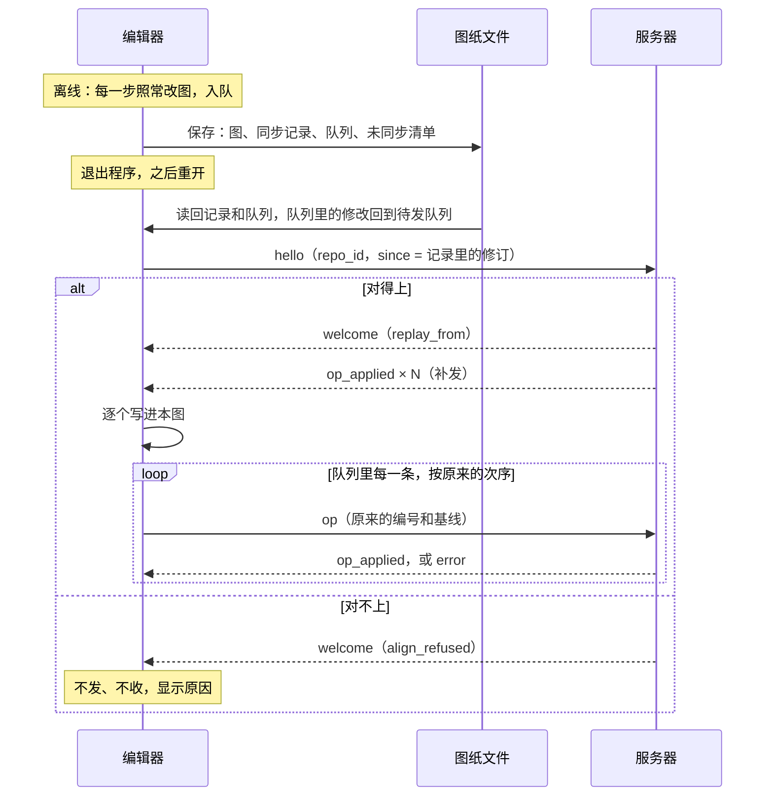

# SPEC：离线使用与上线后同步（`collab-offline-sync`）

> 日期：2026-11-17
> 状态：**已确认**（2026-11-17）。按 2026-11-17 的答复「按推荐方案继续」写成，范围是审核意见里的档 B。§10 的 6 件事都按建议定了；那批没提交的离线改动交给我接着做，从 `OFF-1` 开始。
> 需求依据：`docs/pid-platform/requirements/70-collaboration-and-permissions.md` 的 `REQ-COLL-014`（断线期间的排队与重连后的补发）和 `REQ-COLL-015`（加入时的图纸对齐）。`REQ-COLL-016`（身份、登记、加密传输）不在本文范围。
> 相关规格：`SPEC-collab-client.md`、`SPEC-collab-protocol.md`、`SPEC-collab-server.md`、`SPEC-pid-publish.md`。这几份里与本文不一致的地方以本文为准，各自加了一句指向这里。
> 任务：`todo.md` 的 `OFF-1` – `OFF-13`，排在 `CC-7` 之前。
> 取证情况：本文是读文档和代码写的，没有编译，也没有跑测试。标了「读代码」的结论都还没有用测试证实，对应任务的第一步先写证实它的测试。

## 1. 目标

离线时照常画图和保存；重新连上服务器后，离线期间的修改自动提交，别人的修改自动补上；提交不了的每一条都有交代。

拆成三条，后面的格式和流程都为它们服务：

1. **不连服务器照常用。** 带着同步记录的图，没有服务器时打开、绘制、保存都与普通图一样（`REQ-COLL-015` 验收 4）。
2. **连上之后，每一条离线修改都有结局。** 生效、让位、被拒绝并撤回、进入冲突条目，四种之一（`REQ-COLL-014` 验收 4）。中间退出过程序、重开过几次，结局都一样。
3. **拿不准就拒绝。** 只要不能确定本图与服务器上的一致，就按不一致处理并说明原因，不默认一致。不一致的图有出路：能列出、导出没同步上的修改，换一份最新图纸后照着重做。

## 2. 范围

### 2.1 管哪几种离线

| 情形 | 已提交的代码（`130dda683`） | 本文做完之后 |
|---|---|---|
| 没配服务器，单机用 | 能用 | 一样 |
| 用着用着断线，同一次运行里重连 | 修改排队；重连后补齐别人的、提交自己的 | 一样 |
| 断线后退出程序，之后再打开；中间可以多次开关和保存 | 排队的修改丢掉，不提醒；重新加入时不核对 | 队列随图保存，重开后接着提交；加入时核对 |
| 开程序时就连不上服务器 | 修改不排队；之后连上，本图被当成与服务器一致 | 图里有同步记录就排队，连上后提交 |
| 几个人同时离线，先后回来 | 同一次运行里可以；重开过的同上一行 | 按回来的先后提交；后回来的可能有几步被拒，被拒的撤回 |
| 图里没有同步记录（从没同步过） | 加入时被当成与服务器一致 | 不变，见 §9 的 L1 |

「离线」主要指哪一种（审核意见第五节第 2 条），2026-11-17 定了：上面几种都管（§10 第 5 条），`OFF-7`、`OFF-8` 都要做。

### 2.2 同步什么，不同步什么

同步的：会话那张图上带位号对象的修改。协议规格 §4.3 的十一种变更里，客户端会发的有十种：新建符号、删除对象、改位号、改属性、新建管线、加管路、插管件、改管路、新建连接符、删除连接符。第十一种（连接符配对）只由服务器发。

不同步的，离线和在线都一样：

- 只动位置的修改（移动符号、拖管段）。
- 会话那张图以外的图。一次运行只管一张图（客户端规格 §2.2）。
- 主数据、规则检查的豁免与规则启停、快照、发布包。阶段 B – E 的规格都写着在本机完成、不经协同服务器。

「同步」要不要包括后面这几项（审核意见第五节第 3 条），2026-11-17 也定了：不包括（§10 第 5 条）。要包括就是审核意见里的档 C，要另开方案。

## 3. 现状

### 3.1 已提交的

断线排队、重连补齐、按次序提交、被拒撤回都有，范围是同一次运行（客户端规格 §4.3、§4.4，端到端场景 `y08_offline_reconcile`）。队列只在内存里，图纸文件里没有任何同步记录。

### 3.2 没提交的那批改动

主目录里有一批没有提交的离线改动：19 个代码文件，加一份设计说明 `docs/plans/2026-11-17-collab-offline-mode.md`。它不是本清单的任务做出来的，写本文时没有动它（`OFF-1` 已于 2026-11-18 把它按原样入库，见 §11.1）。它做了这些：

- 图里加两条记录：`PID_AUTHOR_COLLAB`（图号、服务器库标识、已应用到的修订）和 `PID_AUTHOR_COLLAB_QUEUE`（排队的修改）。只写进存盘的那一份，不动正在编辑的图。
- 服务器的库有了标识 `repo_id`，存在库里；`hello` 和 `welcome` 都带它。
- 加入时核对：库标识不符（`REPO_MISMATCH`）、本地修订领先（`REVISION_AHEAD`）、日志不够补发（`REPLAY_GAP`）时，服务器在 `welcome` 之后发一条新消息 `align_refused`，客户端标「不一致」并停止提交。
- 图里有记录时，开程序后还没连上就按「以前连上过」对待：修改排队，队列里的修改重开后回到待发队列。`REQ-COLL-014` 验收 2 写的「从来没有连上过服务器的客户端不排队」，此后要读成「图里没有同步记录、本次运行也没连上过」。

那份设计说明原来有两处与它自己的代码不符，本文按代码写（`OFF-1` 入库时已经在说明里改正，见 §11.1）：

- 记录的键名是 `drawing_id`、`repo_id`、`revision`（`src/pid/collab_state.rs`），不是说明里写的 `drawing`、`repo`、`rev`。
- 保存时写进图里的是队列的全部条目，包括已经发出、还在等答复的那一条（`src/app/update/file.rs` 的 `write_collab_state_into_snapshot`），不是只写没发出的。

### 3.3 还缺什么

加上那批改动之后，离「§1 的三条」还差下面这些。G1 – G8 都是读代码得出的。

| # | 缺口 | 出处 | 后果 | 任务 |
|---|---|---|---|---|
| G1 | 服务器说「对不上」之前，客户端可能已经发出一步 | `src/app/collab/mod.rs`：处理 `welcome` 的最后会发队首，而拒绝是后一条消息；`crates/ocs_collab_server/src/ws.rs` 对被拒的会话没有记号，发来的 `op` 照常裁决 | 一份对不上的图的修改可能进入房间。发生在本地修订领先、或库标识不符而对方修订不高于本图时 | `OFF-2` |
| G2 | 对不上之后，房间的修改仍然写进本图；存盘会把图里的记录改成拒绝它的那个库的标识和修订 | `src/app/collab/apply.rs` 的 `apply_remote_changes` 不看不一致标记；`write_collab_state_into_snapshot` 用的是 `welcome` 给的库标识和房间修订 | 下次连同一台服务器会被当成一致；连回原来的服务器反而对不上 | `OFF-2` |
| G3 | 离线时生成的修改编号会重复 | `src/app/collab/transport.rs` 的 `next_op_id`、`mod.rs` 的 `seed_file_state`：还没连上时编号是 `op-file-<库标识>-<序号>`，序号每次启动从 1 数起 | 客户端按编号认「这是我发的」，同号的一起从队列里删掉（`mod.rs` 的 `answered`）。同一个人连续两次离线开关程序、或两个人同时离线，都会有修改不再提交，而且不标不一致 | `OFF-3` |
| G4 | 服务器不按编号去重；队列不记是谁排的 | `crates/ocs_collab_server/src/ops.rs`、`store.rs` 里没有按 `op_id` 查重；`src/pid/collab_state.rs` 的 `QueuedOp` 没有用户字段 | 同一份带队列的图在两台机器上打开，同一条修改可能生效两次；把图拷给同事，同事会替你提交 | `OFF-3`、`OFF-4` |
| G5 | 「不一致」标记不随图保存 | `write_collab_state_into_snapshot` 不看这个标记；`src/pid/collab_state.rs` 的记录里没有这一项 | 标了不一致的图保存、重开之后，记录对得上就被当成一致，队列又开始提交 | `OFF-5` |
| G6 | 图里有同步记录，修改却没有排上队 | `src/app/collab/apply.rs` 的 `broadcast_changes`：改的不是会话那张图、记录的图号与会话的图号不同、本次运行没配协同、只读会话里漏进来的修改，都直接返回 | 下次加入时记录对得上，被当成一致；服务器只核对库标识和修订号，不核对内容 | `OFF-5` |
| G7 | 写图纸文件的出口不都写同步记录 | 经接口保存的那条路（`src/app/automation.rs` 的 `save_verified_request`）自己写文件，不写记录 | 文件里留着打开时的旧记录和旧队列，而图的内容已经往前走了 | `OFF-6` |
| G8 | 重开后被拒的修改撤不回 | `src/app/collab/apply.rs` 的 `take_back_rejected`：恢复的条目没有撤销步骤，直接标不一致 | 离线几天回来，有一步被拒，整张图停止同步 | `OFF-7`、`OFF-8` |
| G9 | 不一致之后没有出路，也看不到哪些修改没同步上 | 客户端规格 §7、§9 的 C1 | 只能所有人从同一份最新文件重新开始，没同步上的修改靠人记。标记随图保存（G5）之后，连「以其中一份为准重新开始」也要有办法去掉那份图上的标记 | `OFF-9` |
| G10 | 退出不提醒，面板不显示排队的步数（只有状态接口的 `queued_ops` 有） | 客户端规格 §3.2；`src/ui/window/pid_collab.rs` 的 `CollabView` | 不知道同事手里还没有自己的修改 | `OFF-10` |
| G11 | 服务器的库打不开时照常接受会话；从备份恢复后库标识不变 | `crates/ocs_collab_server/src/main.rs`、`lib.rs` 的 `AppState::new` | 见 §6 | `OFF-11` |
| G12 | 发布没有「已同步」这道闸 | `SPEC-pid-publish.md` §3.4 | 离线着、有没提交的修改、已经不一致的图都能发布 | `PUB-1` – `PUB-4`、`PUB-6` |
| G13 | 整条路没有验证 | 那批改动只有程序内的测试，没有起真实服务器和桌面端的场景 | 补齐后两端是否相同没有比对；DXF 出口没试 | `OFF-12`、`OFF-13` |

## 4. 数据格式

### 4.1 图里的三条记录

三条都用 `src/pid/graph_data.rs` 现有的图级记录机制，挂在模型空间块记录的扩展字典下。只写进存盘的那一份，不动正在编辑的图：不让图显得被改过，也不进撤销栈。前两条是那批改动已有的，这里加了几个可选的键；第三条是新的。旧版本写的记录没有这些键，读的时候按「没有」处理。

**`PID_AUTHOR_COLLAB`：这份图上一次对到了哪里。** 一项：

```json
{
  "drawing_id": "PID-1101",
  "repo_id": "3f0c9a52-...",
  "revision": 12,
  "diverged": { "code": "UNQUEUED_EDITS", "message": "...", "at": 1794900000 }
}
```

- 前三项不变：图号、服务器库标识、本图跟到的修订号。
- `diverged` 是新加的，可选。有它，表示这份图已经知道与服务器上的不一样，下次加入不再按一致申报。写上之后不自动清除；要去掉只有 `PIDCOLLAB DETACH`（§4.5），它把三条记录一起去掉。`at` 是 Unix 秒。
- `diverged.code` 的取值：

| 码 | 什么时候写 |
|---|---|
| `UNQUEUED_EDITS` | 图里有同步记录，却做了没有排上队的语义修改（§5.1） |
| `REMOTE_UNAPPLIED` | 别人的修改写不进本图：对象没有、有好几个，或者变更种类不认识（协议规格 §7 第 3 条） |
| `REVISION_GAP` | 收到的修订不连续，中间有没收到的修改 |
| `ROLLBACK_FAILED` | 被拒的修改撤不回，或者撤不干净（§5.4） |

**`PID_AUTHOR_COLLAB_QUEUE`：还要提交的修改。** 一项一条，顺序就是提交的顺序：

```json
{
  "op_id": "op-r-5d2e1c07-...-7",
  "payload": { "kind": "set_property", "object_ref": "P-1001", "field": "设计压力", "value": "1.6MPa" },
  "base_revision": 12,
  "on": true,
  "label": "PIDSETPROP",
  "user_id": "u1",
  "queued_at": 1794900000,
  "inverse": [ { "kind": "set_property", "object_ref": "P-1001", "field": "设计压力", "value": "1.0MPa" } ]
}
```

- 前五项是那批改动已有的，含义不变。
- `user_id`：谁排的。`queued_at`：什么时候排的，Unix 秒。
- `inverse`：撤回这一条要做的修改，形状与 `payload` 里的变更相同（协议规格 §4），按要执行的顺序排好。没有这一项，表示这一条重开程序后撤不回（§5.4）。
- 不存撤销栈的步号：它活不过进程。

**`PID_AUTHOR_COLLAB_UNSYNCED`：本图里做过、服务器没有收下、也不会再自动提交的修改。** 一项一条：

```json
{
  "state": "refused",
  "op_id": "op-r-5d2e1c07-...-7",
  "label": "PIDSETPROP",
  "payload": { "kind": "set_property", "object_ref": "P-1001", "field": "设计压力", "value": "1.6MPa" },
  "user_id": "u1",
  "at": 1794903600,
  "code": "CLAIM_HELD",
  "message": "位号 P-1001 由 u2 占用",
  "rolled_back": true
}
```

| `state` | 含义 | 附带 |
|---|---|---|
| `refused` | 提交过，服务器整步拒绝 | `op_id`、`code`、`message`；`rolled_back` 说本图里撤回了没有 |
| `unqueued` | 做了，但没有排上队 | `message` 说为什么没排上；没有 `op_id` |

这条记录只增不减，直到用 `PIDCOLLAB UNSYNCED CLEAR` 清掉。它不参与对账，只为了让人看得到、导得出。同一次运行里被拒、已经用撤销栈退回的步骤不记在这里，它们还是只进拒绝记录（客户端规格 §3.4），人就在跟前，重做栈里也找得回。

### 4.2 修改编号

形如 `op-<运行标识>-<序号>`。运行标识每次启动程序生成一个，形如 `r-<UUID>`，用 `crates/ocs_collab/src/ids.rs` 里现有的生成方式，不加依赖；序号在一次运行里从 1 递增。编号不再带会话号，所以连没连上都一样生成。从图里恢复的条目保留原来的编号。

编号对两端都是不透明的字符串（读代码：服务器只自己生成 `resolve-<冲突号>`，不解析别人的编号）。协议规格 §3.1 里「形如 `op-<session_id>-<序号>`」的说法随之改掉。

### 4.3 协议增量

相对于已提交的协议。第二列是那批没提交的改动已经做了什么。

| 项 | 那批改动 | 本文 |
|---|---|---|
| `hello.repo_id`（可选） | 有 | 不变 |
| `welcome.repo_id` | 有 | 不变 |
| 拒绝对账怎么告诉客户端 | 新消息 `align_refused{code, message}`，紧跟在 `welcome` 后面 | 改成 `welcome` 里的可选键 `align_refused: {code, message}`，不加消息种类。2026-11-17 已按这个定，见 §10 第 2 条 |
| 错误码 `REPO_MISMATCH`、`REVISION_AHEAD`、`REPLAY_GAP` | 有 | 不变 |
| 错误码 `NOT_ALIGNED` | 无 | 新增：没对上的会话发来的 `op` 一律拒绝。`error` 带 `op_id`，不带 `rejected` |
| 错误码 `STORE_UNAVAILABLE` | 无 | 新增：服务器的库不可用，不接受会话（§6） |
| 同一个 `op_id` 第二次到达 | 照常裁决 | 不再裁决，只给发送者回当初那条 `op_applied`（修订号和变更取日志里那一行），不广播。只认日志里有的：当初被拒的不在日志里（读代码：操作日志只在修改生效时写一行），再来就再裁决一次 |

这些都符合协议规格 §7 的兼容规则：只加可选键、不加消息种类（第 1 条），旧客户端不带新键时行为不变（第 2 条），错误码只增不改（第 4 条）。总计划 §2 第 5 条原来写的是「不改协同协议」，现在改成「只按协议规格 §7 加可选键和错误码」。

### 4.4 导出的未同步清单

`PIDCOLLAB EXPORT <路径>` 写出一个 JSON 文件，队列和 `PID_AUTHOR_COLLAB_UNSYNCED` 合在一起：

```json
{
  "version": 1,
  "kind": "collab_unsynced",
  "drawing_id": "PID-1101",
  "repo_id": "3f0c9a52-...",
  "revision": 12,
  "exported_at": 1794907200,
  "diverged": null,
  "entries": [
    { "state": "queued", "op_id": "...", "label": "...", "user_id": "u1", "at": 1794900000, "changes": [ { "kind": "..." } ] },
    { "state": "refused", "op_id": "...", "label": "...", "user_id": "u1", "at": 1794903600, "code": "CLAIM_HELD", "message": "...", "rolled_back": true, "changes": [ { "kind": "..." } ] }
  ]
}
```

`state` 比图里多一种 `queued`（还在队列里等提交）。`changes` 是这一条的全部变更，按协议规格 §4 的形状展开。文件里只有图纸内容和用户号，没有服务器地址。

### 4.5 状态接口与命令

`GET /api/v1/collab/status`（客户端规格 §3.1）加四个字段，原有的（包括 `diverged`、`queued_ops`）不动：

| 字段 | 含义 |
|---|---|
| `align` | `none`（这张图没有同步记录，也没连上）、`offline`（有记录，没连上）、`ok`（连上并对上了）、`refused`（这次连接对不上）、`diverged`（图本身已经不一致） |
| `align_code`、`align_message` | `refused`、`diverged` 时的原因 |
| `unsynced_count` | `PID_AUTHOR_COLLAB_UNSYNCED` 的条数 |

命令加四个，都作用在最前面那张图上：

| 命令 | 作用 |
|---|---|
| `PIDCOLLAB UNSYNCED` | 在命令行列出队列和未同步清单 |
| `PIDCOLLAB UNSYNCED CLEAR` | 清掉未同步清单，队列不动 |
| `PIDCOLLAB EXPORT <路径>` | 把队列和未同步清单导出成文件（§4.4） |
| `PIDCOLLAB DETACH` | 去掉这张图的三条记录，下次保存时生效；之后它按「从没同步过的图」对待。队列或未同步清单不空时拒绝，要写成 `PIDCOLLAB DETACH FORCE`。正在对着一个对上了的会话时不让用 |

`PIDCOLLAB DETACH` 用在两处：把一张图另存成新图号的新图（副本里还记着原来的图号）；不一致之后决定以这份图为准重新开始（§5.5）。

## 5. 数据怎么传

整条路：



### 5.1 做一步修改、保存

**排不排队。** 每一步编辑都经过同一个入口（`src/app/history.rs` 的 `push_undo_entry`），在那里读出这一步的语义变更。读得出变更的一步：

| 这张图 | 怎么处理 |
|---|---|
| 是会话的图，连着并且对上了 | 入队，发出（现状） |
| 是会话的图，没连上，或者这次连接对不上；图里有同步记录，或者本次运行连上过 | 入队，等着 |
| 是会话的图，从没连上过，图里也没有记录 | 不排队（现状，`REQ-COLL-014` 验收 2） |
| 图里有同步记录，但排不了队：不是会话的图、本次运行没配协同、只读会话里漏进来的修改、入队失败 | 记进未同步清单（`unqueued`）；命令行警告一次，说明保存之后这份图不能再与服务器同步；保存时写 `diverged`（`UNQUEUED_EDITS`） |
| 图里没有记录，也不是会话的图 | 不管（现状） |

只动位置的修改读不出语义变更，不排队也不打标。

**保存写什么。** 所有写整张图的出口都调同一个函数，在取到存盘用的那一份之后、写盘之前，把三条记录写进去：

| 这张图当时的状态 | `PID_AUTHOR_COLLAB` | 队列 | 未同步清单 |
|---|---|---|---|
| 会话的图，对上了（连着，或者对上之后断了线） | 当前的库标识和修订；运行中标了不一致就加 `diverged` | 当前的全部条目 | 当前的 |
| 会话的图，有记录，还没连上或者这次连接对不上 | 打开时读到的库标识和修订，不取这台服务器给的；原有的 `diverged` 保留 | 当前的全部条目 | 当前的 |
| 不是会话的图，或者没配协同；图里有记录 | 原样保留；有没排队的语义修改就加 `diverged` | 原样保留 | 原有的加上新记的 |
| 图里没有记录，也没有对上过；或者用过 `PIDCOLLAB DETACH` | 不写 | 不写 | 不写 |

**哪些出口。** 写整张图的：保存、另存为、自动保存、全部保存、经接口保存（`save_tab_synchronously_protected_as`、`queue_native_save`、`automation_op_inner` 的保存、`save_verified_request`）。这些都写三条记录，DWG 与 DXF 一样。写出另一张图的：块写出（`wblock_write`、`control_wblock`）。写出的文件不带这三条记录，它不是同一张图。网页版的出口（`saveall_web`、`archive_web`）没有协同，按「不是会话的图」那一行处理。出口清单由 `OFF-6` 第一步用全文搜索核一遍，漏掉的补进来。

另存为得到的副本带着同一套记录和同一份队列。两份都拿去连服务器时，队列里的修改靠编号去重，只生效一次（§5.3）。要把副本当成另一个图号的新图用，先 `PIDCOLLAB DETACH`。

### 5.2 打开一张图、加入

**第一步，这张图算不算会话的图。** 会话认哪张图的规则不变（客户端规格 §2.2）。图号的来源多一级，从高到低：

1. 本次运行明确给的：启动参数 `--drawing <号>`，或者本次运行里用 `PIDCOLLAB DRAWING <号>` 设的。
2. 图里同步记录的 `drawing_id`（新加的一级）。
3. 设置文件里存的 `drawing_id`（以前某次运行设的）。
4. 文件名（去掉扩展名）。

明确给的图号与图里记录的不同时，这张图不算会话的图：会话不在它上面起，命令行和面板说明「这份图记着它属于 X，本次会话是 Y」，图里的记录不动。它上面的语义修改按 §5.1「排不了队」那一行处理。确实要把它当成 Y 来用，先 `PIDCOLLAB DETACH`。

这样定的理由：那批改动里，图号不符时记录被忽略（读代码：`src/app/collab/apply.rs` 的 `answer_collab_tags` 只在图号相同时才报记录），这张图会被当成与 Y 的房间一致，存盘时记录被改写成 Y 的。一张图不声不响地换了归属，这是要堵的。

**第二步，客户端自己先判，然后才发 `hello`。**

| 图里的情况 | 客户端怎么做 |
|---|---|
| 没有同步记录 | 照旧：不带 `since` 加入，本图被当成房间现在的样子（§9 的 L1） |
| 记录里有 `diverged` | 不报 `repo_id` 和 `since`，不上报位号；这次连接按「对不上」处理，原因取记录里的 |
| 队列里有别人排的条目（`user_id` 不是当前用户，或者没有 `user_id`） | 同上，原因是「图里带着 <用户> 排队未提交的修改」。不替别人提交 |
| 队列读不全，或者有重复的编号 | 同上 |
| 以上都不是 | 报 `repo_id` 和 `since`（记录里的修订），上报位号，由服务器判 |

**第三步，服务器判**（那批改动已有）：库标识不符 `REPO_MISMATCH`；本地修订领先 `REVISION_AHEAD`；日志不够补发 `REPLAY_GAP`。判为对不上时：会话照开，`welcome` 带 `align_refused`，不补发，不登记这份图上报的位号，记下这个会话没对上。此后它发来的 `op` 一律回 `error NOT_ALIGNED`。

**「对不上」的连接里，客户端对这张图等于没连上：**

- 队列一条都不发。处理 `welcome` 时先看有没有 `align_refused`，再决定发不发队首。
- 房间的修改不写进本图。
- 不申请占用。在场名单和别人的占用照常显示。
- 本地照常画图，修改照常排队。
- 存盘按 §5.1 的第二行：图里的库标识和修订仍是这份图原来的。
- 面板和命令行显示原因和「需要取得最新图纸」（`REQ-COLL-015` 验收 3）。
- 收到 `error NOT_ALIGNED` 时：那一条留在队列里，不撤回，这次连接转为「对不上」。

同一次运行里断线重连也走这一套。重连后服务器既没补发也没说拒绝、而房间修订比本图高时，也按「对不上」处理，不把基线改成房间的。

**两种「不一致」的区别。** 界面上都叫「不一致」，处理不同：

| | 这次连接对不上 | 图本身已经不一致 |
|---|---|---|
| 来源 | 服务器的三种拒绝；客户端第二步的三种 | 运行中发现：没排队的修改、别人的修改写不进来、修订不连续、被拒的撤不回 |
| 写不写进图 | 不写。它说的是这份图和这台服务器，换回原来的服务器可能就对上了 | 写（`diverged`）。它说的是这份图的内容 |
| 房间的修改 | 不写进本图 | 继续尽力写（现状） |
| 队列 | 不发，保留 | 不发，保留 |
| 下次打开 | 重新判 | 仍然不一致，直到 `PIDCOLLAB DETACH` |

### 5.3 追平与重新提交

对上之后的流程就是现有的「断线 → 排队 → 重连补齐」（客户端规格 §4.4）：先把补发的修改逐个写进本图，期间不发自己的；补齐后队列从头一条一条发，每条带它原来的编号和基线，服务器照常裁决。恢复的条目排在前，重开后新做的排在后。

编号在这里起三个作用：

- 补发里出现自己队列里的编号：说明上次发出后房间其实收下了，只是没等到答复。这一条出队，不重发，也不再写一遍（现有做法，客户端规格 §4.4）。
- 同一份带队列的图在两台机器上打开（比如另存为的副本）：后到的那一条，服务器认出编号已经在日志里，不再裁决，只给发送者回当初那条 `op_applied`。客户端照「自己的修改已经生效」处理：出队，修订号不回退。编号还挂在一条没裁决的冲突条目上时，回那条 `conflict`，同样不再裁决。
- 每次启动的运行标识不同，两次离线运行、两个人同时离线，编号都不会撞。

### 5.4 被拒之后

同一次运行里做的步骤被拒，还是现在的做法：用撤销栈退回，进重做栈（客户端规格 §4.3）。下面说的是从图里恢复的条目，它们没有撤销步骤。

**撤回的规则。** 对这一条 `inverse` 里的每项反向修改：本图里仍是这一步写下的样子才执行，否则跳过。

| 这一步做了什么 | 什么叫「仍是这一步写下的样子」 | 反向修改 |
|---|---|---|
| 改属性 | 字段现在的值等于这一步写的值 | 改回原值；原来没有就删掉；覆盖标记一并改回 |
| 改位号 | 对象现在的位号等于这一步改成的 | 位号和位号来源改回 |
| 新建符号 | 这个符号还在 | 删掉它 |
| 删除符号 | 本图里没有这个位号的对象 | 按原样放回：位置、角度、比例、图块、类型、连接点、属性、位号来源 |
| 新建 / 删除连接符 | 连接符还在 / 已经不在 | 删掉 / 按原样放回 |
| 管线、管路、管件的修改 | 这条线、这几条管路现在的账目等于这一步说的账目 | 对齐回这一步之前的账目 |

为什么要先看「仍是这一步写下的样子」：队列是补齐之后才发的，补齐时别人的修改已经盖在我的上面了。比如我离线把设计压力从 1.0 改成 1.6，别人在我离线期间改成了 2.5：补齐后本图已经是 2.5，我那一步被拒时不能再把它改回 1.0。

**各种拒绝原因下，本图当时的样子和收场**（读协议规格 §5.3 的裁决表和代码推出来的，没有跑过测试；`OFF-8` 逐种写测试）：

| 服务器给的码 | 补齐之后本图的样子 | 收场 | `REQ-COLL-014` 的结局 |
|---|---|---|---|
| `OP_SUPERSEDED` | 胜出的值已经写进本图 | 反向修改全部跳过 | 让位 |
| `OBJECT_DELETED` | 对象已经删掉 | 反向修改全部跳过 | 让位 |
| `STALE_BASE_REVISION`（别人动过同一条线） | 别人动过的管路已经按别人的账目对齐 | 别人动过的部分跳过，其余的撤回 | 被拒绝并撤回 |
| `CLAIM_HELD`、`PERM_DENIED_*`、`OBJECT_REFERENCED`、`DUPLICATE_INFLOW_CONNECTOR` | 我的修改还在本图里，房间没有 | 撤回 | 被拒绝并撤回 |
| 房间发来 `conflict` | 本图里还是我写的值；房间里两个值都没生效 | 不撤回。条目出队，等人裁决；裁决结果作为一条普通修改写进本图（现状） | 进入冲突条目 |
| `NOT_ALIGNED` | — | 不撤回，条目留在队列，连接转为对不上 | — |

**连带的条目。** 队列里排在被拒条目之后、提到同一批对象的条目一并作废并撤回，从后往前撤；与它无关的照发。「同一批对象」按名字认：被拒那一步新建、改名、删除的对象，或者同一条线、同一条管路。重开后新做的步骤如果建在被拒的条目上，按现有做法用撤销栈退回。

**留下记录。** 每条被拒的恢复条目：命令行说一句，记一条拒绝记录（客户端规格 §3.4），再记一条未同步清单（`refused`）。重开后撤回的修改没有重做栈可用，清单里的这一条就是要找回它时的依据。让位的条目也记一条，`rolled_back` 写 `true`：本图已经是房间的样子。

**撤不回。** 条目没有 `inverse`，或者反向修改执行失败：标不一致（`ROLLBACK_FAILED`），清单里记 `rolled_back: false`。这是 `REQ-COLL-014` 四种结局之外的情形，目标是一种变更都不落到这里；做不到的种类在 §11 列明，并在检查点 CP-A4 汇报。

**反向修改从哪里来**（读代码判断，没有跑过测试）：

| 变更 | 排队当时能不能算出来 |
|---|---|
| `set_property`、`set_tag`、`insert_symbol` | 能。原值、原位号都在这一步的前后影像里；超过 2 KB 的属性，改前的内容步骤自己留着（`CC-2` 做的 `records_across`） |
| `delete_object`（独立符号） | 能。放回去要的东西都在删除前的影像里。属性超过 2 KB 的符号待证实 |
| `create_connector`、`delete_connector` | 待证实。读法（`connectors.rs` 的 `statements`）要参考图 |
| `create_pipe_line`、`add_pipe_run`、`insert_fitting`、`update_pipe_run`，以及管线、管路、带位号管件的 `delete_object` | 不能直接算。这一步之前的账目要从「没有这一步时的图」里读（`pipes.rs` 的 `statements`、`run_state` 和拓扑表），而排队时图已经是做完这一步的样子 |

管线这一类有两种候选做法，由 `OFF-7` 第一步用测试定，结果记进 §11：

- 做法一：排队之后、界面空闲时，把这一步安静地退回再放上，退回时照「撤销时广播」的读法读出账目。复用现有的 `replay_history_quietly` 和 `collect_undone_step_changes`，后一个已经有端到端场景在用。代价是每个离线的管线步骤多一次退回和放上；有没有副作用（选择集、重做栈、正在进行的命令）要测。
- 做法二：不做。这类条目不带 `inverse`，重开后被拒就走「撤不回」。

先试做法一。它不成立时退到做法二，并在 CP-A4 说明哪几种变更重开后撤不回。

### 5.5 不一致之后的出路

1. 面板和 `PIDCOLLAB UNSYNCED` 列出本图里服务器没有收下的修改：还在队列里的、被拒的、没排上队的。
2. `PIDCOLLAB EXPORT <路径>` 把它们导出成文件（§4.4）。
3. 取得最新图纸：向一位图纸一致的同事要他刚保存的文件。文件里带着同步记录，打开加入后自动补齐。他的文件里如果带着他自己排队没提交的修改，我这边不会替他提交（§5.2 第二步），所以要他在队列发完之后再保存。
4. 对照导出的清单，把还要的修改在线重做一遍。

没有人手里有一致的图纸时，还是原来的办法：以其中一份为准，所有人从它重新开始。选定的那一份先导出清单，再 `PIDCOLLAB DETACH FORCE` 去掉记录和标记，保存后加入；别人取它加入后保存的文件。这条路和以前一样不检查这份图与房间是否相同（§9 的 L1）。按清单自动重放、从服务器重建整张图，留在阶段 4 提纲（`plan.md` §10）。

### 5.6 面板与退出

- 协同面板加一行状态：「离线，n 步待同步」「已连接，n 步待同步」「不一致：<原因>；未同步 n 条」。前两句的数字取队列的条数，最后一句取队列加未同步清单的条数。
- 退出程序、或关掉会话那张图时，队列不空就提示一次：「这张图还有 n 步修改没有同步到服务器。已经随图保存的，下次打开并连上服务器后会接着提交。」按钮：退出、取消。排在现有的「块编辑未保存」「图纸未保存」两个提示之后。
- 队列只在保存时写进文件。不保存就退出，文件里是上次保存时的图和那时的队列，两者配套，不会丢一半。

### 5.7 发布

`SPEC-pid-publish.md` §3.4 的发布前提加三条，只对图里有同步记录的图生效：

| 前提 | 不满足时 |
|---|---|
| 队列是空的 | `COLLAB_UNSYNCED` |
| 没有标不一致，这次连接也没有对不上 | `COLLAB_DIVERGED` |
| 正连着服务器并且已经补齐 | `COLLAB_OFFLINE`。发布时明确带上「允许未对账」（命令加 `ALLOW_OFFLINE`，接口加 `allow_offline: true`）就放行，包的清单里记 `reconciled: false` |

包的清单（同一规格 §3.2）加一段 `collab`：图里没有同步记录时是 `null`；有时是 `{"drawing_id", "repo_id", "revision", "reconciled"}`。三个码都按 409 返回。默认拒绝还是默认放行，2026-11-17 定为默认拒绝、明确带上「允许未对账」才放行，见 §10 第 3 条。

## 6. 服务器这边的前提

1. **账本就是库文件。** `--db` 指定，默认 `%APPDATA%\OpenCADStudio\collab.db`。同一个库文件，就是同一个库标识加同一份操作日志。换了库文件就是换了一个库，所有带记录的图纸都会得到 `REPO_MISMATCH`。
2. **库打不开时不接受会话。** 现状（读代码）：进程照常监听，`GET /health` 报 503，会话照常接受但什么都不落盘，每次启动换一个库标识。改为：`hello` 得到 `error STORE_UNAVAILABLE` 后断开，`/health` 仍报 503。测试用的内存模式（代码里直接建不带库的服务器）不受影响。
3. **操作日志不清理。** 现状没有清理的代码，这里写成规定。只要日志在，离线多久都能补齐。将来要清理，先定「最长离线时间」；落后太多的客户端得到 `REPLAY_GAP`。
4. **从备份恢复之后必须换库标识。** 恢复备份等于修订号回退。比备份新的图纸会得到 `REVISION_AHEAD`，这是对的；危险在恢复之后房间又往前走过了那些修订号，这时旧副本会被当成一致（读代码：服务器只比库标识和修订号）。服务器加启动参数 `--new-repo-id`：写入一个新的库标识后照常启动。恢复备份后用它启动一次，所有人取同一份图纸重新开始（§5.5 的后一种办法）。
5. **一个库文件同一时间只给一个服务器进程用**（现状的假设，写明）。

这几条写进 `SPEC-collab-server.md` 的运行说明（`OFF-11`）。审核意见第 10 条写的「必须带库文件运行」不准确：不带参数时默认就有库文件，只有库打不开时才会无库运行。

## 7. 成功标准

每条都要有能重跑的检查。「两端相同」指位号、属性、拓扑记录逐项比对，取法与 `y08_offline_reconcile` 相同。

| # | 标准 | 任务 |
|---|---|---|
| OS-01 | 没有服务器：带同步记录的图打开、绘制、保存、重开，三条记录都在，失败步骤数为 0（`REQ-COLL-015` 验收 4） | `OFF-1`、`OFF-13` |
| OS-02 | 三条记录经 DWG 和 DXF 存盘再读回，内容不变（`REQ-COLL-015` 验收 1） | `OFF-1`、`OFF-6` |
| OS-03 | 跨重启：断线、改 n 步、保存、退出、重开、连上，补齐别人的修改，n 步按原次序提交，两端相同（`REQ-COLL-015` 验收 2） | `OFF-12` |
| OS-04 | 开程序时没有服务器：图里有记录就排队；服务器起来后提交，两端相同 | `OFF-12` |
| OS-05 | 连续两次离线运行：两次排的修改编号互不相同，全部提交，没有一条被吞掉 | `OFF-3`、`OFF-12` |
| OS-06 | 两个人同时离线各改各的，先后回来：各自的修改都到对方图上，两端相同 | `OFF-3`、`OFF-12` |
| OS-07 | 同一份带队列的图在两台机器上先后打开：每条修改在房间里只生效一次 | `OFF-4`、`OFF-12` |
| OS-08 | 三种对不上（库标识不符、本地修订领先、日志不够）：显示原因和「需要取得最新图纸」；一步都没有发出去；房间的修改没有写进这份图；保存后图里的库标识和修订不变（`REQ-COLL-015` 验收 3） | `OFF-2`、`OFF-12` |
| OS-09 | 没对上的会话硬发 `op`：服务器拒绝，码是 `NOT_ALIGNED`，房间里没有这一步 | `OFF-2`、`OFF-12` |
| OS-10 | 标了不一致的图保存、重开、加入：仍按不一致处理，不上报位号，不发队列 | `OFF-5`、`OFF-12` |
| OS-11 | 带记录的图在没连协同的运行里做了语义修改并保存：下次加入按不一致处理并说明原因；只动位置的修改不触发 | `OFF-5`、`OFF-12` |
| OS-12 | 明确给的图号与图里记录的不同：不在这张图上起会话，图里的记录没有被改写；没给图号时取图里记录的；`PIDCOLLAB DETACH` 并保存之后三条记录都没有了，加入时按没同步过的图对待 | `OFF-5`、`OFF-9`、`OFF-12` |
| OS-13 | 当前用户不是排队的人：不代发，按对不上处理 | `OFF-3`、`OFF-12` |
| OS-14 | 重开后被拒并撤回，四种原因各一例（占用、没有写权限、删除仍被引用的对象、别人动过同一条线）：被拒的那一步从本图撤回，后面无关的照常提交，两端相同，拒绝记录和未同步清单各有一条 | `OFF-8`、`OFF-13` |
| OS-15 | 重开后让位（别人改了同一个字段、别人删了对象）：本图是房间的样子，不标不一致 | `OFF-8`、`OFF-13` |
| OS-16 | 客户端会发的十种变更逐种：做一步、按反向修改撤回，本图的位号、属性、拓扑记录与做这一步之前相同。撤不回的种类列在 §11，目标 0 种 | `OFF-7` |
| OS-17 | 未同步清单列出队列里的、被拒的、没排上队的；导出的文件条数对得上；清单随图保存 | `OFF-9`、`OFF-13` |
| OS-18 | 离线时面板显示「离线，n 步待同步」，提交完数字归零；队列不空时退出提示一次 | `OFF-10`、`OFF-13` |
| OS-19 | 服务器的库打不开：不接受会话；用 `--new-repo-id` 启动后，旧图纸得到 `REPO_MISMATCH` | `OFF-11`、`OFF-13` |
| OS-20 | 发布：队列不空、不一致、没对账三种情形各被拦，码对得上；放行时清单写 `reconciled: false` | `PUB-1` – `PUB-4`、`PUB-6` |
| OS-21 | 原有 228 条契约的场景全部照过 | `CC-7` |

## 8. 验证场景

起真实的服务器和桌面端，写法照 `scripts/collab-e2e/y08_offline_reconcile.py`，文件名前缀用 `o`，作为总入口 `run19.ps1` 的第八组。证据放仓库外，结果文件打码后再看。

| 场景 | 验什么 | 标准 | 任务 |
|---|---|---|---|
| `o01_restart_resubmit` | 跨重启提交并比对两端；开程序时没有服务器 | OS-03、OS-04 | `OFF-12` |
| `o02_ids_and_duplicates` | 连续两次离线运行；两人同时离线；同一份图两台机器 | OS-05、OS-06、OS-07 | `OFF-12` |
| `o03_align_refused` | 三种对不上；硬发 `op`；保存后记录不变 | OS-08、OS-09 | `OFF-12` |
| `o04_diverged_sticks` | 不一致跨重启；没排队的修改；图号不符与 `DETACH`；别人排的队 | OS-10 – OS-13 | `OFF-12` |
| `o05_refused_rollback` | 重开后被拒并撤回（四种原因）；让位；外加一例「我离线删了对象、别人改过它」，把 §9 的 L5 的现状记下来 | OS-14、OS-15 | `OFF-13` |
| `o06_unsynced_exit` | 未同步清单、导出、面板数字、退出提示 | OS-17、OS-18 | `OFF-13` |
| `o07_no_server_dxf` | 没有服务器时打开、绘制、保存；DXF 出口 | OS-01、OS-02 | `OFF-13` |
| `o08_server_store` | 库打不开；换库标识 | OS-19 | `OFF-13` |

OS-16（逐种变更的反向修改）在程序内的测试里验，不起进程。OS-20 在发布的任务里验。OS-21 是 `CC-7` 的全量复验，届时连这八个场景一起跑。

这些场景要用到的观察手段：状态接口（§4.5 的四个字段和原有的 `queued_ops`、`diverged`）、拒绝记录、服务器的操作日志、图纸文件里的三条记录。面板上的文字和退出提示（OS-18）靠截图或界面状态接口取，取不到时在 `OFF-13` 里说明改用什么代替。

## 9. 不在范围与已知限制

| # | 限制 |
|---|---|
| L1 | **从没同步过的图。** 图里没有同步记录时，加入仍被当成与房间一致，不检查（客户端规格 §7「没有初始同步」）。改它会动到现有契约里「第一次加入」的约定，这次不动 |
| L2 | **一次运行只管一张图。** 离线时要改几张图，得分几次启动。别的图上的语义修改会被发现并打标（OS-11），但不会同步 |
| L3 | **离线后占用会释放。** 正常退出立即释放；断线到心跳超时（默认 90 秒）释放（协议规格 §5.1）。离线期间别人可以改同一个对象，回来时被拒的会比在线时多 |
| L4 | **做了又撤销也算改过。** 没排队的语义修改一旦发生就记下，撤销不清。不保存就不会写进图 |
| L5 | **补齐时别人的修改写不进本图，当场标不一致**（现状，读代码）。最常见的是我离线删了一个对象，而别人这期间改过它：不等我的删除被裁决就标了。这次不改，场景 `o05` 把它记下来 |
| L6 | **不一致之后只能换图重做。** 没有自动重放，也不能从服务器重建整张图 |
| L7 | **两个人离线各自发布。** 默认不许；明确放行时可能得到同一个修订号的两个包，清单里的 `reconciled: false` 可以认出来 |
| L8 | **队列跟着图纸文件走。** 文件丢了，队列也丢了 |
| L9 | **重开后的撤回只保证语义内容回去。** 放回来的对象是新建的，句柄与原来不同 |
| L10 | **用户号是自报的**（`REQ-COLL-016` 没做）。「不替别人提交」只防误操作，不防冒名 |
| L11 | **恢复备份后没换库标识。** 旧副本可能被当成一致（§6 第 4 条）。靠运行规定防，程序不拦 |
| L12 | **另存为的副本仍然记着原图号和库标识。** 没明确给图号时它会加入原图的房间。要当成新图用，先 `PIDCOLLAB DETACH` |

不在范围：多张图同时同步、主数据经服务器分发、豁免同步、完整的重新同步（审核意见的档 C）；离线前签出这类长时间占用；`REQ-COLL-016`。

## 10. 待决问题

> **2026-11-17 已定**：本节各条都按「建议」一栏执行。第 1 条定为交给我接着做，`OFF-1` 由我核对后入库。第 6 条里验收 2 的那一句，等 `OFF-1` 把需求文档里那一行没提交的改动入库之后补（2026-11-18 已补；同一次把需求文档状态表里 `REQ-COLL-014` 一行「排队的修改只在内存里」的说法改成了入库之后的样子）。汇总见 `plan.md` §12。

| # | 问题 | 建议 |
|---|---|---|
| 1 | **那批没提交的离线改动谁接着做。** `OFF-2` 起的任务都改它动过的文件，必须等它入库（`OFF-1`） | 交给一条线做到底，不要两条线同时改这批文件。原来那条线接着做，还是交给我，由你定 |
| 2 | **拒绝对账怎么告诉客户端。** 那批改动加了一种新消息；总方案的约束是只加可选键、不加消息种类，加消息种类按共用约定要先问你 | 写进 `welcome` 的可选键。这样不破例，客户端也能在发第一步之前就知道被拒（G1）。代价是要改那批改动里已经写好的消息 |
| 3 | **没对账的图能不能发布。** | 默认不许；发布时明确带上「允许未对账」才放行，并记进包的清单。另两种选法：一律不许；一律放行只记一笔 |
| 4 | **检查点 CP-A4 要不要你确认。** | 要。那时演示跨重启提交、被拒撤回、不一致后导出，并汇报哪几种变更重开后撤不回 |
| 5 | **范围的两问**（§2.1、§2.2）：离线指哪几种，同步包括哪些 | 按本文写的：几种离线都管，只同步会话那张图上的 P&ID 对象 |
| 6 | **需求条文要不要补两句。** `REQ-COLL-014` 验收 2 的「从来没有连上过」要读成「图里没有同步记录、本次运行也没连上过」；验收 4 只列了四种结局，重开后撤不回时本文的处理是标不一致并进未同步清单 | 验收 2 现在就可以补；验收 4 等 `OFF-7` 的结果：如果十种变更都能撤回，条文不用动，否则补一句。需求文档现在有别人没提交的改动，我没有动它 |

## 11. 实现记录

实现时与上文不一致、或上文没写到的地方记在这里（`todo.md` 固定门禁第 7 条）。

### 11.1 `OFF-1`：入库时与任务写法不同的地方（2026-11-18）

那批改动按原样入库，行为没有改。有三处与任务写的不一样：

1. **两个提交，不是三个。** 第一个是图内记录（`src/pid/` 的三个文件），第二个是其余 16 个代码文件和文档。协议与服务器不能单独成一个提交：`hello` 加了 `repo_id` 这一项，桌面端构造 `hello` 的地方不跟着改就编不过。`src/app/update/file.rs` 在任务里算作图内记录，实际放进第二个提交，因为它写记录时要用客户端新加的状态。
2. **需求文档 70 不止改一行。** 协议里新加的三个码（`REPO_MISMATCH`、`REVISION_AHEAD`、`REPLAY_GAP`）补进了错误码表；`REQ-COLL-015` 那一行里的两个记录名去掉了代码样式。两处都是文档检查要求的：协议里的每个码都要登记；全大写带下划线的代码样式会被当成错误码。
3. **设计说明改了四处，不止两处。** §3.2 末尾说的两处之外，还改了记录读写函数所在的文件（是 `src/pid/collab_state.rs`，不是 `graph_data.rs`），并在 D4 下面注明拒绝的形式后来由 `OFF-2` 改。四处列在那份说明的 §7。

入库时的读数，作为后面任务的基线：`cargo test --offline --locked --lib` 6901 通过、49 忽略、4 失败（失败的仍是比对设计文件的那 4 条）；`-p ocs_collab -p ocs_collab_server` 是 96；168 + 18，全过；两个 `clippy` 读数仍是 630 和 965。端到端总入口 27 个场景过了 25 个，`t25_offline`、`y08_offline_reconcile` 都过；没过的两个见下面的 R4。

### 11.2 `OFF-1` 核对出来的问题

下面各条 `OFF-1` 没有修，由「任务」一栏的任务处理。§3.3 的 G1 – G13 不重复。「依据」一栏里，「读代码」是读出来的、还没有测试证实，「跑出来」是端到端场景跑出来的。

| # | 问题 | 依据 | 后果 | 任务 |
|---|---|---|---|---|
| R1 | 重开程序后的第一次连接，补发到一半断线，重连时报出的修订偏大 | 读代码。`src/app/collab/transport.rs` 的 `Seen::take`：这次运行还没连上过时，收到 `welcome` 记下的是房间的修订，不是补发的起点；补发来的每一条都不比它大，这个数不再动 | 断线后的下一次 `hello.since` 是房间的修订，服务器不会再补发剩下的几条。界面按真正写进图的修订算（`src/app/collab/mod.rs` 处理 `Connected` 的地方），发现房间比本图新而没有补发，标不一致。服务器上的数据不丢，但这张图只能换成最新的。不重开程序的重连没有这个问题 | `OFF-2` |
| R2 | 重开后第一次上报图上已有的位号时，图里的队列还没有读回来 | 读代码。`src/app/collab/apply.rs` 的 `answer_collab_tags`：先算 `existing_tags`，后调 `seed_collab_from_file`。`existing_tags` 靠待发队列把房间还不知道的对象剔掉，这时队列是空的。（在这之前改过图就没事：`broadcast_changes` 会先把队列读回来。） | 排队的 `insert_symbol` 放下的对象，位号被当成图上已有的报给服务器；排队改过位号的对象按新位号报。按服务器现有的规则推：位号登记之后，轮到那条排队的修改时它要的位号已经被占，会被另给一个。这一步是推的，没有跑过 | `OFF-3`（它本来就要在加入之前读队列） |
| R3 | 只报 `since`、不报 `repo_id` 的 `hello` 现在一律被拒 | 读代码。`crates/ocs_collab_server/src/ws.rs` 的 `hello`：两项里报了任何一项就算声称对齐，没报库标识按对不上处理，回 `REPO_MISMATCH`，不补发。这是那批改动有意收紧的（`protocol.rs` 里 `Hello.repo_id` 的说明，设计说明 §6）；服务器原有的补发测试都改成了带 `repo_id` | 与 `OFF-2` 验收的最后一条（`hello` 不带 `repo_id` 的客户端，行为与改之前相同）对不上：两项都不带的相同；只带 `since` 的不同，改之前会补发。入库之后的桌面端对着入库之后的服务器总是两项一起报，受影响的是旧版本的桌面端：断线重连时不再得到补发 | `OFF-2` 开工时定：保留收紧、改写那条验收，或者放宽服务器 |
| R4 | 新生成的 M3 基线图带着同步记录和一条排队的修改，`x05_m3_persistence`、`x12_after_session` 在新的证据目录上不过 | 跑出来。`src/pid/dwg_roundtrip.rs` 的 `fixture()` 加了这两条记录（库标识 `r-fixture`、修订 42、排队的 `op-s-1-7`），而生成基线的 `write_the_m3_baseline_drawing` 用的是同一个 `fixture()`。两台桌面端拿它加入，都被判 `REPO_MISMATCH` | `x05` 11 项过、15 项不过，`x12` 17 项过、2 项不过。以前生成的基线没有这两条记录，沿用旧证据目录的不受影响 | 还没定，见 11.4 |
| R5 | 被拒之后界面上没有「需要取得最新图纸」这一句 | 读代码。`src/app/collab/mod.rs` 处理 `AlignRefused`：记下的原因是「<服务器给的原因>（<码>）」；面板（`src/ui/window/pid_collab.rs`）显示「本图与房间已不一致，本地修改不再提交。」加这个原因。「请取得最新图纸后重新打开」只在房间的修改写不进本图时出现在命令行（`apply.rs`） | `REQ-COLL-015` 验收 3 要这一句。§5.2 和 OS-08 已经把它交给 `OFF-2`，这里只是记下入库时的样子 | `OFF-2` |
| R6 | `collab::Outgoing` 多了没人用的序列化派生 | 读代码。`src/app/collab/mod.rs`：加了 `Serialize`、`Deserialize` 和 `restored` 上的默认值标注；存盘用的是 `pid::QueuedOp`，不经过它 | 没有后果 | `OFF-3` 顺手去掉 |

另有四处说明文字还是改之前的说法，改到这些文件的任务顺手改：

- `ws.rs` 的 `missed_ops`：还写着补不了的会话「不补发地接纳，让它自己发现落后」，现在是拒绝。
- `ops.rs` 测试里的 `come_back`：新旧两句说明接在一起。
- `dwg_roundtrip.rs` 的 `assert_graph_keys_present`：写着四个键，现在是六个。
- `transport.rs` 的 `run_session` 和 `Seen.repo_id`：写着 `since` 只和 `repo_id` 一起报；代码在服务器没给库标识时仍然只报 `since`（对旧版本的服务器这样是对的）。

### 11.3 G1、G4 有了运行证据

R4 那次 `x05` 跑的正好是「带记录、带队列的图被拒」，§3.3 里只是读代码得出的 G1、G4 在服务器日志里都出现了：

- **G1**：第一台桌面端的会话先记了一行「对账被拒 code=REPO_MISMATCH」，紧接着就是它发来的 `op-s-1-7`（图里排队的那一条），服务器照常裁决，广播为修订 1。
- **G4**：第二台桌面端打开的是同一份基线，同样被拒，同样发来 `op-s-1-7`；服务器又接受一次，广播为修订 2。同一个修改编号有两条 `op_applied`。

这不能代替对应任务的测试：`OFF-2`、`OFF-3`、`OFF-4` 仍然各自先写出会失败的测试。那次运行的日志和带记录的基线图留在证据目录的 `kept-r4-first-run` 下（证据目录不在仓库里）。

### 11.4 R4 怎么处理（还没定）

两种办法：

1. 生成基线时去掉这两条记录。只改 `write_the_m3_baseline_drawing` 这个生成器，`fixture()` 和往返测试不动。基线图代表的是「还没有任何房间见过的图」，`x05`、`x12` 按第一次加入来用它。
2. 不动，留到 `OFF-12` 给离线场景准备带记录的图时一起处理。在那之前，这两个场景只能沿用以前生成的基线文件，换一台机器或换一个证据目录就不过。

那批改动先按原样入库（也就是办法 2 的现状）。办法 1 试过之后，结果和定下来的做法补在这里。
