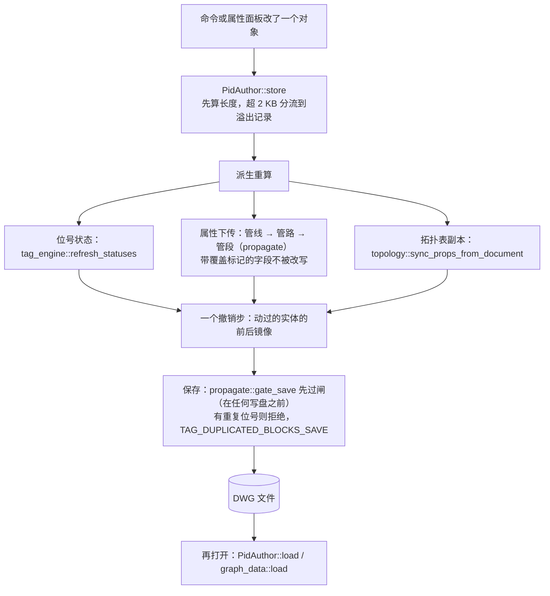

# SPEC：图内 P&ID 语义数据（`pid-author-store`）

> 状态：**已建成，按现状记录**。基线 `main @ 9b5327f96`。数据格式以代码为准，每项标了出处。
> 共用约定见 `01-shared-conventions.md`。

## 1. 目标

把一张 P&ID 图的语义（每个对象是什么类型、什么位号、有哪些属性、怎么连）存在 DWG 文件内部，保存、再打开、换一台机器打开都不丢。其余所有模块都从这里读：协同客户端读它来生成变更、写它来落地对端的变更；规则检查、材料清单、快照、项目索引只读不写。

验收状态：阶段 1 的契约 `VAL-SEM` 39/39、`VAL-DRAW` 31/31、`VAL-PIPE` 32/32 全部通过（现行计划 §1.1）。

## 2. 数据格式

一张图里有两层数据：挂在每个实体上的记录，和挂在模型空间块记录扩展字典里的图级记录。

### 2.1 实体记录：`PID_AUTHOR` 扩展数据

出处：`src/pid/persist.rs`（`PidAuthor`、`encode`、`decode`）。

每个 P&ID 实体带一条应用名为 `PID_AUTHOR` 的扩展数据记录。记录是一串字符串值，每个值形如 `键=值`，第一个 `=` 之前是键，之后原样是值。九个键：

| 键 | 含义 | 取值 | 何时写 | 例 |
|---|---|---|---|---|
| `type` | 类型编码 | 大写英文 | 总是 | `type=PUMP` |
| `tag` | 位号 | 文本，可空 | 总是 | `tag=P-1001` |
| `tag_source` | 位号来源 | `auto`（按规则生成）/ `manual`（手工输入） | 总是 | `tag_source=auto` |
| `tag_status` | 位号状态 | `ok` / `duplicated` | 总是 | `tag_status=ok` |
| `props` | 属性 | 一个 JSON 对象的文本，见 §2.2 | 总是（溢出时改写 `props_ref`，见 §2.3） | `props={"名称":"进料泵"}` |
| `ports` | 端口名 | 逗号分隔 | 非空时 | `ports=in1,out1` |
| `owner` | 宿主实体的句柄 | 大写十六进制 | 非空时 | `owner=1F` |
| `topology` | 拓扑角色 | `pipe_line` / `pipe_run` / `pipe_segment` / `fitting` / `signal_line` / `connector_in` / `connector_out` | 非空时 | `topology=pipe_run` |
| `connector_peer` | 页间连接符的对端 | 两种形式，见 §2.8 | 非空时 | `connector_peer=PID-1102:L-1001/pipe_in` |

约束：

- 键名逐字如此（`XDATA_KEYS`）。读的时候不认识的键跳过，一个认识的键都没有就当作没有记录。
- `PID_AUTHOR` 是独立的应用名，不与识别器用的 `PID_SEMANTICS` 混用——识别器清理自己的记录时会连带删掉。
- 写入一律经 `scene::view::dispatch::set_entity_xdata`：它注册应用名，并把同一应用名的记录整条替换而不是追加。
- 坐标不进这条记录的可变换类型（见共用约定 §7.2）。

类型编码的来源有两处：类型库的树（内置 `EQUIPMENT` → `VESSEL` → `TANK`，`EQUIPMENT` → `PUMP`）和树外的固定编码（`VALVE`、`VALVE_GATE`、`VALVE_ISOLATION`、`INSTRUMENT`、`PIPE_LINE`、`PIPE_RUN`、`PIPE_SEGMENT`、`SIGNAL_LINE`、`FITTING`）。树外编码的位号规则由 `src/pid/tag_rule.rs` 的 `default_tag_rule` 兜底。

### 2.2 `props`：属性与覆盖标记

出处：`src/pid/propagate.rs`（`split_props`、`join_props`、`OVERRIDES_KEY`）。

```json
{
  "管道等级": "A1A",
  "公称直径": "80",
  "流体介质": "工艺水",
  "__overrides": ["公称直径"]
}
```

- 键是属性名（中文数据要素名），值是字符串。空字符串的属性不写。
- `__overrides` 是字符串数组，列出「手工改过、不再跟随管线」的字段。它不是属性，数属性个数时要排除（`persist::props_len`）。只有管路（`PIPE_RUN`）会被打这个记号：别的对象不继承属性，打了只会把记录撑大（`src/app/commands/pidprops.rs`）。
- 五个管级属性（`LINE_FIELDS`）：`管道等级`、`公称直径`、`绝热等级`、`流体介质`、`管线类型`。

### 2.3 属性溢出：超过 2 KB 时

出处：`src/pid/persist.rs`（`XDATA_SOFT_LIMIT`、`encoded_len`、`props_ref_key`、`store_props_record`）。

DWG 的扩展数据有长度硬上限，超了整条记录在写文件时被静默丢弃。所以写之前先算长度：每个值的字节数加 1，合计超过 **2048** 就把 `props` 挪出去。

- 实体记录里去掉 `props=…`，改写一个 `props_ref=<记录名>`。
- `<记录名>` 是 `PID_AUTHOR_ENTITY_` 加实体句柄的显示文本（大写十六进制）。
- 这条 XRecord 挂在模型空间块记录的扩展字典里，条目依次是：

| 序 | 组码 | 内容 |
|---|---|---|
| 0 | 1 | `kind=entity_props` |
| 1 | 1 | `handle=<句柄的十进制数值>` |
| 2… | 310 | `props` JSON 的字节，每片不超过 255 字节 |

读的时候 `PidAuthor::load` 顺着 `props_ref` 把各片拼回完整的 `props`。实体没了而溢出记录还在的，由 `graph_data::collect_orphan_props` 清理。

一个要紧的限制：`PidAuthor::from_entity` 从一条实体快照读，不碰图纸，所以溢出的那一侧读回来的 `props` 是空串。空串不等于「没有属性」，比较前要先问 `PidAuthor::props_are_inline`。协同客户端的两项收口之一（大属性符号）就出在这里，见 `SPEC-collab-client.md`。

### 2.4 图级记录：四个 XRecord

出处：`src/pid/graph_data.rs`（`store`、`load`、`keys`）。

| 记录名 | 内容 | 谁在写 |
|---|---|---|
| `PID_AUTHOR_TYPE_LIB` | 类型库，见 §2.5 | `TypeLib::store` |
| `PID_AUTHOR_TOPOLOGY` | 拓扑表，见 §2.6 | `src/pid/topology.rs` |
| `PID_AUTHOR_TAG_RULES` | 位号规则表 | 目前只有测试与往返校验在写；产品流程里位号规则跟着类型库走 |
| `PID_AUTHOR_CONNECTORS` | 连接符表 | 同上；产品流程里连接符记在拓扑表的 `connectors` 里 |

四个记录用同一种布局，条目都是组码 1 的字符串：

| 序 | 内容 |
|---|---|
| 0 | `kind=graph_data` |
| 1 | `key=<记录名>` |
| 2… | 每条数据一个 JSON 对象的文本；超过 2000 字节的切成 `part=<序号>:<片段>` 若干条 |

整个记录一次重写，不逐条增删；表为空时删掉记录，不留空记录。`graph_data::store(doc, key, items)` 的 `key` 是任意字符串，所以阶段 3 的主数据记录可以用同一套布局而不必改 `keys()` 返回的这四个。

### 2.5 类型库 JSON

出处：`src/pid/type_lib.rs`（`TypeNode`、`DataElement`、`PropertyGroup`）、`src/pid/tag_rule.rs`（`TagRule`）、内置库 `assets/pid-types.json`。

```json
{
  "types": [
    {
      "type_code": "EQUIPMENT",
      "label": "设备",
      "parent": null,
      "groups": [
        { "name": "基本属性", "fields": ["位号", "名称", "描述"] },
        { "name": "工艺参数", "fields": ["设计压力", "设计温度", "操作压力"] }
      ],
      "elements": [],
      "tag_rule": {
        "name": "设备位号", "auto_code": true, "pattern": "P-{序号}",
        "start": 1001, "step": 1, "suffix_increment": false,
        "level": null, "join": null, "unique": true, "pad": 0
      },
      "color_rule": "红"
    },
    { "type_code": "PUMP", "label": "泵", "parent": "EQUIPMENT",
      "groups": [ { "name": "泵参数", "fields": ["流量", "扬程"] } ] }
  ]
}
```

| 字段 | 说明 |
|---|---|
| `type_code` | 类型编码，全库唯一 |
| `parent` | 父类型；只有唯一的根为 `null` |
| `groups[].fields` | 该类型自己的属性名，顺序即显示顺序；同一类型内一个字段不能落在两个分组里 |
| `elements[]` | 数据要素 `{code, label, value_type, options}`；`value_type` 取 `文本` / `数值` / `枚举` / `引用` / `布尔` |
| `tag_rule` | 位号规则；`null` 表示本类型不覆盖，沿父链取最近的一条 |
| `tag_rule.pattern` | 模板，`{序号}` 与 `{后缀}` 是占位符；`{仪表功能}` 这样的占位符取同名属性 |
| `tag_rule.level` | `当前类型依次递增`（默认）/ `父类型递增` |
| `tag_rule.unique` | 是否做同类型唯一校验 |
| `color_rule` | 颜色规则；`null` 同样沿父链继承 |

类型库目前**没有「必填」标志**。规则检查要用的必填字段清单放在哪里，由 `SPEC-pid-drc.md` 决定。

### 2.6 拓扑表 JSON

出处：`src/pid/topology.rs`（`TopologyTable` 及各 `*Record`）。整张表是 `PID_AUTHOR_TOPOLOGY` 下的一个 JSON 对象。下面的例子按字段定义手写，不是取自真实图纸。

```json
{
  "version": 1,
  "pipe_lines": [
    { "tag": "L-1001", "handle": "2A0",
      "props": { "管道等级": "A1A", "公称直径": "80" },
      "runs": ["L-1001-01"], "next_run_ordinal": 2 }
  ],
  "pipe_runs": [
    { "tag": "L-1001-01", "handle": "2A4", "line_tag": "L-1001",
      "props": { "管道等级": "A1A", "公称直径": "50" },
      "overrides": ["公称直径"],
      "segments": ["2A8", "2B4"] }
  ],
  "pipe_segments": [
    { "handle": "2A8", "run_tag": "L-1001-01",
      "start": { "point": [0.0, 0.0], "peer": null },
      "end":   { "point": [40.0, 0.0], "peer": "2B0:连接点1" } }
  ],
  "fittings": [
    { "handle": "2B0", "run_tag": "L-1001-01", "fitting_type": "gate_valve",
      "tag": "V-1001",
      "ports": { "连接点1": "2A8", "连接点2": "2B4" } }
  ],
  "connectors": [
    { "handle": "2C0", "kind": "pipe_out", "line_tag": "L-1001",
      "peer_drawing": "PID-1102",
      "upstream": "L-1001", "downstream": "L-2001" }
  ]
}
```

| 记录 | 字段 | 说明 |
|---|---|---|
| 管线 | `tag`、`handle`、`props`、`runs`、`next_run_ordinal` | `runs` 是管路位号列表；`next_run_ordinal` 是下一条管路的后缀序号 |
| 管路 | `tag`、`handle`、`line_tag`、`props`、`overrides`、`segments` | 位号 = 管线位号 + 两位后缀；`segments` 是管段句柄列表 |
| 管段 | `handle`、`run_tag`、`start`、`end` | 没有位号；两端各有 `point`（`[x, y]`）与 `peer`（所接管件的 `<句柄>:<端口名>`，没接为 `null`） |
| 管件 | `handle`、`run_tag`、`fitting_type`、`tag`、`ports` | `fitting_type` 是符号 id（如 `gate_valve`），打断符是 `break`；`tag` 只有自己编号的管件才有，没有就不写这个键；`ports` 是端口名到管段句柄的映射（没接为 `null`），阀门的两个端口叫 `连接点1`、`连接点2`；打断符不绑任何端口，它是隔断不是导通 |
| 连接符 | `handle`、`kind`、`line_tag`、`peer`、`peer_drawing`、`upstream`、`downstream` | `kind` 取 `pipe_in` / `pipe_out` / `signal_in` / `signal_out`；同一条线在一张图上至多一个流入连接符；`upstream` / `downstream` 是流出侧、流入侧的线号；`peer` 与 `peer_drawing` 见 §2.8；四个可选键没有值时不写 |

表里的句柄都是大写十六进制文本（`topology::handle_text`），与 REST 的 `handle` 字段同一种写法。

表里的 `props` 与 `overrides` 是副本，实体记录才是准的；`topology::sync_props_from_document` 让副本跟上。

拓扑错误码：`DUPLICATE_INFLOW_CONNECTOR`、`CONNECTOR_KIND_MISMATCH`、`CONNECTOR_NO_LINE`、`CONNECTOR_PEER_INVALID`。

### 2.7 位号状态

出处：`src/pid/tag_engine.rs`。

- 同一张图里同类型下两个实例同位号，两个的 `tag_status` 都是 `duplicated`，图面上位号显示为 `？`（`DUPLICATED_DISPLAY`），`tag` 里存的仍是原文。
- 错误码：`TAG_DUPLICATED`、`TAG_DUPLICATED_BLOCKS_SAVE`、`TAG_TEMPLATE_FIELD_MISSING`、`TAG_RULE_MISSING`、`TAG_TYPE_UNKNOWN`、`TAG_NOT_PID_INSTANCE`。

### 2.8 页间连接符的对端：三种状态、两种写法

出处：`src/app/commands/pidconnector.rs`（`pair_connectors`）、`src/app/collab/connectors.rs`（`write_remote_connector`）、`src/pid/topology.rs`（`peer_text`、`parse_peer`）。

连接符没有位号。它的对端记在两处：实体记录的 `connector_peer`，和拓扑表 `connectors[]` 的 `peer` / `peer_drawing`。按配对是谁做的，写法不同：

| 状态 | `connector_peer`（实体） | `peer`（拓扑表） | `peer_drawing`（拓扑表） |
|---|---|---|---|
| 建时指了目标图、还没配上（`PIDCONNECTOR <种类> <图号>`，参数不带冒号） | 不写 | 不写 | 目标图的图号，如 `PID-1102` |
| **协同服务器配的对**（`pair_connector`） | `<图号>:<对端线号>/<对端连接符种类>`，如 `PID-1102:L-2001/pipe_in` | 不写 | 对端图号 |
| **同一个桌面进程里两张打开的图配的对**（`PIDCONNECTOR <种类> <文档编号>:<句柄>`、`PIDPAIR`，参数带冒号） | `<文档编号>:<对端句柄>`，如 `2:1F` | 同左 | 文档编号的文本，如 `2` |

- 「图号」是协同服务器对一张图的标识（`drawing_id`），跨机器、跨会话稳定。
- 「文档编号」是桌面进程给打开的标签页发的号（`GET /api/v1/documents` 的 `document_id`），**只在那一次运行里有意义**，进程重启后不再指向任何东西；句柄也只在对端那一个文件里有意义。所以第三种写法不能拿来做离线的跨图分析，离线能靠得住的只有 `upstream` / `downstream`（两侧线号）。这一点对 `pid-project-index` 是硬约束，见那份规格。
- 两种配对都会把 `upstream` / `downstream` 写成「流出侧线号」「流入侧线号」，流出侧宿主线的属性也都会到流入侧：管道传五个管级属性，信号线只传 `起点仪表`、`终点仪表`。同进程配对由桌面端当场复制；服务器配对由服务器在流入侧那张图上提交普通的属性写入，客户端照常落地（见 `SPEC-collab-server.md`）。
- 配对的条件：一入一出，且同族（都是管道或都是信号线）；否则 `CONNECTOR_PEER_INVALID`。

## 3. 数据怎么传



- **写**：所有写入都经 `PidAuthor::store` 与 `graph_data::store`，没有别的入口。手工改管路的管级属性走 `propagate::set_prop_manual`，它同时打覆盖标记。
- **下传**：管路创建时全量继承管线（`inherit_on_create`）；管线改值时只重写没有覆盖标记的字段（`propagate_line_to_runs`）；管段没有覆盖标记，始终取所属管路的当前值（`propagate_run_to_segments`）。设备位号变更后重算管口前缀的函数（`recompute_nozzle_prefixes`，`src/pid/propagate.rs:352`）已经写好并有单元测试，但目前没有调用方，所以改设备位号时不会触发它。
- **读**：需要完整属性的用 `PidAuthor::load(doc, handle)`；只有实体快照、没有图纸的用 `PidAuthor::from_entity`，并检查 `props_are_inline`。
- **对外读**：桌面端 REST `GET /api/v1/entities/{handle}/xdata/PID_AUTHOR` 读一个实体的记录，`GET /api/v1/records` 读图级记录。
- **文件往返**：存成 DWG 再打开，九个键、溢出记录、四个图级记录逐项不变（`src/pid/dwg_roundtrip.rs`）。

## 4. 对外接口（别的模块调这些）

| 要做什么 | 调什么 |
|---|---|
| 读写一个实体的语义 | `PidAuthor::load` / `store` / `from_entity` / `props_are_inline` |
| 拆合属性与覆盖标记 | `propagate::split_props` / `join_props` / `props_of` / `overrides_of` |
| 读写图级记录 | `graph_data::load` / `store` |
| 读类型库 | `TypeLib::load(doc)`，没有则 `TypeLib::embedded()`；`resolve_tag_rule` / `ancestors` / `children` |
| 读写拓扑表 | `TopologyTable::load(doc)` / `store`；查询用 `line_by_tag`、`runs_of`、`segment_handles_of`、`segment_ends_of`、`connectors_of` 等 |
| 重算位号状态 | `tag_engine::refresh_statuses` / `check_unique` |
| 保存前的闸 | `propagate::gate_save`，调用点在 `src/io/mod.rs` 的保存路径上（`save_owned_as_version_inner`、`save_to_bytes`） |

## 5. 成功标准（已满足，改动时不得破坏）

- 九个键、溢出记录、四个图级记录经 DWG 往返后逐项相等。
- 任何一条实体记录的估算长度不超过 2048；超过的属性一定在溢出记录里，且能完整读回。
- 移动、旋转、缩放实体不改变记录里的任何值。
- 2,000 个实例批量生成位号不超过 3000 ms（`src/pid/perf_budget.rs`）。

## 6. 不在范围与已知限制

- 位号唯一性只在**一张图内**判定。跨图重号由 `pid-project-index` 与规则检查负责。
- 需求文档里的位号冷却期（删除后 30 天内不得复用，`REQ-DATA-001`）没有实现，这次也不做：它需要一份跨图、跨时间的登记簿，属于平台服务端的范围。
- 类型库内置只有四个设备类型，阀门、仪表、管线不在类型树里；扩充类型库是阶段 4（图例标准与符号编辑器）的事。
- 同进程配对的连接符，对端记的是文档编号加句柄，重启后失效（§2.8）。

## 7. 待决问题

无。本模块按现状记录；阶段 3 对它的新增要求（主数据记录、必填字段）分别写在 `SPEC-pid-master-data.md` 与 `SPEC-pid-drc.md`。
