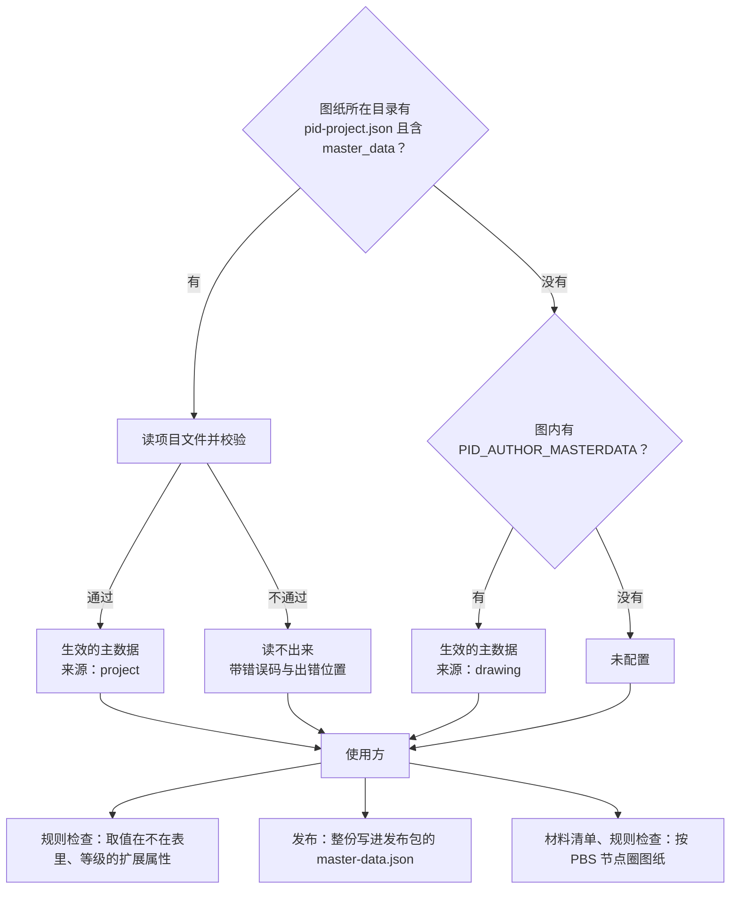

# SPEC：项目主数据（`pid-master-data`）

> 状态：**待建；规格已确认**（2026-11-16，§9 的待决问题都按「建议」定）。基线 `main @ 9b5327f96`。
> 依据：已批准计划 T3.1；需求 `REQ-SYM-013`–`016`（`docs/pid-platform/requirements/30-symbol-library-and-project-settings.md`）。
> 共用约定见 `01-shared-conventions.md`。

## 1. 目标

给一个项目一份统一的取值表：有哪些公称直径、管道等级、绝热等级、流体介质可用，装置怎么分区，用的是哪套图例标准。有了它：

1. 规则检查能判断「这条管线的管道等级在不在项目里」，也能取到等级的扩展属性（材质、最大公称压力）来比较。
2. 发布包里能带一份主数据快照，说明这次发布是按哪份取值表校验的。
3. 材料清单和规则检查能按装置分区（PBS 节点）圈定范围。

本模块只管主数据本身：格式、存放、读取、校验、导入导出。谁来用，见 `SPEC-pid-drc.md`、`SPEC-pid-bom.md`、`SPEC-pid-publish.md`。

## 2. 现状

- 没有主数据。`公称直径`、`管道等级`、`绝热等级`、`流体介质` 是管线上的属性名（`src/pid/propagate.rs` 的 `LINE_FIELDS`），取值是自由文本，填什么都收。
- 权限模型里已经有「主数据维护」这个操作（`crates/ocs_collab/src/permission.rs` 的 `Operation::MaintainMasterData`），桌面端还没有地方用到。
- 图例标准记在符号库上（`SymbolLibrary::current_standard()`，内置值是「内置示例标准」），不随图保存；图上已有符号实例时不许切换（`LEGEND_STANDARD_LOCKED`）。
- 图级记录的读写是现成的：`graph_data::store(doc, key, items)` 的 `key` 可以是任意字符串（`SPEC-pid-author-store.md` §2.4）。
- 读 Excel 的库 `calamine` 在依赖里，本期不用（见 §8）。

## 3. 数据格式

### 3.1 主数据对象

下面的 JSON 是格式定义，数值是举例。

```json
{
  "version": 1,
  "revision": 3,
  "updated_at": 1794800000,
  "legend_standard": "内置示例标准",
  "nominal_diameters": {
    "unit": "mm",
    "items": [
      { "dn": 15, "label": "DN15", "outer_diameter": null, "hidden": false },
      { "dn": 50, "label": "DN50", "outer_diameter": 60.3, "hidden": false },
      { "dn": 65, "label": "DN65", "outer_diameter": null, "hidden": true }
    ]
  },
  "pipe_classes": [
    {
      "name": "A1A",
      "attrs": {
        "压力等级": "PN16",
        "最大公称压力": "16",
        "材质": "碳钢",
        "公称直径下限": "15",
        "公称直径上限": "600"
      }
    }
  ],
  "insulation_classes": [
    { "name": "H", "attrs": { "说明": "保温" } }
  ],
  "fluid_codes": [
    { "name": "工艺水", "attrs": { "代号": "PW" } }
  ],
  "pbs": [
    { "id": "1001", "label": "常压蒸馏装置", "parent": null },
    { "id": "1001-01", "label": "原料罐区", "parent": "1001" }
  ]
}
```

| 字段 | 类型 | 约束 |
|---|---|---|
| `version` | 整数 | 格式版本，现为 1。读到更高的报 `MASTERDATA_VERSION_UNSUPPORTED` |
| `revision` | 整数 | 每次写入加 1；发布清单里记它 |
| `updated_at` | 整数 | 最近一次写入的时间，Unix 秒 |
| `legend_standard` | 文本或 `null` | 项目锁定的图例标准名。`null` 表示没有锁定 |
| `nominal_diameters.unit` | 文本 | 本期只有 `mm` |
| `nominal_diameters.items[].dn` | 整数 | 公称直径，表内唯一 |
| `…items[].label` | 文本 | 显示标签，≤ 16 字符 |
| `…items[].outer_diameter` | 数或 `null` | 外径，可不填 |
| `…items[].hidden` | 布尔 | 为真表示本项目不许用这个直径 |
| `pipe_classes[].name` | 文本 | 管道等级名称，非空，≤ 64 字符，表内唯一 |
| `pipe_classes[].attrs` | 对象 | 扩展属性：属性名 → 文本。属性名随项目自己定 |
| `insulation_classes[]`、`fluid_codes[]` | 同上 | 与管道等级同一种结构：`name` + `attrs` |
| `pbs[].id` | 文本 | 节点号，非空，唯一 |
| `pbs[].label` | 文本 | 节点名称 |
| `pbs[].parent` | 文本或 `null` | 上级节点号；`null` 是根。允许多个根，不许成环，不许指向不存在的节点 |

内置规则会读的扩展属性名（别的名字随便起）：

| 表 | 属性名 | 谁在读 |
|---|---|---|
| 管道等级 | `最大公称压力`（数值文本，如 `16`） | 规则 `DR-007` 阀门压力等级高于管道等级 |
| 管道等级 | `材质` | 规则 `DR-021` 介质与管道等级材质不兼容 |

**默认内容**（`PIDMASTERDATA INIT` 建出来的）：公称直径序列 15、20、25、32、40、50、65、80、100、125、150、200、250、300、350、400、450、500、600（共 19 个，标签 `DN<值>`，都不隐藏，外径不填）；`legend_standard` 取符号库当前的标准名；其余三张表和 PBS 为空。

### 3.2 存在哪里，哪一份算数

| 位置 | 是什么 | 何时用 |
|---|---|---|
| 项目文件 `pid-project.json` | 放在图纸所在的目录里，同目录的图纸共用 | 文件存在就用它 |
| 图内记录 `PID_AUTHOR_MASTERDATA` | 存在 DWG 里的图级记录 | 目录里没有项目文件时用它 |
| 都没有 | — | 主数据「未配置」 |

规则只有一条：**项目文件优先；没有项目文件用图内记录；都没有就是未配置。**

- 两处都有时，图内那份不参与任何判断，`PIDMASTERDATA STATUS` 会说明。
- 项目文件存在但读不出来（JSON 坏了、校验不过）时，**不**退回去用图内那份——那样会把问题藏起来——而是报错，主数据按「读不出来」处理。
- 没保存过的图没有目录，只能用图内记录。图纸所在目录用现有的 `crate::io::drawing_dir(doc)` 取。

### 3.3 项目文件 `pid-project.json`

```json
{
  "version": 1,
  "project": { "id": "CDU-2026", "name": "常压蒸馏改造" },
  "master_data": { "version": 1, "revision": 3, "updated_at": 1794800000 },
  "drawings": [
    { "file": "PID-1101.dwg", "drawing_id": "PID-1101", "pbs": "1001-01" }
  ]
}
```

| 键 | 必填 | 说明 |
|---|---|---|
| `version` | 是 | 文件格式版本，现为 1 |
| `project.id`、`project.name` | 否 | 项目号与名称，写进发布清单 |
| `master_data` | 否 | §3.1 的整个对象（上例省略了各张表）。没有这个键等于项目文件里没有主数据，按「没有项目文件」往下找图内记录 |
| `drawings[]` | 否 | 给图纸补两样信息：`drawing_id`（图号；不写就取文件名去掉扩展名）和 `pbs`（所属 PBS 节点号）。目录里没列出的 `.dwg` 照样算项目图纸，见 `SPEC-pid-project-index.md` |

这个文件是给人直接改的：UTF-8 不带 BOM，缩进 2 格，键按上面的顺序。程序写回时保留它不认识的顶层键，不会把人手加的内容写丢。

### 3.4 图内记录 `PID_AUTHOR_MASTERDATA`

用现有的图级记录布局，只有一条数据：`graph_data::store(doc, "PID_AUTHOR_MASTERDATA", &[主数据对象])`。超过 2000 字节由那套布局自动切片。

不改 `graph_data::keys()`：那个函数返回的四个键是已建成部分的清单，有测试照着它跑。新记录名定义在本模块，往返测试也写在本模块。

### 3.5 属性值怎么与主数据比

- 属性值是文本，比之前去掉首尾空白。
- 管道等级、绝热等级、流体介质：与 `name` 逐字相等才算在表里，区分大小写。
- 公称直径：去掉开头的 `DN`（不分大小写）和空白后按整数解析，与 `dn` 比。`DN80`、`dn 80`、`80` 都算 80。解析不出来，或者那个直径 `hidden` 为真，都算不在表里。
- 主数据未配置或读不出来时，「在不在表里」的结论是「不知道」，不是「不在」。规则检查据此不报这类问题，只给一条说明（见 `SPEC-pid-drc.md`）。

属性里存的是文本的副本，不是对主数据条目的引用。所以改名、删除一条主数据不会动已有对象的取值，这正是需求要的（`REQ-SYM-014` 第 3 条：「修改与删除只对新建管线生效」）；删掉以后，还在用旧值的对象会被规则检查报出来。

### 3.6 错误码

| 码 | 何时 | HTTP |
|---|---|---|
| `MASTERDATA_SCHEMA_ERROR` | JSON 结构不对。说明里带出错位置，如 `pipe_classes[2].name` | 400 |
| `REQUIRED_FIELD_MISSING` | 名称为空（需求起的名字） | 400 |
| `MASTERDATA_DUPLICATE` | 同一张表里名称重复，或 `dn` 重复，或 PBS 节点号重复 | 409 |
| `MASTERDATA_PBS_INVALID` | PBS 的 `parent` 指向不存在的节点，或成环 | 400 |
| `MASTERDATA_VERSION_UNSUPPORTED` | `version` 比程序认识的高 | 400 |
| `MASTERDATA_CONFLICT` | 写项目文件时发现磁盘上的 `revision` 已经变了（有人先改过） | 409 |
| `MASTERDATA_EXISTS` | `INIT` 时目标位置已经有主数据；或导出的目标文件已存在 | 409 |
| `MASTERDATA_NOT_CONFIGURED` | 要导出或嵌入，但主数据未配置 | 409 |

## 4. 数据怎么传



- **读**：每次要用时解析一次（`master_data::resolve`）。文件很小，不做常驻缓存；这样人在外面改了项目文件，下一次检查就能看到。
- **写项目文件**：先读磁盘上的当前内容 → 比 `revision`，与调用方拿到的不等就报 `MASTERDATA_CONFLICT` → `revision` 加 1，`updated_at` 取当前时间 → 写到临时文件 → 改名覆盖。失败不留半成品，原文件不变。
- **写图内记录**：这是一次图纸修改，与 `PIDPIPE` 写拓扑表走同一条路：先 `push_undo_snapshot`，再 `graph_data::store`。所以能撤销，图纸变为「已修改」，随下一次保存落盘。
- **协同时不传**：协同协议只传对象级的变更，图级记录不在报文里（`SPEC-collab-protocol.md`）。一个人往图里写了主数据，房间里的其他人收不到。见待决问题 M2。

## 5. 对外接口

### 5.1 模块接口（`src/pid/master_data.rs`）

```rust
pub const PID_AUTHOR_MASTERDATA: &str = "PID_AUTHOR_MASTERDATA";
pub const PROJECT_FILE: &str = "pid-project.json";

pub enum Source { Project(PathBuf), Drawing }
pub enum Resolved {
    Configured { data: MasterData, source: Source },
    Unreadable { source: Source, error: MasterDataError },
    NotConfigured,
}

/// 按 §3.2 的规则找出生效的那一份。
pub fn resolve(doc: &Document, drawing_dir: Option<&Path>) -> Resolved;
/// §3.1 的默认内容。
pub fn defaults(legend_standard: &str) -> MasterData;
/// 校验一个 JSON 值；错误里带出错位置。
pub fn validate(value: &serde_json::Value) -> Result<MasterData, MasterDataError>;
pub fn store_in_drawing(doc: &mut Document, data: &MasterData);
pub fn write_project_file(
    dir: &Path, data: &MasterData, expected_revision: Option<u64>,
) -> Result<(), MasterDataError>;

impl MasterData {
    pub fn has_diameter(&self, value: &str) -> bool;            // §3.5 的比法
    pub fn entry(&self, table: Table, name: &str) -> Option<&Entry>;
    pub fn names(&self, table: Table) -> Vec<&str>;             // 给以后的下拉候选用
    pub fn pbs_subtree(&self, id: &str) -> Vec<&str>;           // 节点自身加所有下级
}
```

`Table` 取 `PipeClass` / `InsulationClass` / `FluidCode`。`MasterDataError` 每个变体有 `code()`，返回 §3.6 的码。

### 5.2 命令

| 命令 | 做什么 | 只读会话里 |
|---|---|---|
| `PIDMASTERDATA` 或 `PIDMASTERDATA STATUS` | 说明生效的是哪一份、修订号、各表行数；读不出来时说明错在哪里；两处都有时说明图内那份没在用 | 允许 |
| `PIDMASTERDATA INIT [PROJECT\|DRAWING]` | 建一份默认主数据。不带参数时：图纸已保存就建在项目文件里，否则建在图内。目标位置已有主数据则拒绝（`MASTERDATA_EXISTS`） | 拒绝 |
| `PIDMASTERDATA EXPORT <文件>` | 把生效的主数据写成一个 JSON 文件（§3.1 的格式）。目标已存在则拒绝 | 允许 |
| `PIDMASTERDATA IMPORT <文件> [PROJECT\|DRAWING]` | 校验后整份替换。目标的默认值同 `INIT` | 拒绝 |
| `PIDMASTERDATA EMBED` | 把生效的主数据抄进图内记录。单独把一张图发给别人前用 | 拒绝 |

只读会话的处理照 `PIDLEGEND` 的写法：命令名进 `READONLY_ALLOWED`，`readonly_refuses_command`（`src/app/collab/apply.rs`）里加一条——只有不带子命令、`STATUS`、`EXPORT` 放行。

本期没有逐行增删改的命令，也没有编辑界面：改主数据就是改项目文件，或者导出、改、再导入。见待决问题 M1。

### 5.3 自动化操作与 REST

| 操作 | REST | 读写 | 请求 | 应答 |
|---|---|---|---|---|
| `pid_masterdata` | `GET /api/v1/pid/master-data` | 读 | 可选 `usage`（布尔） | 见下 |
| `pid_masterdata_set` | `PUT /api/v1/pid/master-data` | 写 | `target`（`project` / `drawing`，可省）、`master_data`（整个对象）、`expected_revision`（可省；给了就比） | `{"ok":true,"source":"project","revision":4}` |

读的应答：

```json
{
  "ok": true,
  "state": "configured",
  "source": "project",
  "path": "D:/proj/cdu/pid-project.json",
  "shadowed_in_drawing": false,
  "master_data": { "version": 1, "revision": 3 },
  "usage": {
    "pipe_classes": { "A1A": 12 },
    "insulation_classes": {},
    "fluid_codes": { "工艺水": 9 },
    "nominal_diameters": { "80": 7 }
  }
}
```

- `state` 取 `configured` / `unreadable` / `not_configured`。`unreadable` 时应答仍是 `ok: true`（读状态这件事成功了），另带 `error_code` 与 `error`，没有 `master_data`。
- `shadowed_in_drawing` 为真表示图里也有一份但没在用。
- `usage` 是需求里的「使用中管线数 / 使用中对象数」：当前图上取值等于该条目的对象个数，请求带 `usage: true` 时才算。表里没有的取值不列。

MCP：`pid_masterdata` 进 `READ_OPS`，`pid_masterdata_set` 进 `EXECUTE_OPS`，同步更新 `TOOL_SCHEMA_DIGEST`（共用约定 §7.6）。

### 5.4 权限

- 没连协同时，桌面端不判权限。
- 连了协同且会话只读时，写主数据的命令和操作被拒，错误码与其他被拒的写操作相同（`COLLAB_READONLY` 或 `PERM_DENIED_*`，见 `SPEC-collab-client.md` §4.7）。读不受限。
- 会话可写时，本期不按「主数据维护」这个操作单独判权。见待决问题 M3。

## 6. 成功标准

1. 一份主数据写进项目文件再读回，逐项相等；写进图内记录、存成 DWG、再打开，逐项相等。
2. 两处都有时取项目文件；项目文件坏了时报错，不悄悄换成图内那份。
3. 校验失败时错误里有错误码和出错位置。
4. 写项目文件是原子的：中途失败，原文件逐字节不变，目录里不留临时文件。
5. 同样的主数据写出的项目文件逐字节相同（`updated_at` 相同的前提下）。
6. 写图内记录可以撤销，撤销后图内没有这条记录。
7. 只读会话里三个写命令被拒，状态与导出可用。
8. 2,000 行管道等级的主数据，解析加校验不超过 50 ms。

## 7. 测试

先写会失败的测试，再实现（共用约定 §5）。

| 层 | 测什么 |
|---|---|
| 单元（`src/pid/master_data.rs`） | 默认内容有 19 个直径；往返（JSON、图内记录、DWG 文件）；§3.6 每个错误码各一个反例，断言错误码与出错位置；§3.5 的比法（`DN80`、`dn 80`、`80`、`八十`、隐藏的直径）；PBS 子树；§3.2 的四种情形（只有项目文件、只有图内、两处都有、项目文件坏了） |
| 单元（写文件） | `revision` 不等时报 `MASTERDATA_CONFLICT` 且文件不变；写回后不认识的顶层键还在；目标目录不可写时不留临时文件 |
| 命令与操作 | `INIT` → `STATUS` → `EXPORT` → 改文件 → `IMPORT` 的一条龙；`pid_masterdata` 的三种 `state`；`usage` 计数；只读会话里的拒绝与放行 |
| 性能预算 | 2,000 行解析加校验 ≤ 50 ms（`#[ignore]`，写法照 `src/pid/perf_budget.rs`） |

要动的文件：新建 `src/pid/master_data.rs`、`src/app/commands/pidmasterdata.rs`；改 `src/pid/mod.rs`、`src/app/commands/mod.rs`、`src/app/command_driver/utilities.rs`（整行名单）、`src/app/collab/apply.rs`、`src/app/control/mod.rs`、`src/rest.rs`、`src/rest_openapi.json`、`src/mcp.rs`。

## 8. 不在范围

- 主数据的编辑界面（设计稿「主数据管理」屏）、逐行增删改命令、从 Excel 导入。
- 画图时属性输入框从主数据取下拉候选值。接口 `names()` 留好了，界面不接。
- 英制直径序列（需求里的「单位设置」只做 `mm`）。
- 「修改条目同步更新已有对象的取值」（设计稿里的引用影响）：属性存的是文本副本，与需求一致，不做同步。
- 经协同服务器分发主数据。

## 9. 待决问题

> **2026-11-16 已定**：本节各条都按「建议」一栏执行。汇总见 `plan.md` §3，对应的任务见 `todo.md`。

| # | 问题 | 建议 |
|---|---|---|
| M1 | **主数据要不要编辑界面。** 计划的面板三个页签（规则检查、材料清单、快照与发布）里没有主数据，本规格按「改项目文件加导入导出」写 | 本期不做界面。主数据改得少，项目文件是给人直接改的；界面和属性下拉放到面板任务之后，作为可选任务 |
| M2 | **协同时主数据怎么共用。** 图内记录不进协同报文；各人的项目文件在各自的目录里 | 本期靠项目文件，各人自己保证一致；发布包带主数据快照和修订号，可以对账。经服务器分发写进阶段 4 纲要 |
| M3 | **「主数据维护」要不要按角色判权。** 客户端现在只知道会话可写不可写，不知道角色有哪些操作权 | 本期只按会话只读与否拦。按操作判权要给 `welcome` 加一个可选键把操作权清单带下来，放到后续 |
| M4 | **默认内容预置多少。** 计划举了 `A1A`、`B1B` 作例子 | 只预置公称直径序列；管道等级、绝热等级、流体介质留空。预置的示例等级会被当成真的用 |

## 10. 需求对照

| 需求 | 本期 | 说明 |
|---|---|---|
| `REQ-SYM-013` 公称直径序列维护 | 部分 | 有序列、显示标签、外径、隐藏。「单位设置」只有 `mm`；没有编辑界面；「隐藏后不进下拉」「标签只对新建对象生效」要等属性输入接上主数据 |
| `REQ-SYM-014` 管道等级维护 | 部分 | 有名称加扩展属性、名称必填（`REQUIRED_FIELD_MISSING`）与唯一（409）、使用中管线数（`usage`）、「改删不影响已有管线」。没有编辑界面，没有下拉取值 |
| `REQ-SYM-015` 绝热等级维护 | 部分 | 同上 |
| `REQ-SYM-016` 流体介质维护 | 部分 | 同上 |
| 计划 T3.1「图例标准锁定标识」 | 覆盖 | `legend_standard` |
| 计划 T3.1「公称直径标准表 DN15–DN600」 | 覆盖 | 默认内容 |
| 计划 T3.1「管道等级表及允许公称直径范围」 | 覆盖 | 范围用扩展属性 `公称直径下限` / `公称直径上限` 表示；按它检查是一条自定义规则，写法见 `SPEC-pid-drc.md` |
| 计划 T3.1「绝热等级表、流体介质代码表、PBS 节点树」 | 覆盖 | §3.1 |
| 计划 T3.1「单图存 XRecord，项目目录可选共享 `pid-project.json`」 | 覆盖 | §3.2 |
