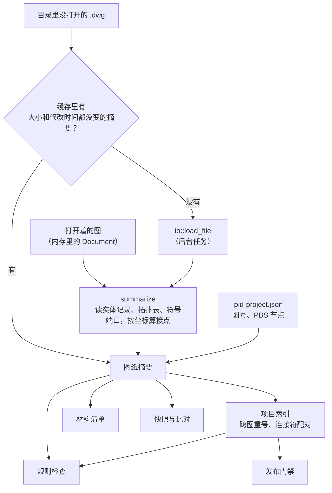

# SPEC：图纸摘要与项目索引（`pid-project-index`）

> 状态：**待建；规格已确认**（2026-11-16，§9 的待决问题都按「建议」定）。基线 `main @ 9b5327f96`。
> 依据：已批准计划 T3.1；需求 `REQ-DATA-001`、`002`、`008`（`docs/pid-platform/requirements/50-data-and-rule-engine.md`）。
> 共用约定见 `01-shared-conventions.md`；图内数据见 `SPEC-pid-author-store.md`。

## 1. 目标

两件事：

1. **图纸摘要**：把一张图读成一份不依赖句柄、不依赖界面的数据——有哪些对象、各有什么属性、每根线的每个端点接到了什么。规则检查、材料清单、快照、发布都只吃摘要，不各自去翻图。
2. **项目索引**：把同一个目录下所有图纸的摘要合起来，回答两个跨图问题：哪些位号在不同图上重复了；页间连接符谁和谁是一对、哪些还悬着。并能从结果打开对应的图、定位到对象。

全部在本机完成，不需要协同服务器。

## 2. 现状

- 位号唯一性只在一张图内判定（`src/pid/tag_engine.rs`）。跨图重号没有任何检查。
- 一条管线在图上有两种线（`src/app/commands/pidpipe.rs`）：
  - `PIDPIPE` 不带 `run` 画的是**管线自己的线**：每段一个线实体，都带这条管线的位号（类型 `PIPE_LINE`，角色 `pipe_line`），不进拓扑表的管段列表。
  - `PIDPIPE run` 画的是**管路**：一个点实体承载管路位号，后面每段一个管段实体（类型 `PIPE_SEGMENT`，没有位号），记在拓扑表里。
  - 阀门、管件只能插在管段上（`PIDFITTING`）；页间连接符放在管线自己的线或信号线上（`ConnectorKind::host_role`）。
- 线的端点接到什么，图里只记了一种：管段接到管件。接到设备端口、接到另一根线、接到连接符，都不留记录：`PIDPIPE run` 画出的管段两端一律记成「未连接」（第 511 行），只有插管件时才把两侧端点指向管件的端口（第 703、710 行）。
- 不单独编号的管件（类型 `FITTING`，含打断符），实体记录里的位号写的是**所在管路的位号**；阀门（类型 `VALVE`）有自己的位号。
- 页间连接符的对端有三种记法（`SPEC-pid-author-store.md` §2.8）：只指了目标图、协同服务器配的对、同一个桌面进程里配的对。后两种都把 `upstream`、`downstream` 写成「流出侧线号」「流入侧线号」；但同进程配对记的对端图是标签页的文档编号，进程一退出就不再指向任何东西。连接符刚建、还没配对时，`upstream` 里已经写了本侧线号，`downstream` 空着。
- 图上没有独立的管口对象，没有仪表回路对象。符号的端口是块里的点，世界坐标用 `symbols::placed_ports(doc, insert)` 取，端口名与方向在符号库里。
- 不开界面读一张图有现成的 `crate::io::load_file(path)`。

## 3. 数据格式

### 3.1 图纸摘要

下面的 JSON 是格式定义，数值是举例（一台泵，出口接一条管路，管路上一个闸阀；管线末端放了一个流出连接符）。

```json
{
  "version": 1,
  "drawing_id": "PID-1101",
  "file": "PID-1101.dwg",
  "source": "file",
  "fingerprint": { "size": 482133, "modified_at": 1794800000 },
  "pbs": "1001-01",
  "length_unit": "mm",
  "objects": [
    {
      "kind": "设备", "type_code": "PUMP", "type_label": "泵", "tag": "P-1001", "own_tag": true,
      "tag_source": "auto", "tag_status": "ok",
      "symbol": "PID_SYM_equipment_pump", "symbol_known": true,
      "props": { "名称": "进料泵" }, "overrides": [], "owner": null,
      "layer": "0", "at": [120.0, 80.0], "bbox": [106.0, 72.0, 134.0, 88.0], "handle": "2A4"
    },
    {
      "kind": "管路", "type_code": "PIPE_RUN", "type_label": "管路", "tag": "L-1001-01", "own_tag": true,
      "tag_source": "auto", "tag_status": "ok", "symbol": null, "symbol_known": true,
      "props": { "管线号": "L-1001", "管道等级": "A1A", "公称直径": "50" }, "overrides": ["公称直径"],
      "owner": "L-1001", "layer": "0", "at": [134.0, 80.0], "bbox": [134.0, 80.0, 190.0, 80.0], "handle": "2A6"
    }
  ],
  "segments": [
    {
      "line": "L-1001", "run": "L-1001-01", "a": [134.0, 80.0], "b": [146.0, 80.0], "length": 12.0,
      "joint_a": { "to": "port", "type_code": "PUMP", "tag": "P-1001", "port": "out1" },
      "joint_b": { "to": "fitting", "type_code": "VALVE", "tag": "V-1001", "port": "连接点1" },
      "handle": "2A8"
    },
    {
      "line": "L-1001", "run": null, "a": [190.0, 80.0], "b": [240.0, 80.0], "length": 50.0,
      "joint_a": { "to": "segment", "line": "L-1001", "run": "L-1001-01" },
      "joint_b": { "to": "connector", "kind": "pipe_out", "line": "L-1001" },
      "handle": "2B8"
    }
  ],
  "signal_ends": [
    { "tag": "S-2001", "at": [300.0, 40.0],
      "joint": { "to": "port", "type_code": "INSTRUMENT", "tag": "TI-1001", "port": "out1" } }
  ],
  "connectors": [
    {
      "kind": "pipe_out", "line": "L-1001", "at": [240.0, 80.0], "radius": 4.0,
      "peer_kind": "server", "peer_drawing": "PID-1102", "upstream": "L-1001", "downstream": "L-2001",
      "handle": "2C0"
    }
  ],
  "ports": [
    { "owner_kind": "设备", "type_code": "PUMP", "tag": "P-1001", "port": "in1",
      "direction": "in", "at": [106.0, 80.0], "joined": false }
  ]
}
```

**图纸一级**

| 字段 | 说明 |
|---|---|
| `version` | 格式版本，现为 1 |
| `drawing_id` | 图号。项目文件 `drawings[]` 里给这个文件写了 `drawing_id` 就用它，否则取文件名去掉扩展名（与协同客户端默认图号的取法一致）；没保存过的图为空串 |
| `file` | 文件名，相对项目目录；没保存过的图为 `null` |
| `source` | `open`（读的是程序里打开着的图，含没保存的修改）/ `file`（读的是磁盘上的文件） |
| `fingerprint` | 文件大小与修改时间（Unix 秒），用来判断文件变没变；`source` 为 `open` 时是 `null` |
| `pbs` | 所属 PBS 节点号，取自项目文件 `drawings[].pbs`；没有则 `null` |
| `length_unit` | 图纸长度单位，取自图纸头变量 `INSUNITS`：`mm` / `cm` / `m` / `in` / `ft` 等；没设置时是 `unitless` |

**图上的实体各归到哪里**：先看实体记录的拓扑角色（`topology` 键），没有角色的再看类型编码。从上往下先中先得：

| 条件 | 归到 |
|---|---|
| 角色 `connector_in` / `connector_out` | `connectors[]`。连接符的类型编码是 `PIPE_LINE` 或 `SIGNAL_LINE`，所以**不能只看类型编码** |
| 角色 `pipe_segment` | `segments[]`，`run` 是所属管路 |
| 角色 `pipe_line` | 这根线进 `segments[]`（`run` 为 `null`）；它所属的管线是 `objects[]` 里的一个「管线」 |
| 角色 `pipe_run` | `objects[]`，种类「管路」 |
| 角色 `signal_line` | 同位号的线合成 `objects[]` 里的一个「信号线」；端点进 `signal_ends[]` |
| 角色 `fitting`，拓扑表里 `fitting_type` 为 `break` | `objects[]`，种类「打断符」 |
| 类型编码是 `VALVE` 或以 `VALVE_` 开头（有没有角色都算） | `objects[]`，种类「阀门」 |
| 角色 `fitting` | `objects[]`，种类「管件」 |
| 类型编码是 `INSTRUMENT` | `objects[]`，种类「仪表」 |
| 类型编码是 `EQUIPMENT` 或它在类型树里的下级 | `objects[]`，种类「设备」 |
| 其余带 `PID_AUTHOR` 记录的实体 | `objects[]`，种类「其他」 |

**`objects[]`：对象**

| 字段 | 说明 |
|---|---|
| `kind` | 种类，见上表。规则的「作用对象」按它选 |
| `type_code`、`tag`、`tag_source`、`tag_status` | 实体记录里的原值 |
| `own_tag` | 有没有自己的编号。不单独编号的管件和打断符为假（它们的 `tag` 是所在管路的位号），其余为真。查重号、出清单都要看它 |
| `type_label` | 类型的显示名。类型库里有就取 `label`；树外的固定编码用内置对照（`VALVE` → 阀门，`VALVE_GATE` → 闸阀，`INSTRUMENT` → 仪表，`PIPE_LINE` → 管线，`PIPE_RUN` → 管路，`SIGNAL_LINE` → 信号线，`FITTING` → 管件），再没有就用编码本身 |
| `symbol` | 符号的块名；不是符号的（管线、管路、信号线）为 `null` |
| `symbol_known` | 当前符号库里有没有这个块；不是符号的恒为真 |
| `props` | 属性，已去掉覆盖标记；溢出到 XRecord 的也读全（用 `PidAuthor::load`，不用 `from_entity`） |
| `overrides` | 覆盖标记里的字段名；只有管路会有 |
| `owner` | 属于谁：管路 → 管线位号；线上的阀门、管件、打断符 → 管路位号；其余 `null`。按拓扑表算，不输出实体记录里的宿主句柄 |
| `layer` | 所在图层 |
| `at` | 定位点：符号取插入点；管路取承载它的那个点；管线、信号线取第一根线的起点 |
| `bbox` | 包围盒 `[最小 x, 最小 y, 最大 x, 最大 y]`；管线、管路、信号线是名下所有线的合并 |
| `handle` | 实体句柄。**只是定位用的提示，不是标识**：它只在这一个文件里有效，跨图比对、快照比对一律按 `(type_code, tag)` |

由多个实体合成的对象：

- **管线**：拓扑表 `pipe_lines[]` 的每条记录一个对象；属性读记录的 `handle` 指向的那根线（`PIDSETPROP <位号>` 会把属性写到带这个位号的每一根线上，各根一致）；`handle` 就是这根线。
- **信号线**：角色为 `signal_line`、位号相同的线合成一个对象；同名属性取第一个非空值；`handle` 取其中最小的。信号线不在拓扑表里，所以两条信号线误用了同一个位号时会被当成一条。

**`segments[]`：线段**。管路的管段，和管线自己的线，都在这里；没有位号，按「属于谁 + 两个端点」称呼。

| 字段 | 说明 |
|---|---|
| `line` | 所属管线的位号 |
| `run` | 所属管路的位号；管线自己的线为 `null` |
| `a`、`b` | 两个端点，取线实体当前的几何（图面上实际在哪就是哪） |
| `length` | 两点距离，图纸单位 |
| `joint_a`、`joint_b` | 两端各接到了什么，见 §3.2；什么都没接是 `null` |
| `handle` | 线实体的句柄，定位用 |

**`signal_ends[]`：信号线的端点**。一条信号线的两端是「在它所有线的端点里只出现一次的点」。每端记 `tag`、`at`、`joint`。

**`connectors[]`：页间连接符**。连接符在图上是一个圆。

| 字段 | 说明 |
|---|---|
| `kind` | `pipe_in` / `pipe_out` / `signal_in` / `signal_out` |
| `line` | 所在线的线号（管线位号或信号线位号） |
| `at`、`radius` | 圆心与半径 |
| `peer_kind` | 对端是怎么记的：`none`（什么都没记）/ `target`（只指了目标图，没配对）/ `server`（协同服务器配的对）/ `local`（同一个桌面进程里配的对）。判法：拓扑表记录里有 `peer` → `local`；没有 `peer` 而有 `peer_drawing`，再看 `downstream` 与 `upstream` 是否都有 → 都有是 `server`，否则 `target`；其余 `none` |
| `peer_drawing` | 对端图号。只在 `target`、`server` 时有值；`local` 时图里记的是文档编号，离线没有意义，输出 `null` |
| `upstream`、`downstream` | 拓扑表里的原值：流出侧线号、流入侧线号。两个都有才表示配过对 |
| `handle` | 定位用 |

**`ports[]`：符号端口**。每个符号实例的每个端口一条：`owner_kind`、`type_code`、`tag` 是它所属的对象；`port`、`direction` 取自符号库里该块的定义；`at` 取自 `symbols::placed_ports`；`joined` 表示有没有线段或信号线的端点接在它上面，或者它与另一个符号的端口重合。符号库里没有这个块时端口没有名字，按顺序记成 `#1`、`#2`，`direction` 为 `null`。设备符号的端口就是规则里说的「管口」。

所有列表按固定顺序输出（对象按 `type_code`、`tag`、`at`；线段按 `line`、`run`、端点；其余按 `tag` 或 `line` 再按坐标），同一张图两次摘要的 JSON 逐字节相同。

### 3.2 端点接到了什么：按坐标现算

图里只记了「管段接管件」这一种连接（§2），其余的在做摘要时按坐标算出来，**不往图里写任何东西**。对每个线段端点、信号线端点，按下面的顺序判，先中先得：

| 序 | 条件 | `joint` |
|---|---|---|
| 1 | 拓扑表里这个管段端点的 `peer` 非空 | `{"to":"fitting","type_code":…,"tag":…,"port":"连接点1"}`，端口名是拓扑表里的那个 |
| 2 | 落在某个打断符的包围盒里 | `{"to":"break"}`。打断符是隔断，不算接通，也不算悬空 |
| 3 | 与某个符号端口重合 | `{"to":"port","type_code":…,"tag":…,"port":"out1"}`，端口名是符号库里的那个 |
| 4 | 落在某个页间连接符的圆内（含圆周） | `{"to":"connector","kind":"pipe_out","line":"L-1001"}` |
| 5 | 与另一根线段的端点重合 | `{"to":"segment","line":…,"run":…}`（同一条管路里的拐点也是这一种） |
| 6 | 落在另一根线段的中间（支管接到主管上） | `{"to":"segment","line":…,"run":…,"tee":true}` |
| 7 | 都不是 | `null`，即悬空 |

- 「重合」指两点距离不超过容差。容差默认 `1e-6`（与协同里判断同一处用的 `SAME_PLACE` 相同），由规则集文件的 `connect_tolerance` 调（`SPEC-pid-drc.md`）。画线时用了对象捕捉，端点与端口是严格重合的；没用捕捉、目测对上的不算接上，会被如实报成悬空。
- 第 1 条只对管段有效：管线自己的线和信号线在拓扑表里没有端点记录。
- 查找用网格索引，不做两两比较，2,000 个对象的图要在预算内算完（§6）。

### 3.3 连通图

由摘要推出，给快照比对和发布包的 `topology.json` 用（`project_index::graph(&summary)`）：

```json
{
  "nodes": ["PIPE_LINE|L-1001", "PIPE_RUN|L-1001-01", "PUMP|P-1001", "VALVE|V-1001", "connector|L-1001|pipe_out"],
  "edges": [
    ["PIPE_LINE|L-1001", "PIPE_RUN|L-1001-01"],
    ["PIPE_LINE|L-1001", "connector|L-1001|pipe_out"],
    ["PIPE_RUN|L-1001-01", "PUMP|P-1001#out1"],
    ["PIPE_RUN|L-1001-01", "VALVE|V-1001#连接点1"],
    ["PIPE_RUN|L-1001-01", "VALVE|V-1001#连接点2"]
  ]
}
```

- 节点名：有自己编号的对象是 `<类型编码>|<位号>`；连接符是 `connector|<线号>|<种类>`。
- 每根线段算在它的管路名下；管线自己的线算在管线名下。每个端点的接点出一条边「线段的主人 — 接到的东西」，接到端口的带 `#<端口名>`；两端的主人相同时（同一条管路内部的拐点）不出边。信号线端点同理，主人是信号线。
- 每条边的两个名字按字典序排，边的列表去重后排序。没有自己编号的对象（位号为空的符号、不单独编号的管件）不进图，接到它们的端点不出边。

### 3.4 项目索引

```json
{
  "version": 1,
  "project_dir": "D:/proj/cdu",
  "generated_at": 1794800000,
  "complete": true,
  "drawings": [
    { "drawing_id": "PID-1101", "file": "PID-1101.dwg", "source": "open", "pbs": "1001-01", "objects": 420, "error": null },
    { "drawing_id": "PID-1102", "file": "PID-1102.dwg", "source": "file", "pbs": null, "objects": 388, "error": null }
  ],
  "duplicates": [
    { "type_code": "PUMP", "tag": "P-1001",
      "places": [ { "drawing_id": "PID-1101", "at": [120.0, 80.0], "handle": "2A4" },
                  { "drawing_id": "PID-1102", "at": [60.0, 40.0], "handle": "1F0" } ] }
  ],
  "links": [
    { "family": "pipe",
      "from": { "drawing_id": "PID-1101", "line": "L-1001", "at": [240.0, 80.0], "handle": "2C0" },
      "to":   { "drawing_id": "PID-1102", "line": "L-2001", "at": [0.0, 80.0], "handle": "1B3" } }
  ],
  "unresolved": [
    { "drawing_id": "PID-1101", "kind": "pipe_out", "line": "L-1003", "at": [240.0, 20.0],
      "handle": "2D0", "status": "unpaired", "target": null }
  ]
}
```

| 字段 | 说明 |
|---|---|
| `complete` | 所有图都读出来了才为真。有一张读不出来就是假，跨图结论不完整 |
| `drawings[]` | 项目里的图。`objects` 是对象数；`error` 是读不出来时的原因 |
| `duplicates[]` | 跨图重复的位号：同一个 `(type_code, tag)` 出现在两张以上的图上。规则见 §3.5 |
| `links[]` | 配成对的页间连接符，`from` 是流出侧，`to` 是流入侧；`family` 取 `pipe` / `signal` |
| `unresolved[]` | 没配成对的连接符，`status` 见 §3.6；`target` 是它指的目标图号，没指为 `null` |

索引里不带各图的完整摘要；要摘要另取（§5）。

### 3.5 哪些算跨图重号

- **算**：设备、阀门、仪表、其他——位号非空、有自己的编号，同一个 `(type_code, tag)` 出现在两张以上的图上。
- **不算**：管线、管路、信号线，以及不单独编号的管件和打断符。一条线经页间连接符续到下一张图时，两张图上本来就是同一个线号；管路的后缀序号每张图各自从 01 排起，同号也是正常的；不单独编号的管件用的是管路的号。见待决问题 I1。
- 同一张图内的重号不在这里，那是位号引擎的事（`tag_status` 为 `duplicated`），规则检查两头都会报。

### 3.6 页间连接符怎么配对

只读各图里已经记下的东西，不猜，也不往图里写。每个连接符有方向（流出 / 流入）、族（管道 / 信号线），和 §3.1 的 `peer_kind`、`peer_drawing`、`upstream`、`downstream`。

| `peer_kind` | 做法 | 结果 |
|---|---|---|
| `server` | 只在 `peer_drawing` 那张图上找：方向相反、同族、`upstream` 与 `downstream` 都相同 | 项目里没有这张图 → `target_missing`；恰好一个 → 进 `links`；一个都没有 → `one_sided`；多于一个 → `ambiguous` |
| `local`，且 `upstream`、`downstream` 都有 | 对端图不可知，在所有其他图上找，条件同上 | 恰好一个 → 进 `links`；一个都没有 → `one_sided`；多于一个 → `ambiguous` |
| `target` | 不找 | `unpaired`，`target` 为它指的图号 |
| `none`，或 `local` 但没配上 | 不找 | `unpaired` |

已知的歧义：同一个线号连续跨三张以上的图，而且是在同一个进程里配的对（`PIDPAIR`）——这时各对的 `upstream`、`downstream` 完全一样，对端图又不可知，分不出谁对谁，报 `ambiguous`。协同服务器配的对没有这个问题。见待决问题 I2。

### 3.7 哪些文件算项目图纸

- 项目目录就是当前图纸所在的目录（`crate::io::drawing_dir`）。目录下直接放着的 `.dwg`（不进子目录，扩展名不分大小写）都算；文件名以 `.` 或 `~$` 开头的跳过。发布包在子目录里，不会被扫进来。
- 目录里的图如果正在程序里打开着，读内存里的那份（含没保存的修改），否则读磁盘文件。
- 没保存过的图不属于任何项目，范围只有它自己。
- 两个文件得出同一个图号（项目文件里写重了）时报 `INDEX_DRAWING_ID_DUPLICATED`，列出两个文件，索引不生成。
- 某张图读不出来：索引照常生成，那张图带 `error`，`complete` 为假。

## 4. 数据怎么传



- **当前图**：每次检查、出清单、做快照时现做摘要，不缓存——图随时在改。
- **磁盘上的图**：摘要按「路径 + 大小 + 修改时间」缓存在内存里，程序退出即清空。第二次扫描只重读变过的文件。不往项目目录里写任何缓存文件。
- **在哪里算**：摘要打开着的图在界面线程做（要读活的图纸）；读磁盘文件并做摘要在后台任务里做，只把摘要传回来，可取消，进度报给命令行和面板。
- **不写图**：摘要与索引都是只读的。配对仍然只能用 `PIDPAIR` 或经协同服务器。

## 5. 对外接口

### 5.1 模块接口（`src/pid/project_index.rs`）

```rust
pub struct SummaryMeta { pub drawing_id: String, pub file: Option<String>, pub pbs: Option<String>,
                         pub source: SummarySource, pub fingerprint: Option<Fingerprint> }

/// 把一张图读成摘要。只读，不改图。
pub fn summarize(doc: &Document, library: &SymbolLibrary, meta: SummaryMeta, tolerance: f64) -> DrawingSummary;
/// §3.3 的连通图。
pub fn graph(summary: &DrawingSummary) -> Graph;
/// 把若干摘要合成索引（§3.4–§3.6）。纯函数。
pub fn build_index(project_dir: &Path, summaries: &[DrawingSummary], failed: &[FailedDrawing]) -> Result<ProjectIndex, IndexError>;
/// 列出项目目录里要读的文件（§3.7），并带上项目文件给的图号与 PBS。
pub fn list_drawings(project_dir: &Path) -> Result<Vec<DrawingFile>, IndexError>;

impl ProjectIndex {
    /// 一个位号在项目里的所有出现处。
    pub fn places(&self, summaries: &[DrawingSummary], type_code: Option<&str>, tag: &str) -> Vec<Place>;
}
```

读文件、缓存、后台任务在 `src/app/commands/pidindex.rs`，不进 `src/pid/`。没有程序对象可用的地方（后台任务、保存路径）符号库用 `SymbolLibrary::load_from_env()`。

### 5.2 命令

| 命令 | 做什么 |
|---|---|
| `PIDINDEX` | 扫描项目目录，说明：几张图（几张读不出来）、跨图重号几处、连接符配成几对、几个没配上 |
| `PIDINDEX DUPLICATES` | 逐条列出跨图重号：类型、位号、各在哪张图 |
| `PIDINDEX LINKS` | 逐条列出连接符：配成对的，和没配上的及其 `status` |
| `PIDLOCATE <位号> [<图号>]` | 定位到一个对象：目标图没打开就先打开，切到那个标签页，选中对象并缩放到它。不给图号就在当前图找；当前图没有而项目里只有一处时去那一处；有多处时列出来让人选 |

这几个命令都不改图，加进只读会话的允许名单 `READONLY_ALLOWED`。定位按 `(type_code, tag)` 在目标图里现找，不用摘要里的句柄；没有位号的（线段、连接符）按坐标缩放到 `at`。选中与缩放用现有的 `Scene::zoom_to_entities`（`src/scene/camera_ops.rs`）。

### 5.3 自动化操作与 REST

| 操作 | REST | 读写 | 请求 | 应答 |
|---|---|---|---|---|
| `pid_summary` | `GET /api/v1/pid/summary` | 读 | — | `{"ok":true,"summary":{…}}`，当前图的摘要（§3.1） |
| `pid_index` | `GET /api/v1/pid/index` | 读 | 可选 `tag`、`type_code` | `{"ok":true,"index":{…}}`（§3.4）；带 `tag` 时另加 `places`，即这个位号的所有出现处 |
| `pid_locate` | `POST /api/v1/pid/locate` | 写（会切标签页、可能打开文件） | `tag`，可选 `type_code`、`drawing_id`、`at` | `{"ok":true,"drawing_id":"…","document_id":2,"handle":"2A4"}` |

`pid_index` 第一次要读文件，可能较慢：扫描没做完时应答 `{"ok":true,"status":"scanning","done":12,"total":40}`，调用方稍后重取。

错误码：

| 码 | 何时 | HTTP |
|---|---|---|
| `INDEX_NO_PROJECT_DIR` | 当前图没保存过，没有项目目录 | 409 |
| `INDEX_DRAWING_ID_DUPLICATED` | 两个文件得出同一个图号 | 409 |
| `LOCATE_NOT_FOUND` | 要定位的位号哪张图上都没有 | 404 |
| `LOCATE_AMBIGUOUS` | 有多处，没指明图号；应答带 `places` | 409 |

MCP：`pid_summary`、`pid_index` 进 `READ_OPS`，`pid_locate` 进 `EXECUTE_OPS`。

## 6. 成功标准

1. 同一张图两次摘要的 JSON 逐字节相同；摘要前后图纸内容不变（做摘要不写图）。
2. 属性超过 2 KB、溢出到 XRecord 的对象，摘要里的 `props` 是完整的。
3. 实体归类表逐行正确：连接符不会被当成管线；不单独编号的管件 `own_tag` 为假。
4. §3.2 的七种情形各有一个端点被判对；支管接在主管中间不算悬空；管线自己的线接到连接符不算悬空。
5. 两张图各有一台 `P-1001`，索引报一处跨图重号；两张图都有管线 `L-1001`，不报。
6. 一对配好的连接符进 `links`；删掉一侧的图后，另一侧变成 `one_sided` 或 `target_missing`；没配过的是 `unpaired`；§3.6 说的歧义情形报 `ambiguous`。
7. 打开着的图里没保存的修改，索引里看得到。
8. `PIDLOCATE` 能打开另一张图并选中目标对象。
9. 性能：2,000 个对象的图做一次摘要不超过 150 ms；100 张图的项目在文件都没变时重扫不超过 1 秒。首次扫描的耗时取决于读 DWG，不设预算，只要求在后台跑、不卡界面、可取消。

## 7. 测试

| 层 | 测什么 |
|---|---|
| 单元（`src/pid/project_index.rs`） | 用命令建一张小图（一台泵、一个容器、一条管线带一条管路和一个阀门、一条信号线、一个连接符），断言摘要的每个字段；实体归类表逐行；§3.2 七种接点；`peer_kind` 四种；连通图的节点与边；输出顺序稳定 |
| 单元（索引） | 跨图重号：算的与不算的；连接符配对的五种 `status` 各一例；一张图读不出来时 `complete` 为假；图号重复报错 |
| 往返 | 建图 → 存 DWG → `load_file` → 摘要，与存盘前的摘要除 `source`、`fingerprint`、`handle` 外相等 |
| 命令与操作 | 临时目录里放两张图，`PIDINDEX` 的输出；`pid_index` 的应答；缓存：文件没变时不重读（数读文件的次数），改了一个文件只重读那一个；`PIDLOCATE` 切页并选中 |
| 性能预算 | 2,000 对象摘要 ≤ 150 ms（`#[ignore]`，取 3 次中位数，写法照 `src/pid/perf_budget.rs`） |

要动的文件：新建 `src/pid/project_index.rs`、`src/app/commands/pidindex.rs`；改 `src/pid/mod.rs`、`src/app/commands/mod.rs`、`src/app/command_driver/utilities.rs`（整行名单）、`src/app/collab/apply.rs`（允许名单）、`src/app/control/mod.rs`、`src/rest.rs`、`src/rest_openapi.json`、`src/mcp.rs`。

## 8. 不在范围与已知限制

- 不做位号登记簿：录入时就拦住跨图重号（`REQ-DATA-001` 的 `TAG_DUPLICATED`）、删除后 30 天冷却期（`TAG_IN_COOLDOWN`）都不做。本期是「事后查出来」，不是「事前拦住」。
- 不做位号搜索界面、多条件联合查询与导出（`REQ-DATA-008` 的界面部分、`REQ-DATA-009`）。
- 不进子目录，不读 `.dxf`。
- 不替用户配对连接符。
- 没用对象捕捉画的线，端点差一点没对上端口的，会被判成悬空。容差可调，但调大会把靠得近而不相接的也算成接上。
- 用普通的移动命令挪动了管段而拓扑表里还记着它接在某个管件上时，摘要按记录算作接着（§3.2 第 1 条）。
- 两条信号线误用同一个位号时分不开（§3.1）。

## 9. 待决问题

> **2026-11-16 已定**：本节各条都按「建议」一栏执行。汇总见 `plan.md` §3，对应的任务见 `todo.md`。

| # | 问题 | 建议 |
|---|---|---|
| I1 | **管线、管路、信号线不参与跨图重号判定。** 需求说位号「项目级唯一」，没有区分类型；但一条线跨图延续时两张图上同号是正常的 | 按本规格做：只有设备、阀门、仪表参与。代价是：两张图上误用了同一个线号、又没有连接符连着的，查不出来 |
| I2 | **同进程配对的同号线跨三张以上图纸时分不出谁对谁。** 根子在 `PIDPAIR` 把对端图记成文档编号 | 本期不改已有的记录格式，如实报 `ambiguous`。实际项目里常见的话，再给连接符记录加一个可选键记对端的图号（老图没有这个键，照旧能读） |
| I3 | **线接设备靠坐标现算，不在画图时记连接。** 另一条路是改 `PIDPIPE`，画的时候就把端点接到哪个端口写进拓扑表 | 本期现算：不动画图命令和图内数据，老图也能查，协同报文不用改。写进拓扑表要同时改画线、移动、协同三处，收益只是省掉计算 |
| I4 | **摘要缓存只放内存。** 程序重启后第一次扫描要把所有图重读一遍 | 本期只放内存，不往项目目录写缓存文件。图多到首扫慢得难受时再加 |

## 10. 需求对照

| 需求 | 本期 | 说明 |
|---|---|---|
| `REQ-DATA-001` 位号项目级唯一与冷却期 | 部分 | 能查出跨图重号；不在录入时拦，没有冷却期 |
| `REQ-DATA-002` 唯一校验开关与作用范围 | 部分 | 图内校验一直开着（已有）；项目级按需运行；没有开关 |
| `REQ-DATA-008` 位号检索与图面定位 | 部分 | 有「一个位号在哪些图上」和打开定位（`PIDLOCATE`、`pid_index` 带 `tag`）；没有搜索界面 |
| `REQ-DATA-009` 多条件查询与结果导出 | 不做 | — |
| 计划 T3.1「每张图的位号摘要、拓扑摘要、连接符记录」 | 覆盖 | §3.1 |
| 计划 T3.1「全项目位号唯一性索引与跨图纸连通图」 | 覆盖 | §3.4–§3.6 |
| 计划 T3.1「跨图重号检测与一键开图定位」 | 覆盖 | §3.5、`PIDLOCATE` |

## 11. 实现记录

实现与本规格、任务文字有出入的地方，以及规格没写到、实现时定下的读法，记在这里（`todo.md` §1 第 7 条）。

### 11.1 `IX-1`：图纸摘要之一——对象、端口与属性（2026-11-20）

**做了什么**（新文件 `src/pid/project_index.rs`，`src/pid/mod.rs` 登记一行）：

- §5.1 的 `SummaryMeta`、`summarize`，和摘要的数据对象 `DrawingSummary`、`SummaryObject`、`SummaryPort`、`ObjectKind`、`SummarySource`、`Fingerprint`。这一步只出图纸一级、`objects` 和 `ports`；`segments`、`signal_ends`、`connectors` 是 `IX-2` 的，到时插在 `ports` 前面，键序照 §3.1。
- 另外公开的：格式版本 `SUMMARY_VERSION`（1）、默认容差 `DEFAULT_TOLERANCE`（1e-6，与协同判「同一处」的口径相同；协同那边的常量是私有的，没去动）、`ObjectKind::has_own_tag`。
- `src/app/mod.rs` 加了一个只在测试里编进去的 `active_document_for_test`，照 `push_test_document` 的先例：`crate::pid` 里的测试用命令建图以后要读当前图，又碰不到 `tabs`。

**与规格写法不同的：**

1. **命令放的泵和容器，类型码是 `EQUIPMENT`。** `PIDINSERT` 把符号的类型挂到类型树的根上，所以摘要里它们是 `EQUIPMENT`、「设备」，不是 §3.1 例子里的 `PUMP`、「泵」。摘要照记录原样写，不去猜。
2. **打断符的位号是空串。** `PIDBREAK` 写进记录的位号是空的（§2 说是所在管路的位号）。摘要照记录原样写；它在哪条管路上看 `owner`。

**规格没写到、这里定下的：**

1. **类型库**用程序内置的那份（`TypeLib::embedded()`）：程序各处都用它，图里不存类型库。`type_label` 先查它，查不到再查内置的七个名字（`VALVE` 阀门、`VALVE_GATE` 闸阀、`INSTRUMENT` 仪表、`PIPE_LINE` 管线、`PIPE_RUN` 管路、`SIGNAL_LINE` 信号线、`FITTING` 管件），再查不到就是类型码本身。
2. **端口接没接上（`joined`）**：三样有一样就算接上——管段、管线自己的线、信号线有一个端点在容差内；别的符号实例有一个端口在容差内；拓扑表里有管段端点的 `peer` 指着这个符号实例（§3.2 第 1 条），这时算离那个端点最近的端口。第三样省不了：`PIDFITTING` 拆开的两段在管件两侧各让开 2（`FITTING_CLEARANCE`），端点不在端口上；表里记的端口名「连接点1」「连接点2」又不是符号库的 `in1`、`out1`，只能按远近对上。只看管段端点的 `peer`，不看管件记录里的 `ports`：与 §3.2 第 1 条同一个来源，而且 `ports` 会过时（见下「发现的问题」）。拓扑表先去掉实体已不在的记录（`prune`，只动摘要自己读出来的那份，不写图）。`IX-2` 有了 §3.2 的接点以后，以接点为准。
3. **管线由哪根线代表**：拓扑表 `pipe_lines[]` 记的那根；它不在图上时取同位号的线里句柄最小的。包围盒合并同位号的所有线。
4. **信号线的属性**：同位号的线按句柄从小到大，每个属性取第一个非空值，都空就是空串；覆盖标记取并集。
5. **管路的包围盒**合并拓扑表里记在它名下的管段；一根都没有时是管路那个点自己。
6. **§3.1 没说的定位点**：线取起点，点取它自己，圆取圆心，其余取包围盒的左下角。
7. **符号的包围盒不含位号标签**：是块定义的范围摆到插入的位置上，放置时挂在插入上的位号属性不算。标签的宽是估的，重号时还会变成 `？`，算进来范围就跟着显示变；§3.1 例子里泵的范围也正是符号本身（±14 × ±8）。程序里量插入范围的 `insert_world_bounds` 会把属性算进去，所以没用它。量不出来时是插入点本身。
8. **长度单位**写短名：`in`、`ft`、`mi`、`mm`、`cm`、`m`、`km`、`uin`、`mil`、`yd`、`angstrom`、`nm`、`um`、`dm`、`dam`、`hm`、`Gm`、`au`、`ly`、`pc`、`us_ft`、`us_in`、`us_yd`、`us_mi`；0 和认不得的值都是 `unitless`。
9. **排序的末位键**：对象按类型码、位号、定位点（先 x 后 y），最后按句柄的数值；端口按位号、定位点、类型码、端口名。坐标用全序比较（`total_cmp`），`-0.0` 排在 `0.0` 前面。
10. **找相近的点**用方格分桶，格子边长取容差（下限 1e-9），只看周围九格。

**发现的问题**（已有命令的，不在本任务里改）：

1. **`PIDFITTING` 拆段时丢了远端的 `peer`。** 在一段另一头已经接着管件的管段上再插一个管件，拆出来的第二段终点只留了坐标（`src/app/commands/pidpipe.rs` 的 `SegmentEnd::open(end_point)`；注释写的是「终点保持原管段终点」），原来的 `peer` 没了。先放的那个管件这一侧在拓扑表里就断了，它自己记录里的 `ports` 还指着已经不挨着它的那段。用命令实测过：先在 100 放闸阀、再在 40 放变送器，闸阀入口那一端（84）的 `peer` 为空，闸阀记录的「连接点1」指着 14–30 那段。按 §3.2 这一端会被报成悬空，闸阀入口的 `joined` 也是假。小图因此顺着管路方向放管件。
2. **端点上插管件不写管段的 `peer`。** 落点正好在管段端点上时（`VAL-PIPE-018`），`PIDFITTING` 只在管件记录里绑了「连接点1」，管段那一端的 `peer` 没写；按 §3.2 和这里的 `joined`，这一端同样算没接上。这一条只读了代码，没有实测。

**测试**（同文件，6 条）：用命令建 §7 那张小图——一台泵左边接一个不在线上的阀门（端口重合）、一台容器、管线 `L-1001` 自己一根线带一个流出连接符、管路 `L-1001-01` 从泵的出口到容器的入口，上面顺着管路方向一个不单独编号的管件（变送器符号）、一个阀门和一个打断符，两根线的信号线接到一台仪表的入口，再加一根挂了 `NOTE` 类型的线——逐个对象比整条（§3.1 的 16 项；不单独编号的管件带着管路的位号，`PIDSETPROP L-1001-01 …` 也写到它身上，摘要照记录原样出），12 个端口逐个比名字、流向、坐标和 `joined`，查键序、输出顺序，查连接符不在对象里、管线只有一个；归类表逐行（打断符压过阀门、`fitting` 角色压过 `INSTRUMENT`、`VALVE_GATE` 没有角色也算阀门、`VALVES` 不算）；类型名；长度单位；超过 2 KB 的属性（先确认真挪进了 XRecord）读得全；同一张图摘要两次 JSON 逐字节相同、图的 `Debug` 输出前后不变。先放空壳，6 条都编得过、都败在断言上；实现后全过。
