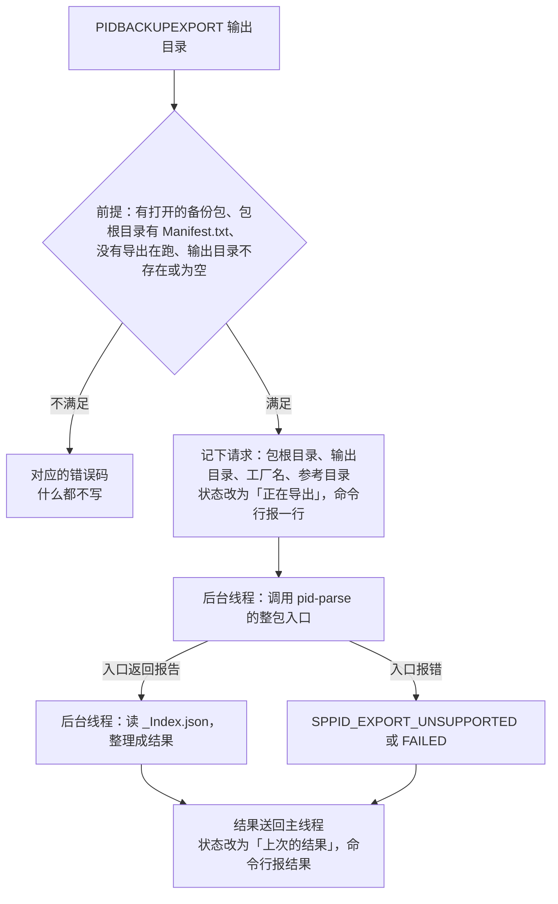

# SPEC：导出 publish 文件（`sppid-export`）

> 状态：**已确认**（2026-11-18）：§9 的 X1–X6 都按建议定。基线 `main @ 5b4784058`；`pid-parse` 主线 `96ee00c`。
> 2026-11-18 补：你定的验收是「能够导出PDF 和对应的publish文件」。publish 文件这一半是本规格；PDF 那一半在 `SPEC-sppid-pdf.md`（待确认）。那份规格的 P1 按建议定（两条命令）时本规格不变；定成「一条命令两样都出」时，本规格 §5 的命令跟着改。
> 依据：`00-capability-map.md` §4、§5 检查点 B、§8 第 3 问（已定：整包导出，不选图，没有进度条和取消）；需求 `REQ-MIG-009`（这次新加的，`docs/pid-platform/requirements/90-migration-and-interop.md`）。
> 共用约定见 `01-shared-conventions.md`。前提：`SPEC-sppid-deps.md`、`SPEC-sppid-read.md` 做完。

## 1. 目标

对已经打开的备份包，一条命令把整包导成 publish 文件，写到指定的目录。三条硬规矩：

1. **内容不由本程序决定。** 转换全部交给 `pid-parse` 的整包入口。同一个包、同一个版本下，写出的文件和命令行程序 `pid_publish_xml` 写出的相同。
2. **每张图都有交代。** 结束时报：写出几张，没写出的是哪几张、什么原因。包里每个 `.pid` 在 `_Index.json` 里恰好记一次。
3. **不卡窗口，出错不退出。** 转换在后台线程做；出错写在命令行里，程序照常运行。

导出不改图：不碰任何打开的图纸，不往备份包里写东西。

## 2. 现状

### 2.1 本程序

没有调用整包入口的地方。

### 2.2 `pid-parse` 主线的整包入口

在 `src/publish/backup_package.rs`：

```rust
pub fn publish_backup_package(
    package_dir: &Path,          // 包根目录，必须有 Manifest.txt
    out_dir: &Path,              // 输出目录，不存在就建
    plant_name: &str,            // 工厂名
    reference_dir: Option<&Path>,// 给了就顺带和参考文件比对
) -> Result<BackupPublishReport, BackupPublishError>
```

- **没有的东西**：只导几张图、进度回调、中途取消。
- **报告**里有：写出的图数 `written`（三个文件都写出才算）、失败计数 `failed`、包里 `.pid` 的数量 `pid_entries`、没有 `DrawingNo` 的图数 `shells`、`_Index.json` 的位置、比对结论 `gate`（给了参考目录才有）、三类提醒（链路问题 `chain_faults`、数据库里缺的东西 `shortfalls`、重复的 UID `duplicate_uids`）。
- **`failed` 不是「失败的图数」**：每张没写出的图、每个打不开的 `PlantData` zip、每个读不了的 zip 条目各算 1。哪张图没写出、为什么，只写在 `_Index.json` 里。
- **错误只有两种**：用法错（目录里没有 `Manifest.txt`；`Export.dmp` 的文件头不认识）和读写错（目录、导出文件读不了；输出目录或 `_Index.json` 写不了）。单张图失败不算错误，计入 `failed`。
- **写文件的办法**：每个文件先写成临时名再改名；一张图的三个文件有一个写不出，这次写出的另两个会删掉；`_Index.json` 最后写；单个 `.pid` 解开后超过 512 MiB 的不解，这张图按失败点名。**输出目录不先清空**，以前留在里面的文件不删。

命令行程序：`pid_publish_xml <备份目录> --out-dir <目录> [--plant <名>] [--strict] [--diff-against <参考目录>]`。`--plant` 不给时是 `P01`。

### 2.3 实测（2026-11-18）

读数表在共用约定 §3.3。地图 §5「现在还不知道的」里的三件由此得到答案：

| 地图里的问题 | 答案 |
|---|---|
| 全厂包整包导出要多久、占多少内存 | 14–16 秒，峰值约 270 MB。第一版不需要进度条和取消，显示「正在导出」和已用时间够用 |
| zip 包还原出来的目录能不能直接交给整包入口 | 能，但要交包根目录（`BackupIndex::backup_root`）。不能交还原目录：来源是目录时，还原目录里没有 `Manifest.txt` |
| 全厂包的参考文件在不在本机 | 在，11 张图。检查点 B 第 4 条按全厂包验 |

另外两个事实：

- **工厂名**写在每个 `_Data.xml`、`_Meta.xml` 开头的 `Plant="…"` 里。厂商的参考文件写的是 `P01`，而全厂包清单里的名字是 `SQPlant`。历次交付没有给 `--plant`，用的都是默认的 `P01`。
- **没有 `DrawingNo` 的图也会写出**，编号取自数据库。全厂包有 2 张，小包有 1 张，正好是浏览时读不出图内对象的那几张。

## 3. 数据格式

### 3.1 输出目录

```text
<输出目录>/
  <图名>_Data.xml        ← 每张写出的图三个文件
  <图名>_Meta.xml
  <图名>_Coverage.json
  …
  _Index.json            ← 整包一份
```

- 内容、文件名、编码全部由 `pid-parse` 决定。本程序不改、不加、不删任何文件。
- `_Coverage.json`、`_Index.json` 里记着包和数据库导出文件的绝对路径；`_Data.xml`、`_Meta.xml` 里没有。

### 3.2 本程序从 `_Index.json` 里读什么

只读下面这些，用来在结果里点名。字段的形状对着 `pid-parse` 的源码和实测写出的文件核过。

| 字段 | 形状 | 用途 |
|---|---|---|
| `export` | 字符串，`OracleExp` 或 `SqlServerMtf` | 包的类型；是 SQL Server 包时加一句「没有验收过」 |
| `pid_entries`、`template_pid_entries` | 数 | `.pid` 的总数；记为图框模板的数 |
| `unmatched_pid_entries` | 列表 | 没对上图纸的 `.pid` |
| `problems` | 字符串列表 | 整包层面的问题，逐句照录 |
| `drawings[]` 的 `name` | 字符串 | 图名 |
| `drawings[]` 的 `files` | 文件名列表 | 为空就是这张图没写出 |
| `drawings[]` 的 `problems` | 字符串列表 | 没写出的图：原因。写出了的图：提醒（比如重复的 UID） |

导出返回成功但 `_Index.json` 读不了（不存在，或不是合法的 JSON），按导出失败报：它是「每张图都有交代」的依据。

### 3.3 错误码

| 码 | 什么时候 |
|---|---|
| `SPPID_EXPORT_NO_PACKAGE` | 没有打开的备份包，或者还在载入 |
| `SPPID_EXPORT_NOT_A_BACKUP` | 打开的来源没有 `Manifest.txt`，比如一个只有散放 `.pid` 的目录 |
| `SPPID_EXPORT_TARGET_NOT_EMPTY` | 输出目录已经存在，而且不是空的 |
| `SPPID_EXPORT_TARGET_INVALID` | 没给输出目录；给的是一个文件；目录建不出来或不可写 |
| `SPPID_EXPORT_REFERENCE_INVALID` | 给了参考目录，但它不存在或不是目录 |
| `SPPID_EXPORT_BUSY` | 上一次导出还没结束 |
| `SPPID_EXPORT_UNSUPPORTED` | `pid-parse` 报用法错：数据库导出文件的格式不认识 |
| `SPPID_EXPORT_FAILED` | `pid-parse` 报读写错；导出结束后 `_Index.json` 读不了；后台线程起不来或中途没了 |

单张图没写出不是错误码，是结果里的名单。

## 4. 数据怎么传



- **请求在开始时一次取齐**，路径都复制一份。之后再打开别的备份包、关掉面板，都不影响正在跑的这一次。
- **导出读的是包根目录。** 来源是 zip 时它在还原缓存里，所以导出期间 `PIDBACKUPOPEN Cache=Clear`（清缓存）会被拒绝，提示等导出结束。
- **同一时间只有一次导出。**
- **已用时间**：状态里记着开始的时刻。不带参数的 `PIDBACKUPEXPORT` 报「正在导出，已用 N 秒」。第一版不在界面上自动跳秒，那是 `sppid-export-ui` 的事。
- **导出时关程序**：导出线程随进程结束。留下的每个文件都是完整的（先写临时名再改名），但目录里没有 `_Index.json`（它最后写）。没有 `_Index.json` 的输出目录就是没导完的；下次往这个目录导会因为非空被拒绝。

## 5. 对外接口

### 5.1 模块接口（`src/io/pid_backup_export.rs`，不碰界面）

```rust
pub const DEFAULT_PLANT: &str = "P01";

pub struct ExportRequest {
    pub package_dir: PathBuf,             // 包根目录
    pub out_dir: PathBuf,
    pub plant: String,
    pub reference_dir: Option<PathBuf>,
}

pub struct ExportOutcome {
    pub written: usize,                   // 三个文件都写出的图
    pub failed: usize,                    // pid-parse 的失败计数，含义见 §2.2
    pub pid_entries: usize,               // 包里 .pid 的总数
    pub templates: usize,                 // 记为图框模板的 .pid
    pub unmatched: Vec<String>,           // 没对上图纸的 .pid
    pub without_drawing_no: usize,        // 没有 DrawingNo、编号取自数据库的图
    pub unwritten: Vec<DrawingNote>,      // 没写出的图：图名和原因
    pub noted: Vec<DrawingNote>,          // 写出了但带提醒的图：图名和提醒
    pub problems: Vec<String>,            // 整包层面的问题
    pub warnings: Vec<String>,            // 三类提醒的句子，与命令行程序打到标准错误的相同
    pub gate: Option<GateSummary>,        // 给了参考目录才有：四个计数和逐张的一句
    pub export_kind: String,              // "OracleExp" 或 "SqlServerMtf"
    pub index_path: PathBuf,
    pub elapsed: Duration,
}

pub enum ExportError { /* §3.3 的八种 */ }
impl ExportError { pub fn code(&self) -> &'static str; }

/// 只检查前提，不写任何东西。
pub fn check(request: &ExportRequest) -> Result<(), ExportError>;
/// 做完才返回。
pub fn export(request: &ExportRequest) -> Result<ExportOutcome, ExportError>;
/// 在后台线程里做，写法照 `restore_in_background`。
pub async fn export_in_background(request: ExportRequest) -> Result<ExportOutcome, ExportError>;
/// 命令行要报的各行。
pub fn summary_lines(outcome: &ExportOutcome) -> Vec<String>;
```

命令和状态在 `src/app/commands/pidbackupexport.rs`。状态有三种：没导过；正在导出（请求和开始的时刻）；上次的结果（成功的结果或错误）。

### 5.2 命令

| 命令 | 做什么 |
|---|---|
| `PIDBACKUPEXPORT <输出目录>` | 把当前打开的备份包导到这个目录。整行其余部分都是路径，可以带空格；两头的引号会去掉 |
| `PIDBACKUPEXPORT Plant=<工厂名> <输出目录>` | 指定工厂名。不给是 `P01` |
| `PIDBACKUPEXPORT Ref=<参考目录> <输出目录>` | 导出时顺带和参考目录里的 `_Data.xml` 比对，结果里多一段比对结论 |
| `PIDBACKUPEXPORT` | 报状态：没导过；正在导出（已用多少秒、导到哪）；上次的结果（原样再报一遍） |

- `Plant=`、`Ref=` 可以都给，顺序不限，都写在输出目录之前。值里有空格时用引号括起来。
- 命令行里整行当一条命令处理（登记进 `run_command_line_impl` 的整行名单）。不登记的话，命令行会先拿不带参数的命令试跑一遍。
- 经典界面的起始页上也能用，与 `PIDBACKUPOPEN` 一样。
- 只读的协同会话：与 `PIDBACKUPOPEN` 一样不在允许名单里，协同的那张图在最前时被拒绝。
- 网页版：报「网页版不支持」。

成功时命令行报的内容，以全厂包为例：

```text
PIDBACKUPEXPORT：正在导出 D:\…\pid-test-data → D:\out\publish-1（工厂名 P01）
PIDBACKUPEXPORT：完成，用时 15.2 秒。写出 53 张图，共 160 个文件。
  失败计数 0。.pid 共 53 个：对上图纸 53，图框模板 0，没对上 0。
  2 张图没有 DrawingNo，编号取自数据库。
  清单：D:\out\publish-1\_Index.json
```

- 有没写出的图：后面逐张列「图名：原因」。超过 20 张只列前 20 张，并说明总数，完整名单在 `_Index.json`。
- 有提醒、有整包层面的问题：逐句列出，同样的上限。
- 给了参考目录：加一行「比对：53 张，7 张一致，0 张有差异，4 张的参考是另一版，42 张没有参考」。
- SQL Server 包：加一行「SQL Server 包的导出没有验收过」。

### 5.3 自动化操作、REST、MCP

第一版不加专用的操作和路由。外部调用方用现有的通用「执行命令」操作发 `PIDBACKUPEXPORT …`，再发不带参数的命令取状态和结果。所以 `src/rest_openapi.json` 和 MCP 的工具摘要值都不变。

这一点和通用约定 §7.6（新加一个能力固定改五处）不一样，所以列在 §9 第 6 问请你定。

### 5.4 交给 `sppid-export-ui` 的东西

请求 `ExportRequest`、结果 `ExportOutcome`、错误 `ExportError`、三种状态。界面那一块直接用这些，不经命令行的文字。

## 6. 成功标准

1. 全厂包：`PIDBACKUPEXPORT <空目录>` 结束后，目录里恰好 160 个文件：53 个 `_Data.xml`、53 个 `_Meta.xml`、53 个 `_Coverage.json`、1 个 `_Index.json`；没有临时文件。
2. 命令行报：写出 53 张，失败计数 0，`.pid` 53 个全部对上，2 张没有 `DrawingNo`。这些数与同一版本的 `pid_publish_xml` 报的相同。
3. 与命令行程序的输出比（命令行程序从钉的提交构建；同一个包路径，同一个工厂名）：106 个 `_Data.xml`、`_Meta.xml` 逐字节相同；54 个 `_Coverage.json`、`_Index.json` 也逐字节相同。
4. 带参考目录（`Ref=D:\work\cad\pid-test-data\验收数据`）：比对结论与命令行程序加 `--diff-against` 的结论相同。现在量到的是 53 张里 7 张一致、0 张有差异、4 张另一版、42 张没有参考。
5. 小包：从目录打开和从 zip 打开各导一次，都是 22 个文件、写出 7 张；两次的 `_Data.xml`、`_Meta.xml` 逐字节相同。
6. 有图没写出时点名：拿小包的副本，把 `PlantData` zip 里一个 `.pid` 换成无效内容再导。这张图出现在没写出的名单里并带原因；其余 6 张照常写出；失败计数不为 0；`_Index.json` 里这张图的 `files` 为空。
7. 前提不满足时什么都不写：没有打开的备份包 → `SPPID_EXPORT_NO_PACKAGE`；来源是只有散放 `.pid` 的目录 → `SPPID_EXPORT_NOT_A_BACKUP`；输出目录非空 → `SPPID_EXPORT_TARGET_NOT_EMPTY`，目录里的文件名单和校验和前后相同；输出路径是个文件 → `SPPID_EXPORT_TARGET_INVALID`；参考目录不存在 → `SPPID_EXPORT_REFERENCE_INVALID`。
8. 导出期间窗口不卡：命令返回时状态已经是「正在导出」，而转换还没做完；这期间不带参数的 `PIDBACKUPEXPORT` 报已用时间；再发一次导出 → `SPPID_EXPORT_BUSY`；`PIDBACKUPOPEN Cache=Clear` 被拒绝。真实窗口里看一次：全厂包导出的十几秒里，图面能平移缩放，命令行能敲命令。
9. `pid-parse` 报错时：命令行出现错误码和原因，程序继续运行，状态变为「上次的结果（失败）」，之后可以再导。
10. 从命令行执行 `PIDBACKUPEXPORT <目录>` 只导一次，只导到给的目录；路径带空格、带引号都对；`Plant=`、`Ref=` 两种顺序都对。
11. 导出前后，最前面那张图的「已修改」状态、撤销栈、标签页数都不变；包根目录里的文件名单、大小、修改时间不变。
12. SQL Server 包：能导，写出 1 张，另 11 个 `.pid` 记为图框模板；结果里有「没有验收过」那一句。它写出的内容不在验收范围。
13. 全厂包导出在本机 60 秒内完成。现在量到 14–16 秒；这条是防退化的上限，不是目标。
14. 门禁不退步；`src/rest_openapi.json` 和 MCP 工具摘要值没有变化；`python scripts/arch_check.py report` 里 `io` 开头各行的数字没有变大。

## 7. 测试

| 层 | 测什么 |
|---|---|
| 单元（`src/io/pid_backup_export.rs`） | 前提检查的各种情况，目录在临时位置现造；从一段 `_Index.json` 文本整理出结果（没写出的图、带提醒的图、模板、没对上的、整包问题）；`summary_lines` 的句子和 20 条上限；每种错误的码 |
| 命令（现造的小备份目录，加一个替身导出函数） | 命令行的解析；状态的流转；忙时拒绝；清缓存被拒；出错后可以再导；整行处理只导一次；不改图。对应成功标准 7–11 |
| 真实包（手动，`--ignored`，由 `scripts/sppid/export-compare.ps1` 串起来） | 成功标准 1–6、11–13：构建或指定命令行程序 → 命令行程序导一份 → 本程序导一份 → 两个目录按校验和比 → 出一张表 |
| 真实窗口 | 成功标准 8 的后半句，检查点 B 时看一次 |

- **替身。** 命令那一层拿到的导出函数是可以换的，正式用的是 `pid_backup_export::export`；测试里换成返回固定结果、固定错误、或者等一个信号才返回的函数。这样不用真实备份包也能测状态和报错。之所以要替身：整包入口要读真实的数据库导出文件，测试里造不出来。
- 真实的转换只在「真实包」那一层跑。

要动的文件：新建 `src/io/pid_backup_export.rs`、`src/app/commands/pidbackupexport.rs`、`scripts/sppid/export-compare.ps1`；改 `src/io/mod.rs`（登记模块）、`src/app/commands/mod.rs`（分发链、命令名单、起始页允许的命令）、`src/app/command_driver/utilities.rs`（整行名单）、`src/app/commands/pidbackup.rs`（导出期间拒绝清缓存）、应用的消息枚举和状态结构（各加一项）、`readings.md`。不动：`src/rest.rs`、`src/rest_openapi.json`、`src/mcp.rs`、`src/app/control/mod.rs`、`src/app/collab/apply.rs`、经典面板。

## 8. 不在范围与已知限制

- **只导选中的图、进度条、中途取消**：`pid-parse` 的入口不支持。量到整包十几秒，第一版不做；包大到分钟级时再向 `pid-parse` 要。
- **界面**（选目录的对话框、进行中、结果画面）：`sppid-export-ui`。
- **不先打开就导**：导的是当前打开的那个包。脚本要导，先发 `PIDBACKUPOPEN`，载入完再发 `PIDBACKUPEXPORT`。
- **导出在本程序里改过或新画的图**：不做。
- **往已有内容的目录里导**：一律拒绝（§9 第 3 问）。不做覆盖，不做合并。
- **把输出打成 zip**：不做。
- **publish 文件内容的完整度**：以 `pid-parse` 为准。等现场数据的那五项不在这里。
- **SQL Server 包的导出不验收**：能跑，带提醒。
- **输出里有本机路径**：`_Index.json`、`_Coverage.json` 记着包的绝对路径；来源是 zip 时，记的是还原缓存里的路径。这是 `pid-parse` 的写法，命令行程序也一样；本程序不改这些文件。交付前要不要抹掉由你定。
- **关程序会中断导出**，留下没有 `_Index.json` 的目录；不做续导。
- **结果只留在内存里**：重启后「上次的结果」没有了，输出目录里的 `_Index.json` 一直在。

## 9. 待决问题

X1–X6 都已定（2026-11-18），按「建议」一列执行。

| # | 问题 | 建议 |
|---|---|---|
| X1 | **命令名和界面上的叫法。** 命令 `PIDBACKUPEXPORT`；界面上叫「导出 publish 文件」 | 用它。和 `PIDBACKUPOPEN` 是一家；名字里没有 PUBLISH，不会和平台发布包的 `PIDPUBLISH` 混 |
| X2 | **工厂名的默认值。** (a) `P01`。(b) 用包清单里的名字，全厂包是 `SQPlant`。(c) 不设默认，必须给 | (a)。命令行默认是它，厂商的参考文件写的是它，历次交付用的也是它。选 (b) 会让每个文件都和以前的交付不同 |
| X3 | **输出目录已经有内容时。** (a) 拒绝。(b) 像命令行程序一样直接往里写，不清空 | (a)。按 (b)，两次导出甚至两个包的文件会混在一个目录里，而 `_Index.json` 只记最后一次。交出去的目录应当只有一次导出的东西 |
| X4 | **参考目录比对（`Ref=`）放不放进第一版。** | 放。入口本来就支持，只多一个参数；检查点 B 第 4 条也正好用它来验 |
| X5 | **SQL Server 包。** (a) 允许导，加一句「没有验收过」。(b) 第一版直接拒绝 | (a)。量到它能导出库里登记的那 1 张图，拒绝等于去掉一个能用的东西；提醒说清楚它没验收 |
| X6 | **第一版只加命令，不加专用的自动化操作、REST 路由、MCP 操作。** 通用约定说新能力要改五处，这里只改前两处 | 先只加命令。导出是后台做的，专用操作要定「发起」和「查结果」两个请求的形状，和界面要的是同一份数据，放到 `sppid-export-ui` 一起定更稳。检查点 B 用命令和测试就能验 |

## 10. 需求对照

| 需求 | 本块 | 说明 |
|---|---|---|
| `REQ-MIG-009` 把备份数据包导出为 publish 文件 | 部分 | 导出、报告、拒绝非空目录、不卡窗口、与命令行工具一致，都用命令做到。专用的画面在 `sppid-export-ui` |
| 地图检查点 B 第 1 条：一条命令导全厂包，每张图三个文件加一份清单 | 覆盖 | 成功标准 1 |
| 地图检查点 B 第 2 条：说清写出几张、失败几张、哪几张、什么原因，每个 `.pid` 都有交代 | 覆盖 | 成功标准 2、6 |
| 地图检查点 B 第 3 条：与命令行程序的输出逐字节相同 | 覆盖 | 成功标准 3、5 |
| 地图检查点 B 第 4 条：有参考文件的图，比对结论与 `pid-parse` 自己的相同 | 覆盖 | 成功标准 4 |
| 地图检查点 B 第 5 条：窗口不卡死，出错不退出 | 覆盖 | 成功标准 8、9 |
| 2026-10-16 备份包方案把「从程序里批量导出」列为不做 | 改为做 | 地图 §6 |
