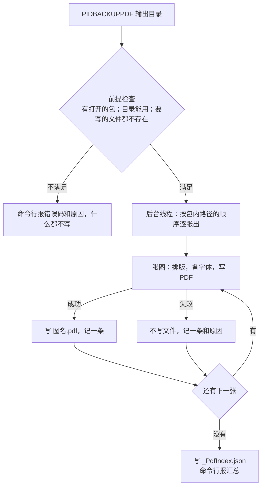

# SPEC：导出 PDF（`sppid-pdf`）

> 状态：**已确认**（2026-11-18）：§9 的 P1–P4 都按建议定。基线 `main @ c399311e7`。
> 依据：你 2026-11-18 定的验收标准里的「能够导出PDF 和对应的publish文件」；`00-capability-map.md` §4、§5 检查点 B；需求 `REQ-MIG-010`（这次新加的，`docs/pid-platform/requirements/90-migration-and-interop.md`）。
> 共用约定见 `01-shared-conventions.md`。前提：`SPEC-sppid-deps.md`、`SPEC-sppid-read.md` 做完。不依赖 `SPEC-sppid-export.md`。

## 1. 目标

对已经打开的备份包，一条命令把包里每张图出成一份 PDF。文件名和这张图的 publish 文件同名：`<图名>.pdf` 对 `<图名>_Data.xml`。出不了的图逐张给出原因。单张图沿用已有的 `PIDPLOT`。

PDF 画成什么样由 `pid-plot` 决定，本程序不改图面内容。本块做四件事：整包出；每张图有交代；和命令行工具出的一样；有测试和读数钉住。

## 2. 现状

### 2.1 程序里已有的

| 项 | 位置 | 情况 |
|---|---|---|
| 单张出 PDF 的命令 `PIDPLOT [<文件.pdf>]` | `src/app/commands/pidplot.rs` | 把当前标签页打开的那个 `.pid` 出成 PDF。用的是磁盘上的文件，不含打开后的编辑。后台做，做完报字节数、图元数、页面大小、图框模板、符号找到几个、缺哪些 |
| `EXPORT`、`EXPORTPDF`、打印到 PDF | 同上（`export_pid_pdf`） | 当前图是从 `.pid` 打开的，就转到上面那条路 |
| 出图的引擎 | `src/io/pid_pdf.rs` 的 `plot_pdf` | 调 `pid-plot`：排版，备字体，写 PDF。全仓库只有这个文件引用 `pid-plot` |
| 从备份面板打开的图 | `src/app/commands/pidbackup.rs`（`Effect::OpenDrawing`） | 标签页记的路径就是还原出来的那个 `.pid`，所以 `PIDPLOT` 对它可用。这是读代码得到的，没有测试 |
| 参考数据 | `src/io/pid_backup.rs` | 还原目录里有包自己的 `Ref`（图框模板、符号库，从 `RefData~*` 解出来）。出图时先用它 |

没有的：整包出 PDF 的命令；新界面下 `PIDPLOT` 的测试。本程序出的 PDF 和命令行工具出的是否相同，没有量过。

### 2.2 `pid-plot` 这一侧

- 命令行工具：`pid_plot <图.pid> <出.pdf> [参考目录]` 出一张；`pid_plot --batch <目录> <输出目录> [参考目录]` 把目录下每个 `.pid` 各出一份，另写汇总 `pid_plot-batch.json`。
- 整目录出的那段逻辑在命令行程序里，不在库里。本程序要整包出，得自己逐张调库。
- 命令行工具写 PDF 时带标题（图的文件名，`write_plot_titled`）；本程序现在用的是不带标题的写法（`write_plot`）。所以两边现在的字节不会相同，页面内容相同。
- 厂商给了 11 张图的 PDF。`pid-plot` 自己和它们比过，记录在 `D:\work\cad\pid-test-data\验收数据\plot\acceptance\`（版本 `6ecd1b4`）：10 张线条覆盖 100%，没有多画的线，文字全部对上；1 张（`集注站 轻烃分离器I气出口接口位置改造工艺及自控流程图`）线条覆盖 98.3%，文字 225 条对上 214 条。
- 主线 `96ee00c` 和 `6ecd1b4` 之间，`pid-plot` 目录没有差别。所以 PDF 不用等那三个没推送的提交。

### 2.3 这次量的（2026-11-18）

用本机现成的 `pid_plot.exe`（2026-11-15 编的，对应哪个提交没有核对，只用来估量，不当基线）对全厂包的 53 个 `.pid` 整目录出了一次，输出在仓库外：

| 项 | 读数 |
|---|---|
| 写出 | 53 张，失败 0 张 |
| 用时 | 94.9 秒（正式构建） |
| 大小 | 合计 8.70 MB；最小 34 KB，最大 347 KB |
| 图框模板找不到 | 0 张 |
| 符号文件找不到 | 16 张图，共 22 处；PDF 照写，汇总里列出名字。**更正（2026-11-19）：是 15 张图。「16」是当时数错了，22 处没有错；那一次的汇总文件按图数是 15 张，`PDF-1` 重量也是 15 张（`readings.md` §11.4）** |
| 存疑的、没有交代的图元 | 都是 0 |

`D03`、`D04` 也写出了。这两张本程序现在读不出图内对象，`D03` 打不开（共用约定 §3.2）。

本程序自己的出图路径在这 53 张上的读数还没有，是本块第一个真实包任务要量的。

## 3. 第一版做什么

- **整包**：新命令 `PIDBACKUPPDF <输出目录>`。包里每张有文件的图出一份 `<图名>.pdf`，另写一份清单 `_PdfIndex.json`。
- **图名**：`.pid` 的文件名去掉扩展名。厂商的文件、命令行工具都是这样起名。全厂包 53 张图，这个名字和 publish 文件用的图名一致。
- **放哪**：平铺在输出目录。可以和同一个包的 publish 文件放在同一个目录（先导 publish 文件，再导 PDF），得到的就是厂商那种摆法：每张图 `<图名>.pdf`、`<图名>_Data.xml`、`<图名>_Meta.xml`。
- **后台做**：界面不卡。做的过程中敲不带参数的 `PIDBACKUPPDF`，报「第几张，共几张」。做完在命令行报汇总。
- **单张**：`PIDPLOT`，已有。本块补新界面下的测试，并让它和整包出的是同一份字节。
- **和命令行工具对齐**：标题用图的文件名；参考目录用还原目录。目标是同样的输入下和 `pid_plot` 逐字节相同。这要量过才算数，见成功标准 5。

## 4. 数据怎么传



## 5. 对外接口

### 5.1 命令（本块新增）

| 命令 | 做什么 |
|---|---|
| `PIDBACKUPPDF <输出目录>` | 把已打开的备份包整包出成 PDF |
| `PIDBACKUPPDF` | 报状态，三种：没导过；正在导（第几张，共几张）；上次的结果 |

整行命令：输出目录可以带空格，不用引号。登记在整行命令的名单里，和 `PIDBACKUPEXPORT` 同一个办法（`SPEC-sppid-export.md` §5）。界面上的名字：「导出 PDF」。第一版没有选项。

### 5.2 输出目录的规则

- 不存在就建。
- 目录里可以已经有别的文件，比如同一个包的 publish 文件。原有的文件一个字节都不动。
- 这次要写的文件（每张图的 `<图名>.pdf` 和 `_PdfIndex.json`）只要有一个已经存在，就拒绝，什么都不写。不覆盖。
- 路径是一个文件、建不出来、或者在包根目录或还原目录里面：拒绝。

### 5.3 写出什么

| 文件 | 多少 | 内容 |
|---|---|---|
| `<图名>.pdf` | 每张写出的图一份 | 一页，页面大小是图纸自己的 |
| `_PdfIndex.json` | 整包一份 | 每张图一条，见下 |

`_PdfIndex.json` 的字段：

| 字段 | 含义 |
|---|---|
| `package` | 包根目录 |
| `drawings`、`written`、`failed`、`without_file` | 图数；写出的；出不了的；库里登记了但包里没有文件的 |
| `pages[]` | 每张图一条，按包内路径排序 |
| `pages[].name` | 图名。有文件时取文件名（去掉扩展名），没有文件时取库里登记的名字 |
| `pages[].pid` | 包内的相对路径，如 `00/00/<图名>.pid`；没有文件时为空 |
| `pages[].pdf` | 写出的文件名；没写出时为空 |
| `pages[].bytes`、`primitives`、`page_mm` | PDF 字节数、图元数、页面大小（毫米） |
| `pages[].template` | 用的图框模板的文件名；没有时为空 |
| `pages[].symbols_found`、`symbols_referenced`、`missing_symbols[]` | 符号找到几个、引用几个、缺哪些 |
| `pages[].ledger` | `pid-plot` 给这一页的账：画上的、有意不画的、存疑的、没有交代的，各多少 |
| `pages[].notes[]` | 说明，比如参考数据是从哪里取的 |
| `pages[].error` | 没写出的原因；写出时为空 |

清单里不写时间和用时，所以同一个包、同一个版本导两次，清单逐字节相同。用时只在命令行的汇总里报。

命令行的汇总：写出几张；出不了几张，逐张列名字和原因（多于 10 张时列前 10 张，其余见清单）；缺符号的图几张；用时；清单的位置。

### 5.4 参考数据和字体从哪里来

- **图框模板、符号库**：还原目录里的 `Ref`，也就是包自己的。包里没有图框模板时，按现有 `PIDPLOT` 的办法退到参考目录（环境变量 `PID_PLOT_CORPUS`），并在这张图的 `notes` 里写明用的是哪个目录。
- **字体**，按顺序找：环境变量 `PID_PLOT_FONTS` 给的目录；还原目录下的 `fonts`；包根目录下的 `fonts`（本块新增）；参考目录下的 `fonts`；Windows 的字体目录。
- 图里的字用到的字体哪个目录都没有，或者有字符哪个字体都画不了：这张图不写，原因写进清单。这是 `pid-plot` 的规则，本程序不替换字体。

### 5.5 错误码

| 错误码 | 什么时候 |
|---|---|
| `SPPID_PDF_NO_PACKAGE` | 没有打开的备份包 |
| `SPPID_PDF_NOTHING_TO_PLOT` | 包里没有一张有文件的图 |
| `SPPID_PDF_TARGET_INVALID` | 输出目录不能用（§5.2 最后一条） |
| `SPPID_PDF_TARGET_HAS_FILES` | 要写的文件已经存在；报出前几个的名字 |
| `SPPID_PDF_BUSY` | 上一次整包出 PDF 还没做完 |
| `SPPID_PDF_FAILED` | 整体做不下去，比如清单写不了 |

单张图出不了不算整体失败：记进清单，命令照常结束。导出进行中，`PIDBACKUPOPEN Cache=Clear` 被拒绝，因为它会删掉正在读的文件。

publish 文件正在导出时可以同时出 PDF，反过来也可以：两样写的文件不重名，各有各的状态，互不拒绝。要导进同一个目录时，先发 `PIDBACKUPEXPORT`（它要求目录是空的），再发 `PIDBACKUPPDF`。

### 5.6 模块接口

新文件 `src/io/pid_backup_pdf.rs`，不引用 `app` 和 `ui`：

```rust
pub struct PdfRequest {
    pub package_dir: PathBuf,       // 包根目录
    pub restored: PathBuf,          // 还原目录
    pub out_dir: PathBuf,
    pub drawings: Vec<PdfDrawing>,  // 来自 BackupIndex::drawings
}
pub struct PdfDrawing { pub name: String, pub pid: Option<PathBuf> }
pub struct PdfPage { /* §5.3 里每张图的那一条 */ }
pub struct PdfOutcome {
    pub pages: Vec<PdfPage>,
    pub written: usize,
    pub failed: usize,
    pub without_file: usize,
    pub index_path: PathBuf,
    pub elapsed: Duration,
}
pub enum PdfError { /* 六种 */ }
impl PdfError { pub fn code(&self) -> &'static str; }

/// 做到第几张、共几张；命令层读它来报进度。
#[derive(Clone, Default)]
pub struct PdfProgress { /* 两个原子数 */ }

pub fn check(request: &PdfRequest) -> Result<(), PdfError>;   // 只查前提，不写任何东西
pub fn export(request: &PdfRequest, progress: &PdfProgress) -> Result<PdfOutcome, PdfError>;
pub async fn export_in_background(request: PdfRequest, progress: PdfProgress) -> Result<PdfOutcome, PdfError>;
pub fn summary_lines(outcome: &PdfOutcome) -> Vec<String>;
```

- 「出一张」是一个可以换掉的函数。仓库里没有真实的 `.pid`，快测试用一个假的出图函数。
- `src/io/pid_pdf.rs` 改三处：写 PDF 时带标题；字体目录能多给；把「出一张」拆成整包也能调的函数。`PIDPLOT` 的命令和回执不变；它写出的 PDF 多一个标题，页面内容不变。
- 后台线程的做法照 `plot_pdf_in_background`：一个有名字的线程，64 MB 的栈，逐张做，不并行。

## 6. 成功标准

1. 没有打开备份包时执行 `PIDBACKUPPDF <目录>`：报 `SPPID_PDF_NO_PACKAGE`，不建目录，不写文件。（快测试）
2. 输出目录的规则逐条成立：是文件、在包根目录或还原目录里面，得 `SPPID_PDF_TARGET_INVALID`；要写的文件有一个已存在，得 `SPPID_PDF_TARGET_HAS_FILES`，目录内容不变；目录里只有别的文件时照常导出，原有文件逐字节不变。（快测试）
3. 每张图恰好一条：清单的条数等于包里的图数；每条要么有 `pdf`，要么有 `error`；目录里 PDF 的个数等于 `written`。其中一张出不了时，其余照写，命令照常结束，汇总里点出这张的名字和原因。（快测试，用假的出图函数）
4. 后台与进度：导出期间程序照常处理别的消息；不带参数的 `PIDBACKUPPDF` 在导出中报「第几张，共几张」；这时再发 `PIDBACKUPPDF <目录>` 得 `SPPID_PDF_BUSY`；`PIDBACKUPOPEN Cache=Clear` 被拒绝。导出结束后都恢复。（快测试）
5. 全厂包和小包：本程序写出的 PDF 张数，不少于同一版本的 `pid_plot --batch` 对同一批文件、同一个参考目录、同一批字体写出的张数；两边都写出的图，PDF 逐字节相同。量出来有不同的，停下来列出是哪几张、差在哪里，报告后再定。（真实包；`pid_plot` 从钉的那个提交编出来，办法同共用约定 §2）
6. 每份写出的 PDF 都以 `%PDF-` 开头，能解析，恰好一页，页面大小和清单里的 `page_mm` 相差不超过 0.01 毫米。（真实包；用仓库已有的 `lopdf` 解析）
7. 配对：全厂包的 publish 文件和 PDF 导到同一个目录后，每个 `<图名>_Data.xml` 都有同名的 `<图名>.pdf`，反过来也是。对不上的列出来，应当是 0 个。（真实包；`sppid-export` 做完后在总验收里验，脚本 `scripts/sppid/check-pairs.ps1`）
8. 厂商参考的 11 张：用 `pid_plot_compare` 把本程序出的 PDF 和厂商的 PDF 比。出图用厂商文件夹里的那 11 个 `.pid`：厂商的 PDF 对应的是这一版，而全厂包里有 4 张是另一版。每张的线条覆盖率不低于 `pid-plot` 自己留的记录（§2.2），多画的长度不高于记录，文字对上的条数不少于记录。容差：覆盖率 0.001，长度 1 毫米。（真实包，脚本；只读数，不改图面）
9. 小包从目录打开和从 zip 打开，导出的 PDF 名单相同，逐字节相同。SQL Server 包能导就导，汇总里带一句「没有验收过」。
10. 重跑：同一个包导到两个空目录，PDF 和 `_PdfIndex.json` 都逐字节相同。
11. 单张：新界面下从备份面板打开一张图，执行 `PIDPLOT <路径>`，写出的 PDF 和整包导出里这张图的 PDF 逐字节相同。（真实包；另有快测试证明新界面下命令走到了出图那一步）
12. 导出不改任何图：打开的标签页的「已修改」标记和撤销栈不变；包根目录和还原目录里的文件数和内容不变。
13. 用时：第一次真实导出的读数写进 `readings.md`，注明是哪种构建。全厂包 53 张在测试构建下超过 600 秒，就先报告再往下做。对照：现成的命令行工具（正式构建）是 95 秒。
14. 门禁不退步；`src/rest_openapi.json` 和 MCP 的摘要值不变；`python scripts/arch_check.py report` 不新增越界引用。

## 7. 测试

| 层 | 测什么 |
|---|---|
| 快测试（随库测试跑） | 成功标准 1–4，12 的前半。备份目录现造，出图函数用假的。命令层的测试照 `src/app/commands/pidbackup.rs` 现有测试的写法 |
| 真实包（手动，`--ignored`，脚本串起来） | 成功标准 5、6、8–11，12 的后半，13 |
| 总验收 | 成功标准 7，和 publish 文件一起验（`scripts/sppid/check-pairs.ps1`） |

- 脚本 `scripts/sppid/pdf-compare.ps1`：用本程序导一遍，用 `pid_plot --batch` 导一遍，逐个比字节；对 11 张有厂商 PDF 的图跑 `pid_plot_compare`，和记录比；出一张表；有一格不过，退出码非 0。输出都在仓库外。
- 比字节时两边用同一批字体：脚本给两边设同一个 `PID_PLOT_FONTS`。
- 先红后绿的做法照共用约定 §7。

要动的文件：

- 新建：`src/io/pid_backup_pdf.rs`、`src/app/commands/pidbackuppdf.rs`、`scripts/sppid/pdf-compare.ps1`、`scripts/sppid/build-pid-tools.ps1`（从钉的提交编出 `pid_plot`、`pid_plot_compare`、`pid_publish_xml`；导出那一块也用它）。
- 改：`src/io/pid_pdf.rs`、`src/io/mod.rs`、`src/app/commands/mod.rs`、`src/app/command_driver/utilities.rs`（整行命令的名单）、`src/app/commands/pidbackup.rs`（导出中拒绝清缓存）、放消息和程序状态的文件；`readings.md` 加一节。
- 不动：`src/rest.rs`、`src/rest_openapi.json`、`src/mcp.rs`、`src/app/control/mod.rs`、`src/app/collab/apply.rs`、经典面板。

## 8. 不在范围与已知限制

- **图面内容不在本块修。** `pid-plot` 画成什么样就是什么样。缺的符号、和厂商 PDF 的差别，记下来报给 `pid-parse` 那边。
- **PDF 不经过画布。** 它是从 `.pid` 文件直接出的。画布上看到的和 PDF 可能有差别；画布显示得对不对归 `sppid-read`（那份规格的 R3）。
- 第一版不做：挑几张图导出、取消、并行、合成一个多页的 PDF、页面大小和比例的选项、专用画面（`sppid-export-ui`）、REST 和 MCP 的入口。
- 字体要能在 §5.4 的目录里找到。验收用的这台机器上，字体在全厂包目录的 `fonts` 里。换一台机器要自己备一个字体目录。
- 包里没有图框模板时退到的那个默认参考目录，是代码里写死的开发机上的位置（现有 `PIDPLOT` 的行为）。本块不改，清单里写明每张图用的是哪里的模板。
- 只读的协同会话里，协同的那张图在最前时，`PIDBACKUPPDF` 会被拒绝，和 `PIDBACKUPOPEN` 一样。维持现状。
- SQL Server 包没有验收。网页版没有这个功能。

## 9. 待决问题（已定）

P1–P4 已定（2026-11-18），都按建议：两条命令；平铺，和 publish 文件同名；「和命令行工具逐字节相同」是验收；能查进度，不做取消。

| # | 问题 | 建议 |
|---|---|---|
| P1 | **PDF 和 publish 文件用两条命令还是一条。** (a) 两条：`PIDBACKUPEXPORT` 照已定的不变，只出 publish 文件；`PIDBACKUPPDF` 出 PDF。两样可以导进同一个目录。(b) 一条：`PIDBACKUPEXPORT` 两样都出，加 `Pdf=No` 表示只出 publish 文件 | (a)。已定的导出规格不用改；PDF 不用等 `pid-parse` 那三个提交，可以先做先验；一样出了问题不拖累另一样。以后做导出画面时放在一个对话框里，两个勾 |
| P2 | **PDF 怎么起名、怎么放。** (a) `<图名>.pdf`，平铺，和 publish 文件同名，厂商就是这样。(b) 照包里的目录层次放，如 `00\00\<图名>.pdf`，命令行工具整目录出是这样 | (a)。两张图同名时第二张不写，清单里说明。全厂包没有同名的图；2026-11-18 核对过，命令行工具出的 53 份 PDF 的名字和历次交付（`publish-v6`）里 53 个 `_Data.xml` 的图名一一相同 |
| P3 | **「和命令行工具逐字节相同」要不要作为验收。** 做到它要改现有 `PIDPLOT` 的一处写法：PDF 里加上标题，页面内容不变。(a) 要：`pid-plot` 自己对厂商 PDF 比对的结论，可以直接用在本程序出的 PDF 上。(b) 不要：只要求每张图有交代，另外单独和厂商 PDF 比 | (a) |
| P4 | **进度和取消。** 53 张用正式构建预计一分半左右。(a) 能查进度，不做取消。(b) 都不做。(c) 都做 | (a)。取消等有了画面再做 |

## 10. 需求对照

| 需求 | 本块 | 说明 |
|---|---|---|
| `REQ-MIG-010` 把备份数据包的图纸导出为 PDF | 覆盖 | 成功标准 1–13 |
| 你定的验收「能够导出PDF 和对应的publish文件」 | PDF 这一半 | 成功标准 5、7、8；publish 文件那一半在 `SPEC-sppid-export.md` |
| 地图检查点 B | PDF 的几条 | 见地图 §5 |

## 11. 实现记录

实现时和上文有出入、或者上文没写到的地方，记在这里。

### `PDF-1` 从钉的提交编出对比用的命令行工具（2026-11-19）

这一步没有改程序。读数和检查在 `readings.md` §11。和上文有关的几处：

- **对比用的程序在 `D:\scratch\ocs-sppid\tools\96ee00c\`**，由 `scripts\sppid\build-pid-tools.ps1` 从钉的提交编出，三个：`pid_plot`、`pid_plot_compare`、`pid_publish_xml`。成功标准 5、8、9 里说的命令行工具用这一份，不用检出里现成的那份：那份能多看到一个没有提交的符号库（`readings.md` §11.5（1））。
- **源码留在工具目录里**（`…\96ee00c\src`），没有编完就删。`pid_plot` 运行时会回到编译时的源码目录找符号库和字体（排在参考目录之后）。本程序出图用的是同一段库代码，回到的是 cargo 取下来的那份源码。两处是同一个提交的文件，比字节时这一层两边相同。§5.4 的字体顺序里没有写这一处（库里它排在参考目录的 `fonts` 之后；这个提交里没有这个目录），`PDF-2` 做字体目录时要把它算进去。命令行工具不找 Windows 的字体目录，本程序找（`src/io/pid_pdf.rs`）：字体只在 Windows 目录里有的图，两边会不一样，`PDF-2` 比字节时留意。
- **§2.3 的两个数。** 「16 张图」应是 15 张，表里已加更正。「94.9 秒」是现成的旧程序量的；从钉的提交编出来的这份是 52 到 53 秒，出的 53 份 PDF 和旧程序的逐字节相同。成功标准 13 的「95 秒」、§9 P4 的「一分半左右」，按 52 到 53 秒看。
- **全厂包的对照已经出好**：53 份，`D:\scratch\ocs-sppid\2026-11-19-pdf1\batch\plant-1\pdf\`，同一个程序出两遍逐字节相同。出的时候 `PID_PLOT_FONTS` 等四个环境变量都没有设；参考目录下有 `fonts`（6 个 `.ttf`），按找字体的顺序用的是它。§7 说比字节时给两边设同一个 `PID_PLOT_FONTS`：设的不是这个 `fonts` 目录时，对照要用同样的设置重出，不能直接拿这一份。
- **离线能编。** 钉的提交要的 287 个包，cargo 的缓存里都有，没有联网。编不出来时脚本退出码 1，报 cargo 的原话，不自己联网（演过一次，`readings.md` §11.3）。

### `PDF-2` 单张出图和命令行工具对齐（2026-11-19）

改的是 `src/io/pid_pdf.rs`。读数和检查在 `readings.md` §12。和上文有出入、或者上文没写到的：

- **§5.6「改三处」做成了什么。** 写 PDF 改用 `write_plot_titled`，标题是文件名去掉扩展名。字体目录的顺序由 `font_folders` 定。「出一张」是 `plot_pdf_against(图, 输出路径, 项目目录, 字体目录)`：出得了时返回回执（`PidPdfReceipt`），里面有字节数、图元数、页面大小、用的模板、符号找到和引用的数、缺的符号、`notes`、这一页的账；出不了时返回原因。账是新加的 `PageLedger`，五个数：图元总数、画上的、有意不画的、存疑的、没有交代的，就是 §5.3 清单里 `ledger` 要的那几项。`PDF-3` 调这个函数：项目目录传还原目录，字体目录传包根目录下的 `fonts`。原来的 `plot_pdf` 留给 `PIDPLOT`，它的命令和打印的回执没有变。
- **§5.4 的字体顺序，实现里多一处。** `PID_PLOT_FONTS`；还原目录下的 `fonts`；**`pid-plot` 编译时带的目录**（上文没有写）；包根目录下的 `fonts`（由调用方给）；参考目录下的 `fonts`；Windows 的字体目录。前三项原样取 `pid-plot` 自己的列表，不拆开。钉的这个提交里没有第三项那个目录，现在不起作用。
- **§5.4 没有写 `PID_PLOT_CJK_FONT`。** 命令行工具认这个环境变量（把它指的字体整份嵌进 PDF），本程序现在也认，否则设了它两边就不一样。§7 比字节时，除了 `PID_PLOT_FONTS`，这个变量两边也要一样：都不设，或者设成同一个文件。这一处是实现时定的，可以推翻。
- **命令行工具必须设 `PID_PLOT_FONTS` 才出得了还原目录里的图。** 还原目录下没有 `fonts`；不设时它 3 张抽查图都出不了（缺字体，退出码 1）。本程序不受影响，它还会找参考目录的 `fonts` 和 Windows 的字体目录。拿命令行工具对比的地方都要照 §7 设 `PID_PLOT_FONTS`。
- **两条路都和命令行工具比过，测试只钉住一条。** 项目目录里有图框模板时（还原目录就是这样），命令行工具拿同一个项目目录就出同一份，这条路有真实样本的测试。项目里没有模板、退到参考目录时，命令行工具要多给两样才出同一份：把回执 `notes` 里写的模板目录当项目目录，把写的符号目录放进 `PID_SYMBOL_LIBRARY`。3 张抽查图这样手工比过（用真实的程序不开窗口跑 `PIDPLOT`），逐字节相同，没有写成测试。
- **3 张抽查图已经逐字节相同**（不设变量、设 `PID_PLOT_CJK_FONT`、设 `PID_PLOT_FONTS` 各一遍），标题等于图名，这一页的账等于命令行工具打印的那一行。其余的图留给 `PDF-5`。
