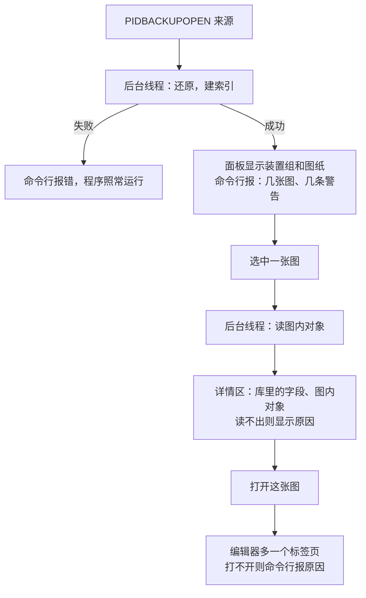

# SPEC：读取备份包（`sppid-read`）

> 状态：**已确认**（2026-11-18）：§9 的 R1、R2 都按建议定。同一天你定了验收标准（「能够正常打开备份数据包」「能够正确浏览PID文件，并能够正确显示出来」），据此加了成功标准 13 和 §9 的 R3，这两处随后也已确认（R3 按建议定）。基线 `main @ 5b4784058`。
> 依据：`00-capability-map.md` §4、§5 检查点 A；需求 `REQ-MIG-008`（这次新加的，`docs/pid-platform/requirements/90-migration-and-interop.md`）。
> 共用约定见 `01-shared-conventions.md`。前提：`SPEC-sppid-deps.md` 做完。

## 1. 目标

不加 `--classic` 启动，用命令就能走完：打开一个备份包（目录或 zip）→ 看到图纸清单 → 看一张图的属性和图内对象 → 把它打开成编辑器里的一个标签页。读不出的图给出原因。三个样本包的读数钉成能重跑、不对就报失败的验收。

读取的代码不重写，沿用经典界面那一套。本块做的是三件事：在新界面下验证过，有测试钉住，读数成为门禁。新画面是 `sppid-screen` 的事。

## 2. 现状

### 2.1 功能链（都已存在）

| 层 | 位置 | 管什么 |
|---|---|---|
| 还原 | `src/io/pid_backup.rs` 及子模块 | zip 解到缓存目录，解过的复用；目录来源只解图纸和参考数据，原目录不写 |
| 索引 | `src/io/pid_backup_browse.rs` 及子模块 | `BackupIndex`：清单的几个字段、包里的文件、装置组树、图纸（名字、文件、所在组、库里的字段）、参考数据树、警告 |
| 面板 | `src/ui/window/pid_backup_browser.rs` 及子模块 | 停靠面板的状态和画法 |
| 命令 | `src/app/commands/pidbackup.rs` | `PIDBACKUPOPEN` 和它的子命令；把面板要做的事落地（载入、读图内对象、打开图纸） |
| 走查 | `src/app/commands/pidbackup/audit.rs` | 手动跑的整包走查，出报告 |

### 2.2 新界面下的情况

下面是读代码得到的，没有测试，也没在真实窗口里看过。这是地图 §5「现在还不知道的」最后一件。

- 新界面的编辑器画面里，图面那一块用的就是经典界面的图面，只去掉了功能区、标签条、状态条、导航方块和起始页（`src/app/view/mod.rs` 的 `view_classic`，第 787 行起）。
- 停靠面板照画，只有特性面板被隐藏（`src/app/dock/update.rs` 的 `dock_panel_visible`，第 883–923 行）。命令行在图面底部。
- 所以敲 `PIDBACKUPOPEN` 之后，备份面板应当停在图面右侧，默认宽 340。
- 现有测试只证明了另一个面板（`PIDPALETTE`）在新界面下能停在图面旁边（`src/app/pid_shell/pid_shell_chrome.rs`）。没有一条测试在新界面下执行 `PIDBACKUPOPEN`。
- 走查建程序的办法不进新界面，所以它现在只覆盖经典界面。

### 2.3 上次读数

见共用约定 §3.2：图纸 53、7、12 张；读不出图内对象 2、1、11 张；打不开 1、1、2 张。

### 2.4 一个限制

仓库里没有真实的 `.pid` 文件。「打开一张图能看到图面」只能用样本包验证，进不了每次都跑的库测试。

## 3. 第一版在新界面下是什么样

- **入口**：图面底部的命令行，敲 `PIDBACKUPOPEN <路径>`。
- **面板**：就是经典面板，停在图面右侧。文字、布局、功能与 `--classic` 下相同，包括库表、枚举映射、参考数据、图纸体检。
- **打开图纸**：在面板里双击图纸，或者按详情区的打开按钮。编辑器多一个标签页。
- 面板的样子和新界面不一致，这是第一版已知的。样子一致、不用敲命令的画面在检查点 C。

## 4. 数据怎么传

本块不改这条链。

## 5. 对外接口

### 5.1 命令（都已有，本块不加也不改）

| 命令 | 做什么 |
|---|---|
| `PIDBACKUPOPEN` | 显示面板，询问来源 |
| `PIDBACKUPOPEN <来源> [<还原到的目录>]` | 打开一个 zip 或目录 |
| `PIDBACKUPOPEN Select <a > b > c>` | 选中树上的一个节点 |
| `PIDBACKUPOPEN Press [<序号>\|<按钮名>]` | 按详情区的一个按钮，比如打开图纸 |
| `PIDBACKUPOPEN Split <百分比>` | 调面板里上下两块的比例 |
| `PIDBACKUPOPEN Cache`、`Cache=<目录>`、`Cache=Default`、`Cache=Clear` | 看、改、清还原缓存 |

### 5.2 走查加两个开关（本块新增）

| 环境变量 | 作用 |
|---|---|
| `OCS_PID_BACKUP_AUDIT_SHELL=1` | 按「不加 `--classic` 启动」的办法建程序，再走查 |
| `OCS_PID_BACKUP_AUDIT_EXPECT=<图纸数>,<读不出上限>,<打不开上限>` | 走完后断言。不满足则测试失败，列出超出的图名和原因 |

已有的四个不变：`OCS_PID_BACKUP_AUDIT`（来源）、`OCS_PID_BACKUP_AUDIT_OUT`（报告目录）、`OCS_PID_BACKUP_AUDIT_LANG`、`OCS_PID_BACKUP_AUDIT_SKIP_IMPORT`。不给新开关时，走查的行为和现在完全一样。

### 5.3 一个脚本（本块新增）

`scripts/sppid/walk-samples.ps1`：对全厂包、小包（目录和 zip）、SQL Server 包各走查两遍，一遍经典界面，一遍新界面，都带期望值。汇总成一张表：包、哪个界面、图纸数、读不出、打不开、图元总数、耗时、过没过。任何一格不过，退出码非 0。样本的位置从参数取，默认值是共用约定 §2 的位置；报告写到仓库外。

## 6. 成功标准

1. 新界面下执行 `PIDBACKUPOPEN <目录>`：备份面板可见；当前画面仍是编辑器；载入完成后索引里的图纸数等于造的数；命令行里有一行报出图纸数。（快测试；「新界面下」指测试按不加 `--classic` 的办法建程序，照 `src/app/pid_shell/pid_shell_startup.rs` 里的建法。）
2. 新界面下面板打开时，特性面板仍然隐藏，编辑器的标签条还在；关掉面板后它不再可见。（快测试）
3. 新界面下激活一个图纸节点：发出打开这张图的请求，指向还原出来的那个 `.pid`。（快测试）
4. 新界面下给一个不存在的路径、一个不是备份的目录：命令行各有一条错误，程序继续运行；面板的状态和 `--classic` 下做同样的事之后相同。（快测试）（2026-11-18 实现时发现：不是备份的目录实际不报错，`--classic` 下也一样。`RD-1` 没有改程序；同日定下改成报错，在另加的任务 `EXP-1b` 里做，这后一半到那时才达到，见 §11。）
5. 三个样本包在新界面下走查：图纸数 53、7、12；读不出图内对象的不多于 2、1、11 张；打不开的不多于 1、1、2 张；报告里每张读不出或打不开的图都有一句原因。（上限随 `sppid-deps` 的结果下调，见 §9 第 2 问。）
6. 同一个包，新界面和经典界面两份走查的数字完全相同：图纸数、读不出的名单、打不开的名单、每张图的图元数。
7. 新界面下的走查里，打开一张图之后标签页数加 1，新标签页在最前，图里的图元数大于 0，当前画面仍是编辑器。（2026-11-18 实现时发现：「标签页数加 1」不是每次都成立。最前面是一张没动过的空白图时，打开的图占用这个标签页；这张图已经开着时，切到它的标签页。`RD-2` 没有改程序，走查按这条实际的规则判，见 §11。成功标准 9 的「多一个标签页」同理。）
8. 小包从 zip 打开和从目录打开，图纸名单相同（7 张），读不出和打不开的名单相同。
9. 真实窗口看一次：不加 `--classic` 启动 → 命令行打开全厂包 → 面板在图面右侧，列出 53 张 → 打开一张 → 多一个标签页并显示图面。截图留在仓库外，汇报里说明看到了什么。
10. `--classic` 下不变：`pid_backup`、`pidbackup` 现有的测试一条不改，全部通过。
11. `scripts/sppid/walk-samples.ps1` 一条命令跑完第 5–8 条，全部通过时退出码为 0。
12. 门禁不退步。
13. 显示对照（2026-11-18 加，已确认）：有厂商 PDF 的 11 张图，新界面下逐张打开，缩放到全图，取画布截图，和厂商 PDF 的页面图并排存到仓库外。从哪里打开：包里还原出来的 `.pid` 和厂商文件夹里的 `.pid` 校验和相同的，从备份面板打开；不同的直接打开厂商文件夹里的那个（已知全厂包里有 4 张和厂商的不是同一版），免得把版本的差别当成显示的差别。每张图给一句结论：看不出差别，或者差在哪里。清单写进 `readings.md`。有差别的图要不要修、在哪里修，检查点 A 时我逐项给处理意见和理由，你有不同意见就说（`plan.md` §5）。

## 7. 测试

| 层 | 测什么 |
|---|---|
| 快测试（新文件 `src/app/pid_shell/pid_backup_in_shell.rs`，随库测试跑） | 成功标准 1–4。备份目录在测试里现造，照 `src/app/commands/pidbackup.rs` 现有测试的造法 |
| 真实包走查（手动，`--ignored`） | 成功标准 5–8，由脚本串起来 |
| 真实窗口 | 成功标准 9、13。厂商 PDF 的页面图用本机现成的办法取（比如用浏览器打开后截图），用了哪种办法写进 `readings.md` |

- 这些测试多半一写出来就是绿的，因为按代码看功能是通的。每条先用一个故意错的期望值看它失败，再改回来，两次的输出都留（共用约定 §7）。
- 如果成功标准 1–4 的测试是真的红，说明新界面下确实不可用。要改的地方预计在 `src/app/view/mod.rs`、`src/app/dock/update.rs` 或 `src/app/pid_shell/editor.rs`；改之前先报告是什么问题。

要动的文件：`src/app/commands/pidbackup/audit.rs`（两个开关）；新建 `src/app/pid_shell/pid_backup_in_shell.rs`，在 `src/app/pid_shell/mod.rs` 里登记；新建 `scripts/sppid/walk-samples.ps1`；`readings.md` 加一节。

## 8. 不在范围与已知限制

- 新画面、不敲命令的用法：`sppid-screen`，检查点 C。
- 读取那一层的行为不改。读不出的图不在本块修。（2026-11-18 定的一处例外：不是备份包的来源改成报错，在另加的任务 `EXP-1b` 里做，见 §11。）
- 显示上的差别也一样：本块只查出来、列清楚。修不修、在哪一层修，由你在检查点 A 定；要修就另加任务。
- 画布和 PDF 是两条路：画布上的图是本程序读 `.pid` 转出来的，PDF 是 `pid-plot` 从 `.pid` 直接出的（`SPEC-sppid-pdf.md`）。两边可能有差别。
- SQL Server 包：能按文件夹列出图纸，读不到库里的字段。维持现状。
- 只读的协同会话里，协同的那张图在最前时，`PIDBACKUPOPEN` 会被拒绝，因为它不在只读会话允许的命令名单里（`src/app/collab/apply.rs` 的 `READONLY_ALLOWED`）。维持现状。
- 读数的验收不进每次都跑的门禁，因为样本包不在仓库里。它在检查点、升级前后、动了读取代码之后手动跑。
- 网页版没有这个功能。

## 9. 待决问题

R1、R2、R3 已定（2026-11-18），都按建议。R3 是同一天后加的。

| # | 问题 | 建议 |
|---|---|---|
| R1 | **真实窗口那一次由谁看。** (a) 我来：启动真实程序，用它自己的自动化接口发命令、取截图，不占你的鼠标键盘。(b) 你照成功标准 9 的几步操作看一眼 | (a)。截图的位置写在汇报里，你想亲眼看再看 |
| R2 | **上限要不要随升级下调。** 升级后读不出的图如果变少，比如 `D03`、`D04` 读出来了 | 下调到新读数，写进 `readings.md` 和脚本。上限只降不升；要升必须有原因并经你同意 |
| R3 | **「正确显示」怎么验。** (a) 只看数字：每张能打开的图，图元数大于 0。(b) 加一套对照图：有厂商 PDF 的 11 张，画布截图和厂商 PDF 并排，我逐张看、列出差别，你抽看（成功标准 13）。(c) 再加自动比对：把画布的图面转成图片，和 PDF 逐块比，出一个覆盖率 | (b)。(a) 证明不了显示得对。(c) 要新做一个比对工具，门槛定多少现在没有依据；等 (b) 的清单出来、确实需要长期盯着时再做 |

## 10. 需求对照

| 需求 | 本块 | 说明 |
|---|---|---|
| `REQ-MIG-008` 打开备份数据包并浏览其中的图纸 | 部分 | 打开、列图纸、看属性和图内对象、打开图纸、读不出给原因，都用命令加经典面板做到。专用的画面在 `sppid-screen` |
| 地图检查点 A 第 1 条：用命令打开三个包，图纸数 53、7、12 | 覆盖 | 成功标准 1、5 |
| 地图检查点 A 第 2 条：每张图能看能开，或者给出原因，不超过现在的张数 | 覆盖 | 成功标准 5 |
| 地图检查点 A 第 4 条：打开一张图多一个标签页，有自动测试，真实窗口看一次 | 覆盖 | 成功标准 3、7、9 |
| 地图 §5「现在还不知道的」最后一件：新界面下 `PIDBACKUPOPEN` 是否可用 | 按代码看可用，本块用测试和真实窗口坐实 | §2.2、成功标准 1–4、9 |
| 你定的验收「能够正常打开备份数据包」 | 覆盖 | 成功标准 1、4、5、8 |
| 你定的验收「能够正确浏览PID文件，并能够正确显示出来」 | 浏览：覆盖。显示：数字加对照图，修不修另定 | 浏览是成功标准 1–3、5–7；显示是成功标准 7、9、13 和 R3 |

## 11. 实现记录

实现时和上文有出入、或者上文没写到的地方，记在这里。

### `RD-1` 新界面下的快测试（2026-11-18）

- **成功标准 4 的后一半没有达到，这一步程序也没有改。同日已定：改成报错，在 `EXP-1b` 做（本条最后一项）。** 那一条写「一个不是备份的目录：命令行有一条错误」。实际没有错误：命令行说 `PIDBACKUPOPEN: 0 drawing(s), 1 warning(s)` 和 `PIDBACKUPOPEN: the folder is used in place (read-only).`，面板列出一个没有图纸的备份，带一条警告 `no Export.dmp in the backup folder; drawings are listed by folder`。没有一句话告诉用户「这不是备份包」。
  - **原因在读取那一层，和新界面无关。** `src/io/pid_backup.rs` 的 `restore_in` 对目录一律不拒绝：里面有 `PlantData~` 压缩卷就解到缓存，没有就就地使用（这样一个只放了几张 `.pid` 的文件夹也能浏览）。`src/io/pid_backup_browse.rs` 的 `build_index_in` 之后也不判断它是不是备份。`--classic` 下完全一样。是写这条标准时对现状的假设错了。
  - **为什么不在这一步改。** §8 写了「读取那一层的行为不改」，成功标准 10 写了「`--classic` 下不变」，改成报错两条都要动。另外要先定什么算「不是备份」：现成的 `is_backup_folder`（有清单、有导出库文件、或有 `PlantData~` 开头的文件）加上往下找两层的 `find_backup_root` 可以当判断，但按它判断，一个只有 `.pid` 的文件夹也不是备份，而它现在是能就地浏览的。
  - **测试怎么写的。** 第 5 条测试钉住现在的行为：没有错误，报 0 张图和至少一条警告；新界面和 `--classic` 下命令行说的话、面板的状态完全相同；之后还能接着打开一个真的备份。以后谁改了这个行为，这条测试会失败，届时连这里的记录一起改。
  - **处理意见（当时写的是「检查点 A 请你定」）。** 建议改成报错，另加任务，和导出那一段一起做：`EXP-1` 本来就要「来源不是备份包」的前置检查，判断可以共用。只有 `.pid` 的文件夹算不算备份，到时一并定。
  - **已定（2026-11-18，没有等到检查点 A）。** `RD-1` 的汇报里写了上面这条处理意见，答复「按照推荐方案继续下一步。」：改成报错，任务记为 `EXP-1b`（`todo.md`，排在 `EXP-1` 之后）。这是 §8「读取那一层的行为不改」和成功标准 10（`--classic` 下不变）的一处例外，只此一处。只有 `.pid` 的文件夹怎么算，答复里没有单独说；我的建议写在 `EXP-1b` 里：它照旧能就地浏览，只拒绝既不像备份、里面也没有一张 `.pid` 的来源；做到那一步时你没有别的意见就照此做。`EXP-1b` 做完之前，程序的行为和第 5 条测试都不变。
- **成功标准 4 的前一半达到了。** 不存在的路径：命令行恰好一条错误 `PIDBACKUPOPEN: <路径> does not exist`（前面带命令行给错误加的标记）；面板可见，没有载入任何备份，记着这条原因；和 `--classic` 下相同；之后能接着打开一个真的备份。按代码看，给一个不是 zip 的文件走的是同一条报错的路（`… is not a zip file or a folder`），没有另写测试。
- **成功标准 3 的「激活」没有模拟双击。** 界面库判双击靠两次按下的时间间隔，全套测试并行跑时间隔不稳。改成三步：在窗口里画出来的那一行上按一下，选中的是那张图（证明新界面下鼠标点得到面板里的行）；用命令行按详情里的「打开图纸」按钮（`PIDBACKUPOPEN Press Open drawing`）；直接送双击会发出的那条消息。后两步都核对请求打开的文件就是还原出来的那个 `.pid`，并核对这个请求被接下、画面仍是编辑器。真实的双击留给 `RD-4` 的真实窗口。
- **除了状态，还画了一帧核对位置**（成功标准 1、2 没要求）。面板在图面那一格里、图面的右边，宽不小于 200；图面让出了面板的宽度；面板在模块自己的检查器左边。模块自己的工具条、图元栏、标签条、图面格、检查器五块和当前图的标签，面板打开前后、关闭之后位置都没变。只看状态证明不了面板真的画出来了。
- **「特性面板仍然隐藏」是对照着测的。** 同一个备份，在 `--classic` 的程序里打开，把特性面板设为显示，它可见；新界面下同样设，不可见。
- **关掉面板后备份还在。** 关的是面板，索引没有丢；再敲一次不带参数的 `PIDBACKUPOPEN`，面板带着原来的列表回来。
- **还原出来的文件放在测试自己的临时目录**（用设置缓存目录的那个函数，等于 `PIDBACKUPOPEN Cache=<目录>`），不往这台机器默认的缓存目录里写；测试结束时连同造的备份一起删掉，测试失败也删。
- **先红后绿。** 第一次跑是 3 过 2 不过：不过的一条是上面说的目录（按规格的写法期望一条错误），另一条是测试自己把错误行的文字写少了前缀，程序的行为是对的。改好测试后，5 条各换一个故意错的期望值跑了一遍，都在改错的那一处失败；改回后全过。三次的输出在 `D:\scratch\ocs-sppid\2026-11-18-rd1\`（`run1-first.log`、`run2-red.log`、`run3-green.log`）。

### `RD-2` 走查的两个开关（2026-11-18）

- **成功标准 7 的「标签页数加 1」不是每次都成立。走查按程序实际的规则判，程序没有改。** 从面板打开一张图，它落在哪里有三种情况，标签页数只有第三种加 1：
  - 这张图已经开着：切到它的标签页，不重新载入（`src/app/update/mod.rs` 里处理 `OpenRecent` 的那一支先查 `tab_showing`）。
  - 最前面是一张没动过的空白图（没有文件名、没改过、没有图元）：打开的图占用这个标签页（`src/app/update/file.rs` 的 `on_file_opened`）。新界面一启动就带着这样一张空白图，所以打开备份包之后开的第一张图总是这种情况。
  - 其余：新开一个标签页放到最前。
- **走查怎么判。** 打开之前先按上面三条判断这张图该落在哪里，打开之后核对四件事：标签页数是该有的数；最前面的标签页显示的就是这个文件；它里面的图元数大于 0；当前画面仍是编辑器。任何一条不符，报告里点名，测试失败。标签页数按新界面标签条上看得到的算：开始页那个标签页不算，标签条不显示它。
  - 走出来的结果：小包 6 张打得开的图，1 张占用空白图，5 张各开一个标签页；全厂包 52 张，1 张占用空白图，51 张各开一个标签页。四件事没有一张不符。
  - 按字面的规则（每次都加 1）判，小包的走查在第一张打得开的图上失败：`DWG-0201GP06-01: 1 tab(s) became 1 where 2 were due (a tab of its own)`。这一遍是故意跑的，输出留着（`walk-module-small-red\`），也证明走查里这几条断言确实接上了。
  - 「已经开着」那种情况走查里走不到：每张图只打开一次，新开的标签页核对完就关掉。它的判定有快测试。程序里「已经开着就切过去」有一条现成的测试（`src/app/automation.rs` 的 `handing_over_an_already_open_drawing_switches_to_its_tab`），走的是从程序外面递文件进来的入口；面板用的入口没有单独的测试。
  - 成功标准 9 和检查点 A 第 4 条的「多一个标签页」照此看：`RD-4` 在真实窗口里，开的第一张图占用空白图，再开一张才多一个标签页。
- **新界面下，每张打得开的图都从面板打开一次。** 原来的走查只从面板打开一张图：第一张有文件的图，不管它打不打得开，结果只记进报告，不做判断（小包里这一张恰好是打不开的 `001`）。新界面下，导入能画出图元的每一张都打开、核对；新开的标签页核对完关掉，关掉之后标签页数要回到打开之前，回不去也算不符。原来那一步在 `--classic` 下原样留着，新界面下不重复做。
- **打不开的图也从面板打开一次**（规格没有写）。核对五件事：标签页数不变；最前面的还是原来那个标签页；命令行多出一条错误；当前画面仍是编辑器；这条原因里不带还原目录的路径。小包的 `001`、全厂包的 `D03` 是这样的图，命令行说的是「打开失败 : 001.pid 里没有可画的图形：解析器在里面没有找到图形」。
- **导入不报错、但一个图元也没画出来的图，不从面板打开，单独计数。** 小包和全厂包里现在没有这样的图。
- **两个开关认哪些值**（规格只写了 `=1` 和三个数）。`OCS_PID_BACKUP_AUDIT_SHELL`：`1` 是新界面；`0`、空、不设是 `--classic`；别的值测试直接失败并说明写法，免得走的是一种界面、报告归在另一种名下。`OCS_PID_BACKUP_AUDIT_EXPECT`：三个不带符号的整数，逗号隔开，数字两边可以有空格；少一个、多一个、空着一项、小数、负数都失败并给出用法。它不能和 `OCS_PID_BACKUP_AUDIT_SKIP_IMPORT` 一起给：跳过导入就没有「打不开」的名单。给了期望值而来源不存在，测试失败；不给期望值时照旧说一句 `skipped:` 后通过。新界面加 `OCS_PID_BACKUP_AUDIT_SKIP_IMPORT`：从面板开图那一段也跳过，报告里注明。
- **判定一次说全。** 图纸数不等、读不出超限、打不开超限同时出现时三样都列出来，后两样带图名和原因。用 `8,0,0` 走小包，三样都点到了：图纸数 8 对 7；读不出的 `001`（图纸里没有图号）；打不开的 `001`（没有可画的图形）。
- **报告多了什么。** 新界面下，`source:` 之后多一行 `interface: …`；「参考数据」那一行之后多一张表，每张图一行（打开前后的标签页数、落在哪里、标签页里的图元数、耗时），加一行合计。给了期望值，末尾多一节 `== expectation … : met ==` 或 `not met`，不满足时下面列出不符的项。报告在断言之前写出，测试失败也有报告。`scripts/sppid/compare_walks.py` 读的那几处没有动：新界面的报告、带 `not met` 的报告它都照常读。
- **表里「标签页里的图元数」比导入那张表里的数大，是数法不同，不是多画了。** 导入表数的是从图纸记录画出来的图元。标签页里还有图框模板的图元；模板没有盖住图纸边框、图纸又给了纸张大小的，再加一个代替的边框矩形（`src/io/pid/mod.rs` 的 `finish`）。两个包的差数都对得上：小包 6 张一共多 315，是模板的 309 加 6 个矩形；全厂包 52 张一共多 4404，是模板的 4366 加 38 个矩形。
- **不给新开关时没有变化。** 小包、`--classic`、两个新开关都不给：报告 489 行，除耗时和输出目录外和改动前逐行相同。
- **同一个包两种界面的报告只差该差的几处。** 小包：`--classic` 489 行，新界面 493 行，除耗时外 482 行逐行相同。不同的是界面那一行、从面板开图那一段（`--classic` 是原来那一步，新界面是一张表）和期望值那一行。`compare_walks.py` 比这两份报告，判「没有变化」。
- **观察到一件事，这一步没有处理：从面板打开一张图，常常比只导入它慢得多。** 打开包含一次导入，多出来的是导入之后的部分。
  - 小包：6 张的导入一共 0.42 秒，从面板打开一共 14.1 秒。其中 4 张各用 2.1 到 5.0 秒（它们的导入是 0.01 到 0.17 秒），另 2 张不到 0.04 秒。
  - 全厂包：52 张的导入一共 31.7 秒，打开一共 62.1 秒。15 张的打开比导入的两倍还多、且多出 0.5 秒以上。多得最多的是开的第一张 `D07`（191 个图元）：导入 0.04 秒，打开 3.8 秒。
  - 多出来的时间和图元数不成比例：一万个图元的图有的几乎不多；小包里 `002` 和 `222` 两张图差不多大，先开的 `002` 用 2.1 秒，后开的 `222` 用 0.03 秒。看起来像某种第一次用到才建的东西（比如字体），这一点没有查证。和图上有没有图框模板对不上：慢的 4 张里有一张没有模板，快的 2 张里有一张有。
  - 走查用的是没有优化的测试构建。全厂包这一遍跑了两次，打开的总数是 71.9 秒和 62.2 秒。`--classic` 下一样，升级依赖之前也一样：`DEP-4` 留下的走查报告里，从面板打开全厂包的 `D07`，升级前 5.0 秒、升级后 5.2 秒；SQL Server 包的第一张图（125 个图元）是 3.5 秒和 3.4 秒。
  - `RD-4` 在真实窗口里量一次，慢的话在检查点 A 的汇报里给处理意见。
- **先红后绿。** 12 条快测试先写，判定的函数先留空，12 条都在断言处失败（`run1-red.log`，当时的源文件存为 `audit.rs.red`）；写好后全过（`run2-green.log`）。走查里的断言：按字面规则跑的那一遍失败（见上），`7,1,1` 通过，`8,0,0` 失败。输出都在 `D:\scratch\ocs-sppid\2026-11-18-rd2\`。
- **有一条和这次改动无关的测试，按耗时判，偶尔会失败。** 库测试的第一遍多出一条失败：`modules::insert::picker::tests::upper_cache_avoids_allocation_and_partial_sort_limits`，报 `too slow`。它要求五次筛选一共在 20 毫秒内做完，量的是实际经过的时间；整套库测试是并行跑的，轮到它时机器正忙就会超时。那一次具体是什么占了机器，没有记录。重跑一遍库测试，它通过，失败数回到 4。这次改动没有碰它测的代码。两遍的输出都留着（`gates\lib-test.log`、`gates2\lib-test.log`）。
