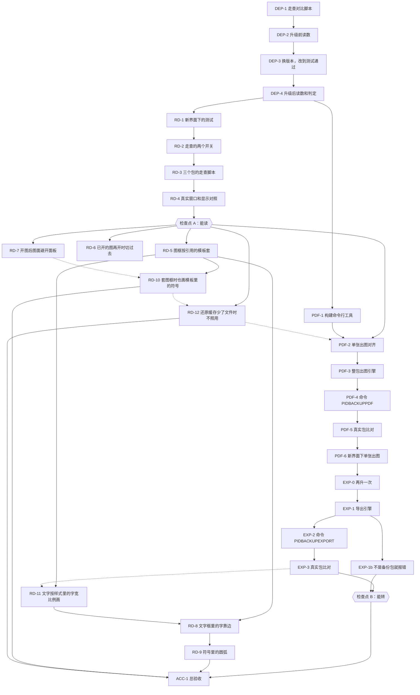

# SmartPlant 备份包：打开、浏览、导出 PDF 和 publish 文件 · 实施计划

> 日期：2026-11-18
> 状态：**已确认**（2026-11-18）。答复原话：「按你推荐的方案做。没有明确推荐的，你结合当前情况选最合适的继续，并简要说明理由。」P1–P4、R3 都按建议定（§3、§9），从 `DEP-1` 开始做。计划里没给建议的地方怎么办，见 §3 末尾。
> 配套：`todo.md`（19 个任务，2026-11-18 另加 1 个 `EXP-1b`，检查点 A 之后再加 6 个 `RD-5` – `RD-10`，`RD-5` 做完时又加 2 个 `RD-11`、`RD-12`；逐个写了做什么、验收、验证命令、依赖、文件、规模）。规格：`SPEC-sppid-deps.md`、`SPEC-sppid-read.md`、`SPEC-sppid-export.md`、`SPEC-sppid-pdf.md`，四份都已确认。共用约定在 `01-shared-conventions.md`，模块怎么切在 `00-capability-map.md`。
> 基线：代码是 `main @ c399311e7`，之后只有这份计划的文档提交。本地的提交都没有推送。`pid-parse` 钉在 `d0a58c64c413`，要升到主线 `96ee00c`。

## 1. 总览

你定的验收我拆成四条。计划按它们排成五段，每段做完都能演示。

| 你定的验收 | 在哪一段做 | 在哪里验 |
|---|---|---|
| 能够正常打开备份数据包 | 第 1 段 | 检查点 A |
| 能够正确浏览PID文件，并能够正确显示出来 | 第 1 段 | 检查点 A。显示有差别时修不修，也在这里定 |
| 能够导出PDF | 第 2 段 | 检查点 B |
| 和对应的publish文件 | 第 3 段 | 检查点 B |
| 四条合起来 | 第 4 段 | 总验收 |

| 段 | 内容 | 任务 | 做完能演示什么 |
|---|---|---|---|
| 0 | 升级解析库 | `DEP-1` – `DEP-4`，4 个 | 升级前后三个样本包的读数对照表；读取和开图没有变差 |
| 1 | 读取与显示 | `RD-1` – `RD-4`，4 个；检查点 A 之后另加 `RD-5` – `RD-12` | 不加 `--classic`，用命令打开三个包、列图纸、看属性、打开图；11 张图的显示对照 |
| 2 | 导出 PDF | `PDF-1` – `PDF-6`，6 个 | 一条命令把全厂包每张图出成 PDF，和命令行工具出的逐字节相同 |
| 3 | 导出 publish 文件 | `EXP-0` – `EXP-3`，4 个；另加 `EXP-1b` | 一条命令把全厂包导成 publish 文件，和命令行工具出的逐字节相同；给一个不是备份包的来源，打开时报错 |
| 4 | 总验收 | `ACC-1`，1 个 | 按四条从头走一遍，出一张对照表和一个交付目录 |

共 19 个任务。按规模：S 11 个，M 7 个，L 1 个（`DEP-3`：升级只改六处版本号，但连带要改多少文件事先不知道）。2026-11-18 另加 1 个（`EXP-1b`，S），不算在这 19 个里，来由见 §10。同日检查点 A 之后再加 6 个（`RD-5` – `RD-10`），是显示对照和真实窗口里判为「现在修」的事，也不算在这 19 个里，来由见 §10；`RD-5` 做完时又加 2 个（`RD-11`、`RD-12`），`RD-10` 改了范围并提前，来由也在 §10。其中 `RD-7`、`RD-8`、`RD-9`、`RD-11` 的规模是估的（`RD-8`、`RD-9` 要先查原因）。

界面（`sppid-design`、`sppid-screen`、`sppid-export-ui`）不在这份计划里。设计稿由你在 Pencil 里画，和这五段并行；后两块的规格等检查点 B 之后再写（地图 §9 第 4 步）。到总验收为止，这几个功能在新界面里用命令来做。

## 2. 做法上的几个决定

1. **读数先行。** 每一段先量再改：升级前先留读数；PDF 先量本程序现在的出图路径；导出先用命令行工具出一份对照。读数进 `readings.md`，每组注明日期和两边的提交。
2. **两层，从里往外做。** 引擎在 `src/io/`：进出都是数据和文件，不碰界面，能单独测。命令在 `src/app/commands/`：一个薄入口，管后台线程、状态、报文字。以后的画面调的是同一个引擎。
3. **内容不在本程序里决定。** publish 文件由 `pid-parse` 写，PDF 的页面由 `pid-plot` 画。本程序只管：出哪些，放在哪，每张图有没有交代。所以两样的验收都落在「和它们的命令行工具逐字节相同」上，它们各自对厂商文件比对的结论就能直接用。
4. **真实包的验收都写成脚本。** 样本不在仓库里，所以真实包的测试标 `#[ignore]`，由 `scripts/sppid/` 下的脚本串起来：一条命令出一张表，有一格不过退出码非 0。证据放仓库外（`D:\scratch\ocs-sppid\`）。
5. **先红后绿，一个任务一个提交，不推送。** 固定门禁写在 `todo.md` §1。
6. **只在两处联网。** `DEP-3` 取一次代码（已同意）；取之前先看一眼 `pid-parse` 主线现在的提交号，算在同一次里。`EXP-0` 再升一次时还要一次，到时候先问。其余全部离线。

顺序为什么是先 PDF 后 publish 文件：PDF 只用 `pid-plot`，主线 `96ee00c` 就够；publish 文件要等那 3 个还没推送的提交（D1）。先做 PDF，等推送的这段时间不空着。

## 3. 已定的决定

三次答复都是按建议定。结果列在这里，实施时照此做；原文和理由在地图 §8 和各规格 §9。

**能力地图的六问**

| 问 | 定的结果 |
|---|---|
| 1 浏览放在新界面的哪里 | 导航里加一个新画面「备份数据包」。检查点 B 之后做 |
| 2 新画面第一版放多少 | 只放图纸这条线。库表、枚举映射、参考数据文件、图纸体检留在经典面板 |
| 3 导出第一版做到什么程度 | 整包导出，用 Oracle 导出的包验收。不选图，不做进度条和取消 |
| 4 要不要先升级 | 先升级 `pid-parse` |
| 5 设计稿 | 你在 Pencil 里画。设计稿文件由你提交，你发话之前我不碰 |
| 6 和手上的活怎么排 | 离线那批改动（OFF-1）已收尾提交。OFF-2 及以后往后排 |

**三份规格的 12 项**

| 项 | 定的结果 |
|---|---|
| D1 | 钉到主线 `96ee00c`。没推送的 3 个导出提交，等推送后在做导出之前再升一次 |
| D2 | 同意联网取一次代码 |
| D3 | 接受锁文件的连带变化（`rusqlite` 0.39 → 0.41 等）。实际变了哪些包，第一次汇报里列出 |
| D4 | 第一次汇报之后接着做。读数变差，或者锁文件有预期外的变化，才停下 |
| R1 | 真实窗口里的那次检查由我做 |
| R2 | 读不出、打不开的上限降到升级后的新读数，只降不升 |
| X1 | 命令叫 `PIDBACKUPEXPORT`，界面上叫「导出 publish 文件」 |
| X2 | 工厂名默认 `P01` |
| X3 | 输出目录不是空的就拒绝 |
| X4 | 第一版就带 `Ref=<目录>` |
| X5 | SQL Server 包允许导出，结果里注明「没有验收过」 |
| X6 | 第一版只有命令，不加专用的自动化操作和路由 |

**PDF 的四项和显示的一项**（2026-11-18 第三次答复，都按建议）

| 项 | 定的结果 |
|---|---|
| P1 | 两条命令：`PIDBACKUPEXPORT` 不变，加 `PIDBACKUPPDF` |
| P2 | 平铺，`<图名>.pdf`，和 `<图名>_Data.xml` 同名同目录。重名的第二张不写，清单里点名 |
| P3 | 「和 `pid_plot` 逐字节相同」是验收。为此单张的 `PIDPLOT` 也给 PDF 加上标题 |
| P4 | 能查进度，不做取消 |
| R3 | 11 张图的画布截图和厂商 PDF 并排，我逐张看、列差别，你抽看 |

**计划里没给建议的地方**（同一次答复）：到时候我结合当时的情况选最合适的一项接着做，汇报里写明选了什么、为什么。已经给了建议或者已经定了的照原样，比如 D4：读数变差、锁文件有预期外的变化才停下。照这一条，下面几处原来写着「到时候问你」的，现在这样做：

- 做导出时那 3 个提交还没推送：不等，先按已钉的版本做（§7）。
- 显示对照里的差别：每一项我给处理意见和理由；改本程序能修的，排成任务接着做（§5 检查点 A）。
- 本程序出的 PDF 和 `pid_plot` 的对不齐，或者整包出 PDF 太慢：我选一个办法接着做（§7）。

仍然停下等你的有四类：只有你能做的事（推送 `pid-parse` 的提交，画设计稿）；超出已同意范围的操作（推送本仓库，约定之外再联网，改 `pid-parse` 仓库，碰设计稿文件）；已定的停点（D4）；四条验收里有一条走不通，而我能选的办法都解决不了。

## 4. 依赖图

- 我一个人按顺序做，不并行。图里的箭头是「必须先有」，没有箭头连着的两个任务谁先谁后都行。
- `PDF-1`（构建命令行工具）只依赖升级，和第 1 段没有先后关系。
- `EXP-0` 需要你先推送那 3 个提交（§6）。如果在 `DEP-3` 开始之前就推送了，`DEP-3` 直接钉新的主线提交，`EXP-0` 取消，任务变成 18 个，也少联一次网。做到 `EXP-1` 时还没推送：不等，先按已钉的版本做 `EXP-1` – `EXP-3`，`EXP-0` 挪到推送之后做（§7）。（`DEP-3` 做的时候还没有推送，`EXP-0` 留着。）
- `EXP-1b` 是 2026-11-18 另加的（§10），不算在上面说的任务数里。我在 `EXP-1` 之后、`EXP-2` 之前做它；它还要用 `RD-3` 的走查脚本证明三个样本包照常打开。
- `RD-5` – `RD-10` 是 2026-11-18 检查点 A 之后另加的，`RD-11`、`RD-12` 是同日 `RD-5` 做完时加的（§10），都不算在上面说的任务数里。`RD-5`、`RD-6`、`RD-7`、`RD-10`、`RD-12` 依次做，做完再做第 2 段；`RD-11`、`RD-8`、`RD-9` 等 `EXP-3` 做完再依次做，然后是总验收。图里的四条虚线是这个先后，不是「必须先有」。

## 5. 检查点

每个检查点我发一次汇报：过了哪几条，没过哪几条，读数表，证据放在哪。

### 检查点 A：能读（第 1 段做完）

通过的条件是地图 §5 检查点 A 的 6 条。汇报里有：

1. 升级前后的对照表：三个包的图纸数，读不出的张数和名单，打不开的张数和名单，图元数变了的图和原因，总耗时。
2. 三个包的走查表：经典界面和新界面各一遍，两遍的数字要完全相同。
3. 真实窗口的截图：打开全厂包，列出 53 张，打开一张图。
4. 显示对照：11 张图各一张并排图、各一句结论，加一份差别清单。

**你要做的**：看显示对照。差别清单里的每一项我给处理意见（现在修、以后修、不修）和理由；你有不同意见就说，没有回话我照处理意见做。

**之后怎么走**：

- 6 条都过：我接着做第 2 段，不等回话。PDF 和 publish 文件不依赖显示对照的结论。
- 判为要修、改的又是本程序的差别：我估每一项要改哪里、改多大，排成新任务写进 `todo.md` 接着做；插在哪一段看大小，汇报里写明。要 `pid-parse` 改的，写清楚交给那边，总验收里记为「有差别，等那边」。
- 有一条不过（包打不开；读数比升级前差；新界面下命令不可用）：先找原因。读数比升级前差按 D4 停下。其余的，有我能做的办法就选最合适的一项做下去，汇报里写明；没有就停下，报告原因和可选的办法，等你定。

**结果（2026-11-18）**：6 条都过。显示对照的差别 13 项：现在修 4 项，以后修 4 项，不修 5 项；真实窗口里另看到 2 件要修的事。要修的排成 `RD-5` – `RD-10`（§4），都是改本程序；其中 `RD-8` – `RD-10` 的原因还没有查实，查出来要 `pid-parse` 改的再交给那边。读数、清单和每项的理由在 `readings.md` §5，汇报随这次提交发出。后来（`RD-5` 做完，2026-11-18）：`RD-10` 的原因查实了，在本程序，范围改成「套图框时也画模板里的符号」并提前；另加 `RD-11`、`RD-12`（§4、§10）。

### 检查点 B：能转（第 2、3 段做完）

通过的条件是地图 §5 检查点 B 的 9 条。汇报里有：

1. PDF 对照表：全厂包 53 张、小包 7 张各写出几张，没写出的图名和原因；和 `pid_plot` 逐字节相同的张数；11 张图和厂商 PDF 比对的读数，旁边是 `pid-plot` 自己留的记录；耗时。
2. publish 文件对照表：写出几张，失败计数，没写出的图名和原因；和 `pid_publish_xml` 逐字节相同的文件数；带参考目录的比对结论；耗时。
3. 真实窗口里看一次：导出期间图面能平移缩放，命令行能敲命令。
4. 另加的 `EXP-1b` 的结果（不在那 9 条里）：不是备份包的来源打开时报错；三个样本包照常打开，读数不变。

**你要做的**：没有必须做的。想抽看，汇报里有输出目录的位置。

### 总验收（第 4 段）

按你定的四条从头走一遍。用真实程序和全厂包，不加 `--classic`。

| 验收 | 怎么走 | 证据 |
|---|---|---|
| 能够正常打开备份数据包 | `PIDBACKUPOPEN <全厂包目录>`；小包再从 zip 打开一次 | 命令行报出的图纸数（53、7）；截图 |
| 能够正确浏览PID文件，并能够正确显示出来 | `PIDBACKUPOPEN Select …` 选图纸，看属性和图内对象；`PIDBACKUPOPEN Press …` 打开图纸 | 走查表；显示对照，和你对差别清单的结论 |
| 能够导出PDF | `PIDBACKUPPDF <交付目录>` | `_PdfIndex.json`；逐字节比对表；厂商 PDF 比对表 |
| 和对应的publish文件 | `PIDBACKUPEXPORT <交付目录>`。先导这个，因为它要求目录是空的 | `_Index.json`；逐字节比对表；成对检查（`scripts/sppid/check-pairs.ps1`）：两样都写出的图，`<图名>.pdf` 和 `<图名>_Data.xml` 一一对上 |

全厂包的交付目录应当有 214 个文件：每张图四个（`_Data.xml`、`_Meta.xml`、`_Coverage.json`、`.pdf`），加两份清单。2026-11-18 先核过一件事：命令行工具出的 53 份 PDF 的名字，和历次交付（`publish-v6`）里 53 个 `_Data.xml` 的图名一一相同，没有重名。

走完出一张对照表（每条：过没过，证据的位置），写进 `readings.md`。交付目录的位置写在汇报里。有一条不过就不算验收通过，汇报里写明差在哪。

## 6. 需要你做的事

| 什么时候 | 什么事 | 不做会怎样 |
|---|---|---|
| 已办（2026-11-18） | 确认这份计划和 `todo.md`；定 P1–P4 和 R3（§9）。都按建议 | — |
| `EXP-0` 之前，越早越好 | 把 `pid-parse` 那 3 个提交（`d3fbe3e`、`3253301`、`6ecd1b4`）推到主线，告诉我新的主线提交号；同意再联网取一次代码 | 我不等：先按已钉的版本做导出；推送之后再升一次，把比对脚本重跑一遍 |
| 检查点 A | 看显示对照和我给的处理意见，有不同意见就说 | 第 2、3 段照常做；差别我照处理意见办 |
| 随时 | 在 Pencil 里画「备份数据包」画面和导出的画框；设计稿文件什么时候提交由你定 | 不影响这份计划，影响检查点 C |

## 7. 风险与应对

| 风险 | 应对 |
|---|---|
| 升级后读数变差：读不出或打不开的图变多；图元变少而说不出原因；耗时超过 1.5 倍 | 先找原因。是本程序的调用方式要跟着改，就在 `DEP-3` 里改。是 `pid-parse` 的行为变了，写清是哪个提交、影响哪几张图，停下请你定。不在本程序里绕过去 |
| 升级要改的代码比预想多 | 用到这两个库的文件有 21 个，98 个路径在主线上都还公开，签名变没变要编译才知道。`cargo check` 通过后先汇报改了多少，再往下做 |
| `Cargo.lock` 出现预期之外的包变化 | 停下报告，不提交 |
| 新界面下 `PIDBACKUPOPEN` 实际不可用（`RD-1` 的测试是真的红） | 先报告是什么问题再改。预计要改的地方：`src/app/view/mod.rs`、`src/app/dock/update.rs`、`src/app/pid_shell/editor.rs` |
| 画布显示和厂商 PDF 有差别，有多大现在不知道 | 检查点 A 列清单。修是另加的任务，先估再做，不算在这 19 个里 |
| 本程序出的 PDF 和 `pid_plot` 出的不逐字节相同 | 先找差在哪：标题，字体目录的顺序，符号目录。对得齐就对齐；对不齐就列出差别，我选一个仍然能验的办法接着做（比如页面内容逐字节相同、只有文件信息不同），汇报里写明选了什么、为什么 |
| 包里用到的字体本机没有 | 这张图记为没写出，原因里点出缺的字体名。不换字体硬出 |
| 整包出 PDF 太慢：测试构建下全厂包超过 600 秒 | 报读数和构建方式。要不要给 `pid-plot` 单独加优化级别（`pid-parse` 已经有这样一段），我看读数定，汇报里写明。现成的命令行工具（发布构建）量到的是 53 张 95 秒 |
| 做导出时那 3 个提交还没推送 | 不等，先按已钉的版本做。引擎和命令不依赖那 3 个提交的内容；逐字节比对用的命令行工具是同一个提交构建的，两边仍然可比。推送之后做 `EXP-0`，把比对脚本重跑一遍。这期间和参考目录比对的读数可能和规格里记的不一样，汇报里注明 |
| 离线构建 `pid-parse` 的命令行工具失败：它自己的依赖本机缓存里没有 | 先试别的离线办法（比如用 `cargo fetch` 留在本机的那份源码构建）。都不行时用本机已有的现成工具，对照表里写明它的构建时间，以及它不是钉的那个提交；这一格只算参考，不算验收通过。要联网才能解决时停下问你 |
| 设计稿文件有未提交的改动，库测试有 4 条、文档检查有 1 条因它失败 | 已知的基线，不是这份计划引起的。这个文件不碰、不提交；门禁按「失败的仍只有这几条」判 |
| 样本包和厂商文件不在仓库里，换一台机器跑不了真实包的验收 | 脚本的路径都能用参数改。读数写进 `readings.md` 时带上日期和两边的提交 |

## 8. 不做的事

- 新画面和不敲命令的用法：`sppid-screen`、`sppid-export-ui`，检查点 C。
- 改 `pid-parse` 仓库。要它改的事，写清楚交给那边。
- 改 PDF 的页面内容，改 publish 文件的内容。
- 只导选中的几张图，中途取消，续导。
- SQL Server 包的导出验收。
- 把备份包的数据迁进本平台的项目库。
- 推送。提交都留在本地，什么时候推由你定。
- 离线那条线的 OFF-2 及以后、CC-7、CC-8。
- 碰设计稿文件。

## 9. 请你定的事（已定）

五个问题，加一个确认。问题的全文和各选项的利弊在规格里。2026-11-18 答复：五个问题都按建议定，计划和任务清单确认。原话见文首。

| # | 问题 | 我的建议 | 全文在哪 |
|---|---|---|---|
| P1 | PDF 和 publish 文件用两条命令，还是一条命令一起出 | 两条：`PIDBACKUPEXPORT` 不变，加 `PIDBACKUPPDF`。两样可以各自重做，互不拖累 | `SPEC-sppid-pdf.md` §9 |
| P2 | PDF 怎么命名、怎么放 | 平铺，`<图名>.pdf`，和 `<图名>_Data.xml` 同名同目录。重名的第二张不写，点名 | 同上 |
| P3 | 要不要拿「和 `pid_plot` 逐字节相同」当验收 | 要。为此单张的 `PIDPLOT` 也会给 PDF 加上标题（图名） | 同上 |
| P4 | 进度和取消 | 能查进度（做完几张、共几张）；不做取消 | 同上 |
| R3 | 「正确显示」怎么验 | 11 张图的画布截图和厂商 PDF 并排，我逐张看、列差别，你抽看 | `SPEC-sppid-read.md` §9 |
| 确认 | 这份计划和 `todo.md` | 确认后从 `DEP-1` 开始 | 本文和 `todo.md` |

## 10. 修订记录

| 日期 | 改动 |
|---|---|
| 2026-11-18 | 初稿，待确认 |
| 2026-11-18 | 确认，原话见文首。P1–P4、R3 按建议定（§3、§9）。按答复的后半句，把几处原来写着「到时候问你」的改成「我选最合适的一项接着做，并说明理由」：§3 末尾，§4 的说明，§5 检查点 A，§6，§7 的四行。任务、顺序、验收都没有改 |
| 2026-11-18 | 另加任务 `EXP-1b`：来源里没有备份也没有图纸时，`PIDBACKUPOPEN` 报错。来由：`RD-1` 发现给一个不是备份的目录不报错，和 `SPEC-sppid-read.md` 成功标准 4 不符（该规格 §11）；我建议改成报错、另加任务、和导出的「来源不是备份包」检查一起做，答复「按照推荐方案继续下一步。」。改了：文首，§1 的分段表和任务数，§4 的图和说明，§5 检查点 B 的汇报内容。原来 19 个任务的编号和顺序没有改 |
| 2026-11-18 | 任务表以外多一个提交：改 `build.rs`，源码没变时 cargo 不再重编。来由：`RD-3` 观察到每次走查都把本程序重编一遍（`SPEC-sppid-read.md` §11）；我建议改、单独一个提交，答复「按你推荐的方案做。」。排在 `RD-3` 之后、`RD-4` 之前。任务、顺序、验收都没有改 |
| 2026-11-18 | 检查点 A：6 条都过（`readings.md` §5）。照 §5 的走法，判为「现在修」的排成 6 个任务 `RD-5` – `RD-10`：前 3 个在第 2 段之前做；后 3 个要先查原因，排在第 3 段之后、总验收之前。其中 `RD-6`、`RD-7` 是真实窗口里看到的两件事，不是显示对照的差别，一并排了。改了：文首，§1 的分段表和任务数，§4 的图和说明，§5 检查点 A 的结果。原来任务的编号、顺序、验收都没有改；`ACC-1` 多了一条依赖（`RD-8` – `RD-10`）。你对处理意见有不同看法，这几个任务跟着改 |
| 2026-11-18 | `RD-5` 做完（`readings.md` §6）。任务表有三处改动，来由在 `readings.md` §6.8：（1）`RD-10` 的范围从「11 号图的会签栏」改成「套图框时也画模板里的符号」，提到 `RD-7` 之后做，编号不改。原因查实了：套图框时不画模板里的符号，会签栏、`∽`、另两个包各一张图的整个图框是同一个原因。（2）加 `RD-11`：文字按样式里的字宽比例画，排在 `EXP-3` 之后、`RD-8` 之前。用 `CPE-SQ` 模板的图，标题栏的字比 PDF 宽。（3）加 `RD-12`：还原缓存被系统清理掉一部分时不照用，排在 `RD-10` 之后。这一步里系统临时目录被清理过一次，缓存少了文件，程序照用。改了：文首，§1 的分段表和任务数，§4 的图和说明，§5 检查点 A 的结果。其余任务的编号、顺序、验收都没有改；`ACC-1` 的依赖改成 `RD-8` – `RD-12`。你有不同看法，这几个任务跟着改 |
